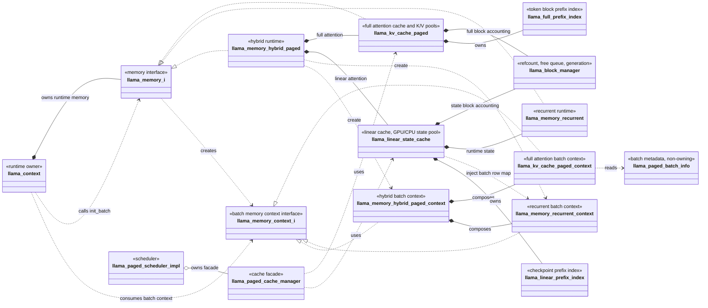
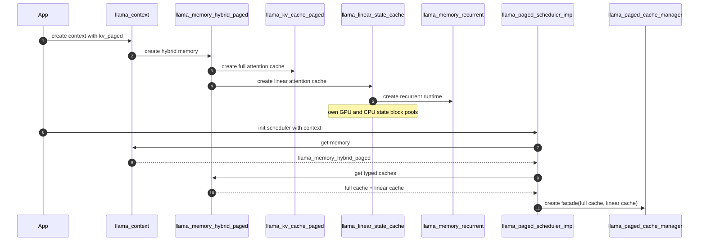
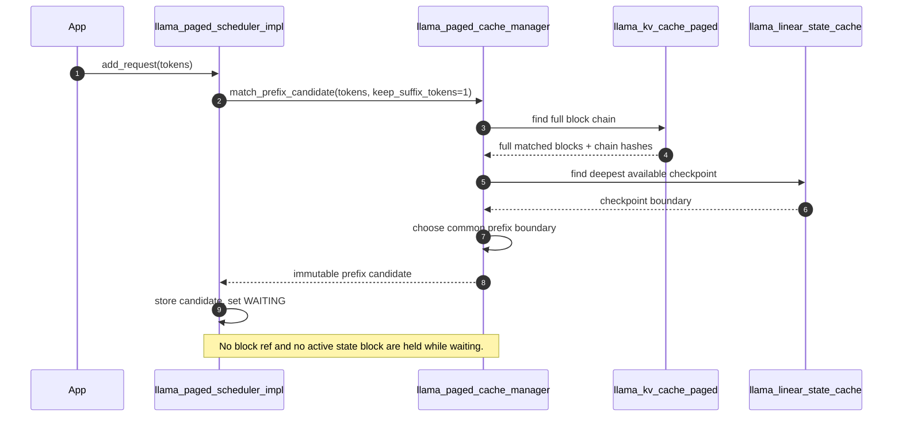
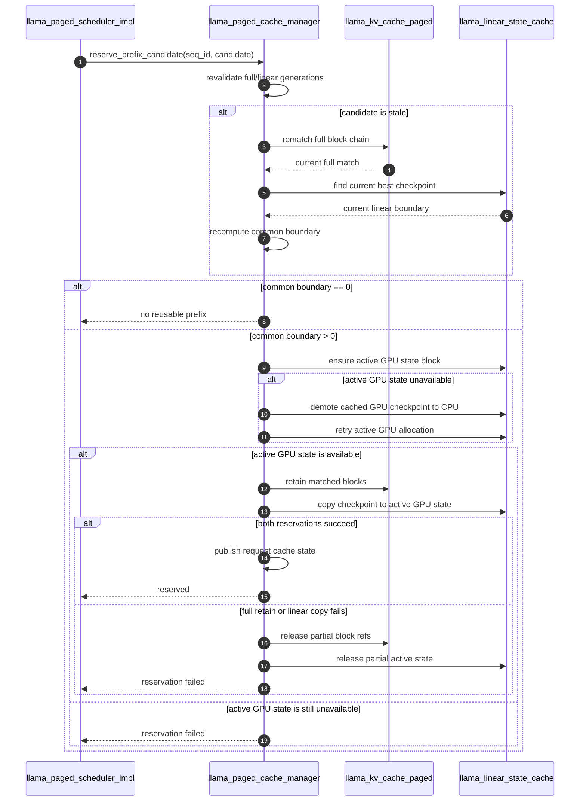
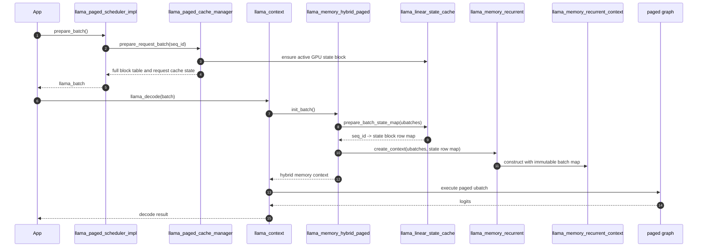
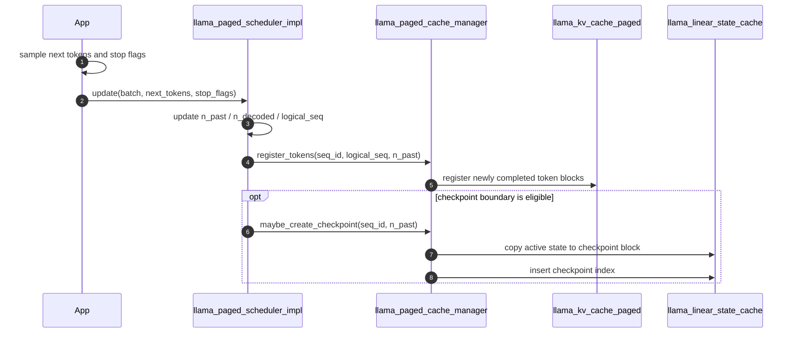
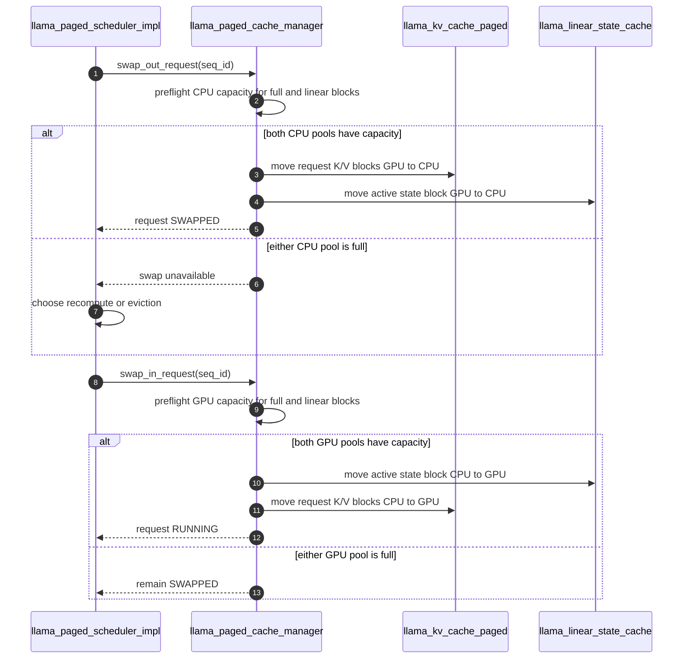
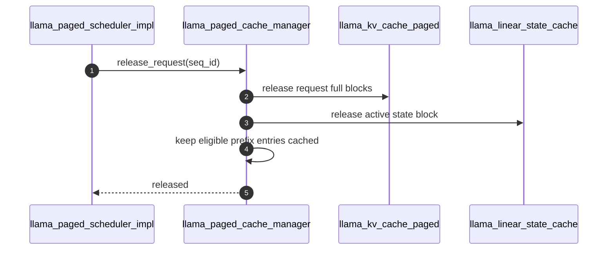
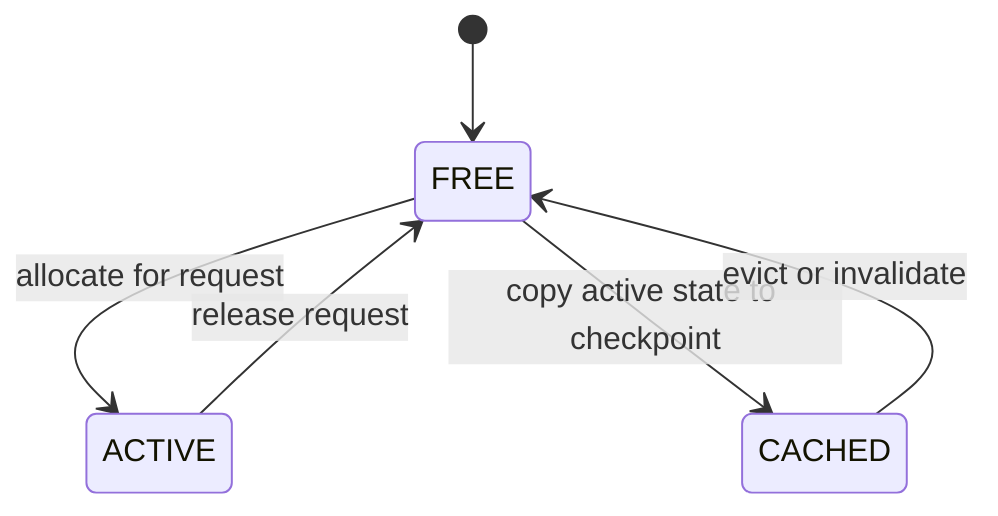
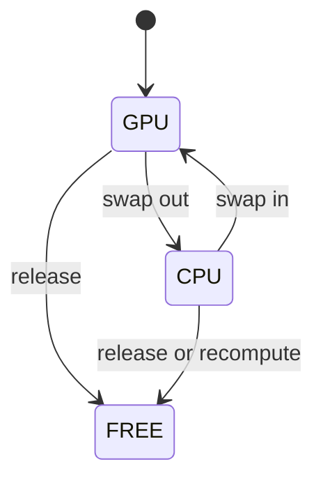

# Linear Attention Cache 与 Paged Prefix Cache 重构方案

状态: 设计稿 v6 (2026-11-04)

适用范围: `kv_paged` 下的 hybrid 模型，第一版建议只覆盖 Qwen3.5 和 Qwen3.5MoE。其他 recurrent 或 hybrid 模型继续使用现有路径。

本文先说明重构后的类关系和方法调用时机。类成员、具体接口签名、数据结构和算法实现不在本文展开，后续应单独写实现设计或在代码评审中讨论。

## 1. 目标类图

本图覆盖 cache 所有权、batch runtime context 和主要数据路径，不展开 scheduler 队列、请求优先级、graph 内部实现或具体类成员。



类关系的关键点:

1. `llama_memory_hybrid_paged` 继续持有两类 runtime memory。
2. full attention 的 GPU/CPU K/V storage、block manager 和 token prefix index 归 `llama_kv_cache_paged`。
3. `llama_full_prefix_index` 只负责 `token hash -> block` 查找，不拥有 K/V 数据。
4. linear attention 的 GPU/CPU state pool、block manager 和 checkpoint index 归 `llama_linear_state_cache`。
5. `llama_block_manager` 管理物理 block id、refcount、GPU/CPU free queue 和 generation，不保存 K/V 或 state 数据。
6. full 和 linear cache 各持有一个独立的 `llama_block_manager` 实例，不共享物理 block pool。
7. `llama_memory_hybrid_paged_context` 是 per-batch runtime context，组合 full attention context 和 recurrent context。
8. `llama_paged_batch_info` 是 scheduler 到 paged context 的 batch metadata 输入。
9. `llama_paged_cache_manager` 是非 owning facade，由 scheduler 持有，只协调底层 cache。
10. scheduler 不再直接持有 prefix map，也不直接维护物理 block 引用计数。
11. `llama_linear_state_cache` 向 batch context 注入 immutable state row map，recurrent runtime 不反向持有 cache 指针。

图中没有单独画 K/V tensor 类，因为当前实现将 K/V GPU/CPU tensors 直接保存在 `llama_kv_cache_paged` 内。`llama_block_manager` 管 block 元数据和空闲队列，`llama_full_prefix_index` 管 hash 查询，两者都不保存 K/V 数据。


## 2. 方法调用时机

### 2.1 初始化和依赖注入



初始化阶段之后，scheduler 只通过 `llama_paged_cache_manager` 操作 prefix cache 和 block pool。

### 2.2 请求入队：只生成 prefix 候选



入队阶段只记录:

- 候选 full block 数量。
- 候选 linear checkpoint。
- 公共 prefix token 数。
- 候选 block 的 generation。

此时不增加 full block 引用，也不分配 linear active state block。

### 2.3 Waiting 准入：重新验证并原子预留



需要明确:

- prefix 引用和 active state 只在 waiting 队首获准进入 RUNNING 时预留。
- 入队后 cache 可能变化，准入时必须重新验证候选。
- 候选失效后允许回退到更短公共边界；没有 checkpoint 时回退全量 prefill。
- full attention 可能匹配得更长，但 hybrid 请求只能复用到 linear checkpoint 实际覆盖的边界。
- 如果完整 prompt 都命中，仍保留至少一个 suffix token。
- full 和 linear 的 reserve 必须是 all-or-nothing 事务。

### 2.4 Batch context 和 state row 数据路径



该数据路径避免 `llama_memory_recurrent` 反向查询 `llama_linear_state_cache`:

- `llama_linear_state_cache` 持有 `seq_id -> state block` 映射。
- `llama_memory_hybrid_paged` 在创建 batch context 时取得本批次 row map。
- `llama_memory_recurrent_context` 只持有本批次 immutable row map。
- graph 通过 recurrent context 读取 row map，不持有 cache manager 指针。

### 2.5 Prefill、Decode 和 Checkpoint



调用时机约束:

1. `prepare_batch()` 只准备 metadata，不执行 graph。
2. `llama_decode()` 由上层应用调用，scheduler 不能直接持有 graph 执行顺序。
3. `register_tokens()` 必须在 `update()` 之后、`n_past` 已经更新时调用。
4. checkpoint 只在完整 token 边界且整个 ubatch 已经执行完成后创建。
5. 如果当前 ubatch 跨过多个 checkpoint 候选边界，只能保存 ubatch 结束时的状态；要保存中间边界必须由 scheduler 提前切分 ubatch。

### 2.6 Swap out、Swap in 和缓存淘汰



Swap 规则:

- SWAPPED 请求不能保留 active GPU linear state。
- full attention K/V 和 active linear state 必须一起换出到各自的 CPU pool。
- swap out/in 先做容量预检，再移动数据，避免只完成一半。
- 任一方向失败都不能发布半换出或半换入状态。
- cached checkpoint 可以位于 GPU 或 CPU；从 CPU checkpoint 命中时直接复制到新的 active GPU state。

淘汰规则:

- 淘汰只能作用于 cached block。
- active full block 和 active linear state 不能由 cache manager 擅自淘汰。
- GPU cache 不足时，可以先把 cached checkpoint 降到 CPU pool。

### 2.7 请求结束



请求结束后:

- full attention 满块可以由 cache 持有额外引用，继续作为 cached prefix。
- linear active state 必须从当前 GPU 或 CPU pool 释放。
- linear checkpoint 独立于请求存活，由 LRU 或显式失效回收。

### 2.8 调用阶段汇总

| 阶段 | scheduler 负责 | cache manager 负责 |
|---|---|---|
| context 初始化 | 获取 hybrid memory | 不参与 |
| scheduler 初始化 | 创建 facade，保存 typed cache 指针 | 绑定 full/linear cache |
| 请求入队 | 保存 prefix candidate | 只匹配，不 reserve |
| waiting 准入 | 选择可以转入 RUNNING 的队首 | 重新验证并原子 reserve |
| batch 准备 | 选择 prefill/decode | 注入 state row map，保证 GPU state |
| decode 后更新 | 更新 token/pos 状态 | 登记 token blocks、创建 checkpoint |
| swap out | 决定换出或重算 | 同时移动 full K/V 与 linear state 到 CPU |
| swap in | 恢复 SWAPPED 请求 | 同时移动 full K/V 与 linear state 到 GPU |
| 请求结束 | 更新调度状态 | 释放 refs 和 active state |

## 3. 重构范围

### 3.1 第一版范围

- `kv_paged` 下的 Qwen3.5/Qwen3.5MoE hybrid 路径。
- full attention token block 共享。
- linear attention GPU/CPU state block 分配和 swap。
- sparse prefix checkpoint。
- scheduler-facing cache facade。

### 3.2 非目标

- 不重构所有 recurrent 架构。
- 不实现跨进程 prefix cache。
- 不允许 mutable recurrent state 在多个 active sequence 之间共享。
- 不要求每个 token block 都有 linear checkpoint。
- 不实现 checkpoint 落盘或跨进程持久化；第一版支持 GPU/CPU block pool residency。
- 不在本文展开具体接口签名和类成员。

## 4. 为什么需要重构

### 4.1 当前 `seq_id` 与 recurrent cell 耦合

当前 [llama-memory-recurrent.cpp](../../src/llama-memory-recurrent.cpp) 使用 `cells[seq_id]` 保存 per-sequence metadata 和 tail。

这导致:

- `seq_id` 实际充当 recurrent cell 下标。
- prefix checkpoint 需要占用保留 `seq_id`。
- active request 和 checkpoint 争用同一个 cell 空间。
- `n_seq_max` 不能只表示最大并发请求数。

目标是把 logical sequence identity 和 physical state identity 分开:

```text
seq_id -> active linear state block
```

两者不再要求数值或下标相同。

### 4.2 Prefix cache 所有权分散

当前 [llama-paged-scheduler-impl.cpp](../../src/llama-paged-scheduler-impl.cpp) 持有 prefix map，而物理 block 在 `llama_kv_cache_paged` 中。

结果是:

- scheduler 读 block refcount 和 GPU 状态。
- swap 后需要通过 callback 更新 prefix entry。
- release/reuse 和 prefix invalidation 不在同一对象中完成。

### 4.3 Full 和 linear 的 prefix 语义不同

| 项目 | Full attention | Linear attention |
|---|---|---|
| 数据 | token block 中的 K/V | 完整 recurrent state |
| 可复用粒度 | 每个完整 token block | 已保存的 checkpoint |
| 共享方式 | 增加 block 引用 | 复制 checkpoint 到 active state |
| 淘汰对象 | token block | state block |
| 索引 key | token block hash 链 | checkpoint boundary hash |

因此两类 cache 需要独立 block pool 和独立 prefix index。

### 4.4 现有 hybrid 命中回退过强

当前逻辑要求 full attention 最后一个 matched block 同时存在 linear checkpoint。没有时直接全量 prefill。

目标允许匹配更短的公共边界:

```text
reuse_end = min(full_match_end, deepest_linear_checkpoint_end)
```

### 4.5 Graph 写入假设物理连续

当前 recurrent graph 写入假设 active state 位于连续物理行。任意 state block id 需要显式 read/write row mapping，但具体 graph 改造和数据结构不在本文展开。

## 5. 核心设计

### 5.1 Full attention cache

保留现有分页 KV 机制:

- 每个 block 对应固定数量 token 的 K/V。
- 满块只读，可以按引用共享。
- block 可以在 GPU 和 CPU pool 之间换入换出。
- token block hash 链登记在 full prefix index。

新增要求:

- prefix index 与 block pool 位于同一生命周期。
- 每个物理 block 需要 generation，防止释放后复用造成 stale prefix hit。
- prefix entry 在 block 失效时同步删除或标记失效。
- prefix hash 碰撞校验沿用当前策略：chain hash 命中后校验 block 首尾 token。

### 5.2 Linear attention cache

linear attention 的 block 表示某个 prefix 边界上的完整 recurrent state。

一个 state block 包含:

- 所有 linear layers 的 conv state。
- 所有 linear layers 的 SSM state。
- 可选的 PLE conv row。
- `1 + n_rs_seq` 个 rollback snapshot planes。

第一版建议:

- 每个 active sequence 拥有一个 active state block。
- checkpoint 命中后复制到新的 active state block。
- cached checkpoint 只读，不参与 graph 原地写入。
- checkpoint 数量由 state block pool 和 LRU 控制。
- state block pool 同时包含 GPU 和 CPU 两级。
- SWAPPED 请求的 active state 位于 CPU pool。
- cached checkpoint 可以位于 GPU 或 CPU pool。

### 5.3 Prefix checkpoint

checkpoint 只在完整 prefix 边界创建。

第一版建议:

- 每 4 个 full token block 创建一个候选 checkpoint。
- 完整 prompt 结束时创建一个候选 checkpoint。
- 达到预算后按 LRU 淘汰。
- checkpoint 的 hash key 使用该边界之前的完整 token block hash 链。

checkpoint 创建必须发生在对应 token 已经实际处理完成之后。

## 6. Linear State Block 生命周期



说明:

- `ACTIVE` block 可以被 graph 写入。
- `CACHED` block 只读。
- checkpoint 命中不会把 `CACHED` 改成 `ACTIVE`。
- checkpoint 命中后从 `CACHED` 复制到一个新的 `ACTIVE` block。

设备位置是独立于 block 状态的属性:



因此一个 block 的状态和位置需要分别记录:

```text
lifecycle: FREE | ACTIVE | CACHED
placement: GPU | CPU
```

## 7. Prefix Match 规则

### 7.1 公共边界

full attention 和 linear attention 必须使用相同的 token 边界:

```text
full_end   = full attention 可复用的最长 token block 边界
linear_end = linear checkpoint 可复用的最长 token block 边界
reuse_end  = min(full_end, linear_end)
```

示例:

```text
full attention 命中 12 blocks
linear checkpoint 只覆盖 8 blocks
请求复用 8 blocks
```

### 7.2 原子性

prefix reserve 必须满足:

1. full block 引用增加成功。
2. linear checkpoint 到 active state 的复制成功。
3. 任一步失败，之前完成的步骤全部回滚。

### 7.3 Zero suffix

如果完整 prompt 都命中，至少保留一个 suffix token。

该规则应由 cache manager 或统一的 prefix match 调用路径保证，不能由不同调用者各自解释。

## 8. 所有权和生命周期

| 对象 | 所有者 | 职责 |
|---|---|---|
| `llama_memory_hybrid_paged` | `llama_context` | 持有 full/linear runtime memory |
| `llama_kv_cache_paged` | `llama_memory_hybrid_paged` | full attention GPU/CPU K/V storage、full prefix index |
| `llama_linear_state_cache` | `llama_memory_hybrid_paged` | GPU/CPU state pool、active state、checkpoint index |
| `llama_block_manager` | full 或 linear typed cache 各持有一个实例 | refcount、free queue、generation 和物理 block 元数据 |
| `llama_memory_recurrent` | `llama_linear_state_cache` | recurrent tensor、memory context、graph-facing runtime |
| `llama_memory_hybrid_paged_context` | per-batch memory context 生命周期 | 组合 full attention context 和 recurrent context |
| `llama_kv_cache_paged_context` | `llama_memory_hybrid_paged_context` | 提供 full attention batch metadata 和 K/V tensors |
| `llama_memory_recurrent_context` | `llama_memory_hybrid_paged_context` | 持有本批次 immutable state row map |
| `llama_paged_batch_info` | scheduler 持有，context 非 owning 读取 | write slots、block table、context lens、batch offsets 和 lengths |
| `llama_paged_cache_manager` | `llama_paged_scheduler_impl` | 非 owning facade，协调两类 cache |

`llama_paged_cache_manager` 不能比底层 cache 存活更久。

## 9. 并发和一致性约束

### 9.1 线程模型

第一版沿用当前单调度线程语义:

- scheduler 与 cache manager 串行调用。
- block table 在 batch 执行期间不修改。
- graph 执行期间不修改 prefix index。

容量判断必须同时覆盖:

- full attention GPU blocks。
- full attention CPU blocks。
- linear state GPU blocks。
- linear state CPU blocks。

deadlock 和 livelock 判断不能只检查 full attention GPU pool。

### 9.2 Block generation

物理 block 释放后可能被复用。仅检查 `block_id` 不足以确认 prefix entry 仍指向原内容。

每个 prefix entry 必须能够校验:

- physical block id。
- generation。
- cached 状态。
- token 或 checkpoint 边界。

### 9.3 必须保持的 invariant

1. `seq_id` 不等于 state block id。
2. 每个 active request 最多有一个 active linear state block。
3. cached checkpoint 只读。
4. full 和 linear 的复用 token 数相同。
5. WAITING 请求只保存 prefix candidate，不持有 block 引用或 active state。
6. SWAPPED 请求不持有 active GPU linear state。
7. 使用 CPU state 的 SWAPPED 请求，其 full K/V 和 linear state 必须同时位于 CPU。
8. prefix reserve 失败时不能留下 partial reservation。
9. release 后不能留下指向该 block 的有效 prefix entry。
10. active block 不能被 cache eviction 淘汰。
11. checkpoint 必须对应实际已经处理的 token 边界。

## 10. 内存模型

定义:

```text
N_gpu = num linear GPU state blocks
N_cpu = num linear CPU state blocks
K = 1 + n_rs_seq
```

linear cache 的总状态大小与以下内容成正比:

```text
(N_gpu + N_cpu) * K * sum(n_embd_r + n_embd_s + optional_p) * element_size
```

因此:

- GPU state pool 服务 RUNNING active state 和 GPU-resident checkpoint。
- CPU state pool 服务 SWAPPED active state 和 demoted checkpoint。
- active state 数量由并发请求决定。
- checkpoint 数量必须单独计入预算。
- checkpoint 越多，prefix 命中粒度越细，但显存占用越高。
- 第一版应使用稀疏 checkpoint。

## 11. 当前方案的主要风险

| 编号 | 风险 | 对策 |
|---|---|---|
| R1 | checkpoint 复制成本过高 | 稀疏 checkpoint、批量复制、后续评估异步复制 |
| R2 | state block 显存增加 | 独立 GPU/CPU 预算、LRU、CPU demotion |
| R3 | graph 改造范围过大 | 第一版只覆盖 Qwen3.5/Qwen3.5MoE |
| R4 | block 释放后 prefix stale hit | generation 与主动 invalidate |
| R5 | full/linear 部分成功 | reserve 采用 all-or-nothing |
| R6 | checkpoint 落在 ubatch 内部 | scheduler 切分 ubatch，或只在 eligible 边界创建 |
| R7 | 非 paged recurrent 回归 | 新 wrapper 只从 hybrid-paged 路径创建 |
| R8 | linear pool 复用当前 block manager 的限制 | 使用 state 专用 GPU/CPU allocator 或扩展 block manager 的设备语义 |
| R9 | state pool 耗尽但 full pool 未耗尽 | 准入和 deadlock 判断同时检查两类 cache 的 GPU/CPU 容量 |
| R10 | swap out/in 只完成一半 | 同时预检 full 和 linear 的目标设备容量，再整体提交 |

## 12. 分阶段重构

### Phase 1: 目标边界和 runtime wiring

- 新增 `llama_paged_cache_manager` 的设计和生命周期。
- 明确 full/linear cache 的所有权。
- 明确 linear cache 向 recurrent context 注入 batch row map 的边界。
- scheduler 初始化时创建 facade。
- 暂不改变请求行为。

验收:

- 类关系与本文目标类图一致。
- 不修改非 paged recurrent 路径。

### Phase 2: 解耦 `seq_id` 和 recurrent state block

- 移除 `seq_id == cell_id` 假设。
- 引入独立 linear GPU/CPU state block pool。
- active sequence 使用 state block id。
- linear cache 提供 batch row map，recurrent context 持有 immutable copy。
- graph 使用显式 state read/write row。
- linear active state 支持 GPU/CPU swap。

验收:

- logical `seq_id` 不再受 state block 数量限制。
- `n_rs_seq` rollback 语义不变。
- active sequence 的 decode 输出与旧路径一致。

### Phase 3: 下沉 prefix index

- full prefix index 进入 `llama_kv_cache_paged`。
- checkpoint index 进入 `llama_linear_state_cache`。
- block release、swap 和 reuse 在 typed cache 内部同步索引。
- scheduler 删除 prefix map 和 checkpoint seq id 预留段。

验收:

- block swap 后仍可正确命中。
- block reuse 不会命中旧 prefix。
- checkpoint 不占用请求 `seq_id`。

### Phase 4: 原子 prefix match 和公共边界

- cache manager 同时查询 full 和 linear。
- 选择最深公共 checkpoint 边界。
- 入队只保存 prefix candidate，不 reserve。
- waiting 队首准入时重新验证并原子 reserve。
- 实现 full/linear reserve 的 all-or-nothing。
- 支持较短 checkpoint 的部分复用。

验收:

- 最后一个 block 没有 checkpoint 时，可以退回更短 prefix。
- linear copy 失败不会留下 full block 引用泄漏。

### Phase 5: 性能和策略

- checkpoint interval 调优。
- LRU 和内存预算。
- checkpoint 复制优化。
- CPU demotion 和 checkpoint 分层。
- 后续评估 COW。

## 13. 测试计划

复用现有 [test-paged-kv.cpp](../../tests/test-paged-kv.cpp)，不新增 `tests/*` 文件。

### 13.1 功能测试

- 同一 prompt 的第二个请求只 prefill suffix。
- 相同 system prompt、不同 user prompt。
- full match 长于 linear checkpoint。
- 完整 prompt 命中仍保留 suffix token。
- checkpoint 被淘汰后回退到更短 prefix。
- checkpoint copy 失败时 full refs 回滚。
- waiting 请求不持有 block 引用或 active state。
- 准入时 prefix candidate 已失效，可以重新匹配或安全回退。

### 13.2 并发与生命周期

- `seq_id` 大于 state block 数量。
- 多个 active sequence 各自拥有独立 state block。
- checkpoint block 释放后复用。
- small pool 下持续请求不泄漏 block 或 state。
- block swap 后 prefix index 仍然一致。
- full K/V 和 linear active state 的 swap out/in 必须成对完成。
- batch row map 在不同请求和不同 state block 数量下仍正确。

### 13.3 精度

- prefix cache 开启和关闭路径逐 token 输出一致。
- `n_rs_seq > 0` 时 rollback 结果一致。
- 多轮对话共享历史 prefix 时不重复应用 token。

## 14. 评审清单

- [ ] 确认第一版只覆盖 Qwen3.5/Qwen3.5MoE 的 `kv_paged` hybrid 路径。
- [ ] 确认 linear attention block 表示完整 recurrent state。
- [ ] 确认 checkpoint 命中后复制到 active state，不直接共享 mutable state。
- [ ] 确认 full/linear prefix index 分别由 typed cache 持有。
- [ ] 确认 `llama_paged_cache_manager` 是非 owning facade。
- [ ] 确认 scheduler 不再直接操作 block refcount 和 prefix map。
- [ ] 确认入队只保存 prefix candidate，不增加引用。
- [ ] 确认 waiting 准入时重新验证并原子 reserve。
- [ ] 确认 full/linear 选择相同公共边界。
- [ ] 确认 checkpoint 只在实际处理完成的 ubatch 边界创建。
- [ ] 确认 block generation 和 invalidation 策略。
- [ ] 确认 linear state 同时具备 GPU 和 CPU pool。
- [ ] 确认 SWAPPED 请求不保留 active GPU linear state。
- [ ] 确认 full K/V 和 linear state 的 swap out/in 具备联合容量预检。
- [ ] 确认 linear cache 向 recurrent context 注入 batch row map。
- [ ] 确认 prefix hash 碰撞校验接受首尾 token 方案。
- [ ] 确认新增类放在新文件，还是合并进现有文件。

## 15. 待决策

| 编号 | 问题 | 建议 |
|---|---|---|
| Q1 | `llama_linear_state_cache` 是否独立文件 | 建议独立，边界清楚 |
| Q2 | checkpoint 使用 copy-on-fork 还是 COW | 第一版 copy-on-fork |
| Q3 | state block 数量如何配置 | 第一版内部推导，暂不新增公开 C API |
| Q4 | checkpoint interval | 从 4 blocks 开始，按 benchmark 调整 |
| Q5 | cached checkpoint 是否主动降到 CPU | 支持，GPU 不足时允许 demotion |
| Q6 | block identity 用 raw id + generation 还是 stable handle | 第一版 raw id + generation |
| Q7 | cache manager 是否 hold owning cache | 不持有，只保存非 owning 指针 |

## 16. 结论

重构后的核心调用链是:

```text
Scheduler
  -> llama_paged_cache_manager
     -> llama_kv_cache_paged
     -> llama_linear_state_cache
        -> llama_memory_recurrent
        -> llama_memory_recurrent_context
```

三个关键边界:

1. `seq_id` 只表示 logical sequence，不再表示物理 state block。
2. prefix cache 与各自 block pool 处于同一生命周期。
3. scheduler 只决定调度策略，cache manager 决定匹配、预留、失效和淘汰。

后续实现设计只在上述边界内展开，不再把 block 生命周期散落到 scheduler。
