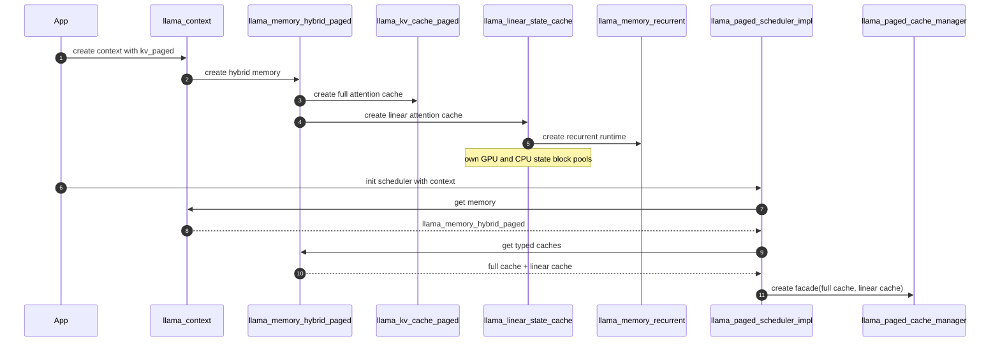
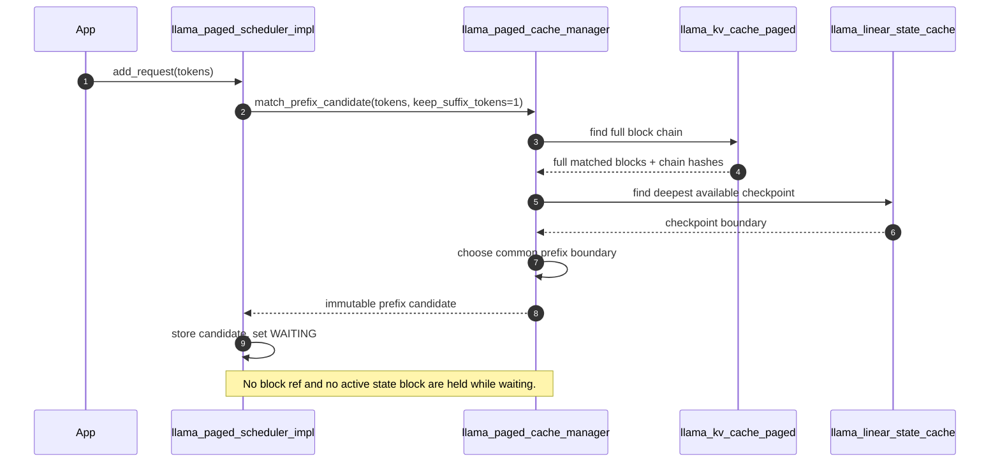
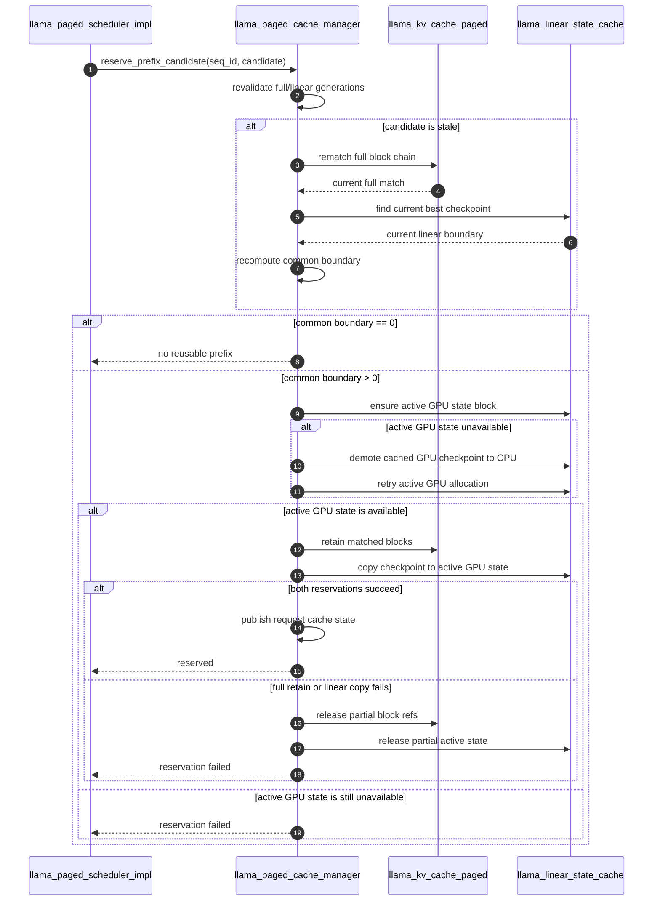
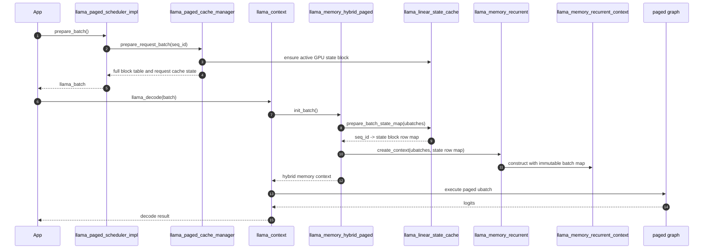
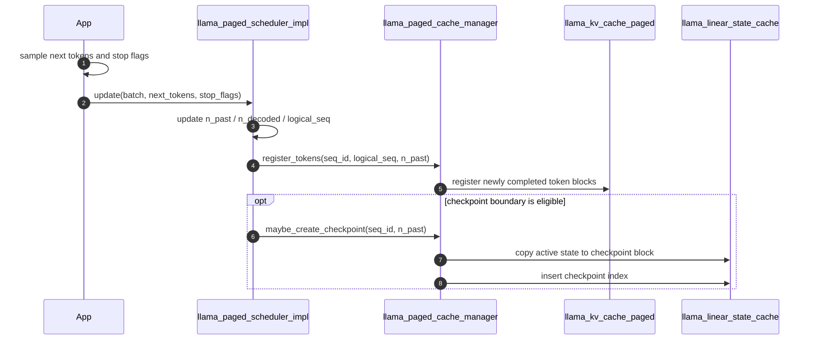
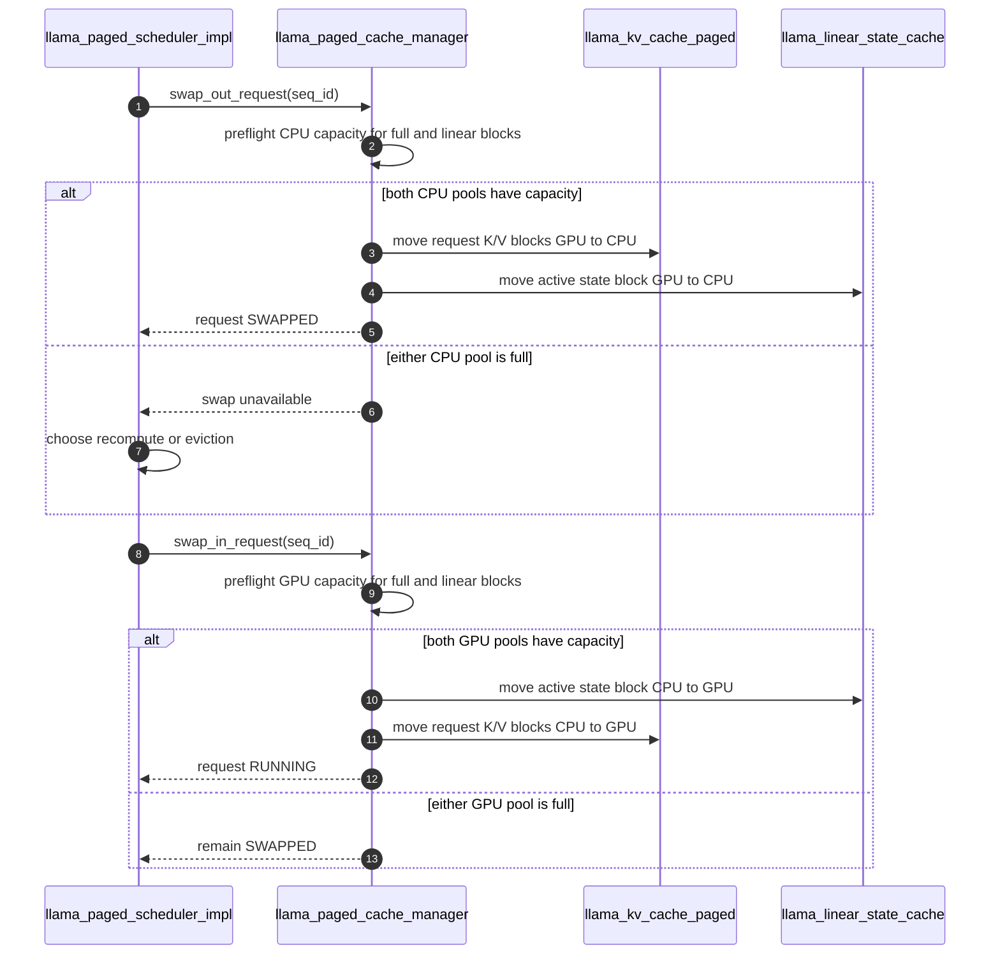
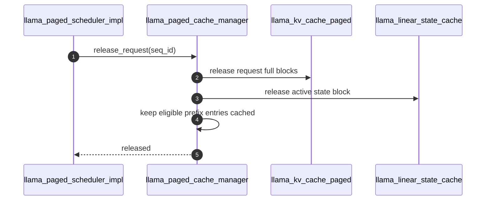
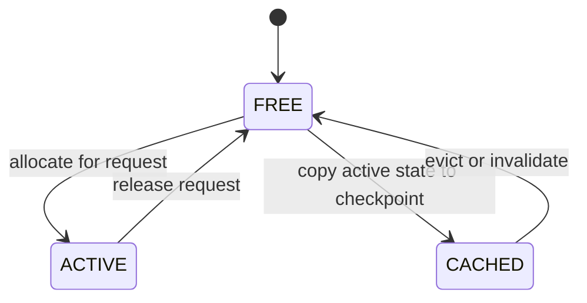
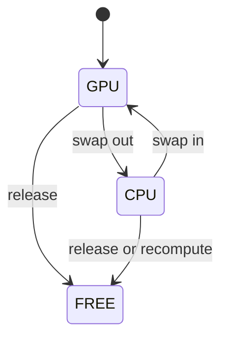

# Linear Attention Cache 与 Paged Prefix Cache 重构方案

状态: 设计稿 v7 (2026-11-05)

适用范围: `kv_paged` 下的 hybrid 模型，第一版建议只覆盖 Qwen3.5 和 Qwen3.5MoE。其他 recurrent 或 hybrid 模型继续使用现有路径。

v7 修改: 用“一个总预算 + 两套独立物理池”替换 linear state cache 当前的固定块数推导；checkpoint 改为可配置的同余格点，prefill 和 decode 使用同一判定。详见 §5.3 和 §10。

本文先说明重构后的类关系和方法调用时机。类成员、具体接口签名、数据结构和算法实现不在本文展开，后续应单独写实现设计或在代码评审中讨论。

## 1. 目标类图

本图覆盖 cache 所有权、batch runtime context 和主要数据路径，不展开 scheduler 队列、请求优先级、graph 内部实现或具体类成员。


类关系的关键点:

1. `llama_memory_hybrid_paged` 继续持有两类 runtime memory。
2. full attention 的 GPU/CPU K/V storage、block manager 和 token prefix index 归 `llama_kv_cache_paged`。
3. `llama_full_prefix_index` 只负责 `token hash -> block` 查找，不拥有 K/V 数据。
4. linear attention 的 GPU/CPU state pool、block manager 和 checkpoint index 归 `llama_linear_state_cache`。
5. `llama_block_manager` 管理物理 block id、refcount、GPU/CPU free queue 和 generation，不保存 K/V 或 state 数据。
6. full 和 linear cache 各持有一个独立的 `llama_block_manager` 实例，不共享物理 block pool。
7. `llama_memory_hybrid_paged_context` 是 per-batch runtime context，组合 full attention context 和 recurrent context。
8. `llama_paged_batch_info` 是 scheduler 到 paged context 的 batch metadata 输入。
9. `llama_paged_cache_manager` 是非 owning facade，由 scheduler 持有，只协调底层 cache。
10. scheduler 不再直接持有 prefix map，也不直接维护物理 block 引用计数。
11. `llama_linear_state_cache` 向 batch context 注入 immutable state row map，recurrent runtime 不反向持有 cache 指针。

图中没有单独画 K/V tensor 类，因为当前实现将 K/V GPU/CPU tensors 直接保存在 `llama_kv_cache_paged` 内。`llama_block_manager` 管 block 元数据和空闲队列，`llama_full_prefix_index` 管 hash 查询，两者都不保存 K/V 数据。


## 2. 方法调用时机

### 2.1 初始化和依赖注入



初始化阶段之后，scheduler 只通过 `llama_paged_cache_manager` 操作 prefix cache 和 block pool。

### 2.2 请求入队：只生成 prefix 候选



入队阶段只记录:

- 候选 full block 数量。
- 候选 linear checkpoint。
- 公共 prefix token 数。
- 候选 block 的 generation。

此时不增加 full block 引用，也不分配 linear active state block。

### 2.3 Waiting 准入：重新验证并原子预留



需要明确:

- prefix 引用和 active state 只在 waiting 队首获准进入 RUNNING 时预留。
- 入队后 cache 可能变化，准入时必须重新验证候选。
- 候选失效后允许回退到更短公共边界；没有 checkpoint 时回退全量 prefill。
- full attention 可能匹配得更长，但 hybrid 请求只能复用到 linear checkpoint 实际覆盖的边界。
- 如果完整 prompt 都命中，仍保留至少一个 suffix token。
- full 和 linear 的 reserve 必须是 all-or-nothing 事务。

### 2.4 Batch context 和 state row 数据路径



该数据路径避免 `llama_memory_recurrent` 反向查询 `llama_linear_state_cache`:

- `llama_linear_state_cache` 持有 `seq_id -> state block` 映射。
- `llama_memory_hybrid_paged` 在创建 batch context 时取得本批次 row map。
- `llama_memory_recurrent_context` 只持有本批次 immutable row map。
- graph 通过 recurrent context 读取 row map，不持有 cache manager 指针。

### 2.5 Prefill、Decode 和 Checkpoint



调用时机约束:

1. `prepare_batch()` 只准备 metadata，不执行 graph。
2. `llama_decode()` 由上层应用调用，scheduler 不能直接持有 graph 执行顺序。
3. `register_tokens()` 必须在 `update()` 之后、`n_past` 已经更新时调用。
4. checkpoint 只在完整 token 边界且整个 ubatch 已经执行完成后创建。
5. checkpoint 的候选边界由统一格点决定（§5.3）。prefill 的 ubatch 切分必须保证 `n_past` 能在每个格点边界处停下；否则必须由 scheduler 提前切分 ubatch，不能跳过中间格点。
6. prefill 和 decode 必须复用同一个判定函数。格点逻辑只存在于 cache manager 的 `maybe_create_checkpoint()`，scheduler 和 graph 不得各自实现一套。

### 2.6 Swap out、Swap in 和缓存淘汰



Swap 规则:

- SWAPPED 请求不能保留 active GPU linear state。
- full attention K/V 和 active linear state 必须一起换出到各自的 CPU pool。
- swap out/in 先做容量预检，再移动数据，避免只完成一半。
- 任一方向失败都不能发布半换出或半换入状态。
- cached checkpoint 可以位于 GPU 或 CPU；从 CPU checkpoint 命中时直接复制到新的 active GPU state。

淘汰规则:

- 淘汰只能作用于 cached block。
- active full block 和 active linear state 不能由 cache manager 擅自淘汰。
- GPU cache 不足时，可以先把 cached checkpoint 降到 CPU pool。

### 2.7 请求结束



请求结束后:

- full attention 满块可以由 cache 持有额外引用，继续作为 cached prefix。
- linear active state 必须从当前 GPU 或 CPU pool 释放。
- linear checkpoint 独立于请求存活，由 LRU 或显式失效回收。

### 2.8 调用阶段汇总

| 阶段 | scheduler 负责 | cache manager 负责 |
|---|---|---|
| context 初始化 | 获取 hybrid memory | 不参与 |
| scheduler 初始化 | 创建 facade，保存 typed cache 指针 | 绑定 full/linear cache |
| 请求入队 | 保存 prefix candidate | 只匹配，不 reserve |
| waiting 准入 | 选择可以转入 RUNNING 的队首 | 重新验证并原子 reserve |
| batch 准备 | 选择 prefill/decode | 注入 state row map，保证 GPU state |
| decode 后更新 | 更新 token/pos 状态 | 登记 token blocks、创建 checkpoint |
| swap out | 决定换出或重算 | 同时移动 full K/V 与 linear state 到 CPU |
| swap in | 恢复 SWAPPED 请求 | 同时移动 full K/V 与 linear state 到 GPU |
| 请求结束 | 更新调度状态 | 释放 refs 和 active state |

## 3. 重构范围

### 3.1 第一版范围

- `kv_paged` 下的 Qwen3.5/Qwen3.5MoE hybrid 路径。
- full attention token block 共享。
- linear attention GPU/CPU state block 分配和 swap。
- sparse prefix checkpoint。
- scheduler-facing cache facade。

### 3.2 非目标

- 不重构所有 recurrent 架构。
- 不实现跨进程 prefix cache。
- 不允许 mutable recurrent state 在多个 active sequence 之间共享。
- 不要求每个 token block 都有 linear checkpoint。
- 不实现 checkpoint 落盘或跨进程持久化；第一版支持 GPU/CPU block pool residency。
- 不在本文展开具体接口签名和类成员。

## 4. 为什么需要重构

### 4.1 当前 `seq_id` 与 recurrent cell 耦合

当前 [llama-memory-recurrent.cpp](../../src/llama-memory-recurrent.cpp) 使用 `cells[seq_id]` 保存 per-sequence metadata 和 tail。

这导致:

- `seq_id` 实际充当 recurrent cell 下标。
- prefix checkpoint 需要占用保留 `seq_id`。
- active request 和 checkpoint 争用同一个 cell 空间。
- `n_seq_max` 不能只表示最大并发请求数。

目标是把 logical sequence identity 和 physical state identity 分开:

```text
seq_id -> active linear state block
```

两者不再要求数值或下标相同。

### 4.2 Prefix cache 所有权分散

当前 [llama-paged-scheduler-impl.cpp](../../src/llama-paged-scheduler-impl.cpp) 持有 prefix map，而物理 block 在 `llama_kv_cache_paged` 中。

结果是:

- scheduler 读 block refcount 和 GPU 状态。
- swap 后需要通过 callback 更新 prefix entry。
- release/reuse 和 prefix invalidation 不在同一对象中完成。

### 4.3 Full 和 linear 的 prefix 语义不同

| 项目 | Full attention | Linear attention |
|---|---|---|
| 数据 | token block 中的 K/V | 完整 recurrent state |
| 可复用粒度 | 每个完整 token block | 已保存的 checkpoint |
| 共享方式 | 增加 block 引用 | 复制 checkpoint 到 active state |
| 淘汰对象 | token block | state block |
| 索引 key | token block hash 链 | checkpoint boundary hash |

因此两类 cache 需要独立 block pool 和独立 prefix index。

### 4.4 现有 hybrid 命中回退过强

当前逻辑要求 full attention 最后一个 matched block 同时存在 linear checkpoint。没有时直接全量 prefill。

目标允许匹配更短的公共边界:

```text
reuse_end = min(full_match_end, deepest_linear_checkpoint_end)
```

### 4.5 Graph 写入假设物理连续

当前 recurrent graph 写入假设 active state 位于连续物理行。任意 state block id 需要显式 read/write row mapping，但具体 graph 改造和数据结构不在本文展开。

## 5. 核心设计

### 5.1 Full attention cache

保留现有分页 KV 机制:

- 每个 block 对应固定数量 token 的 K/V。
- 满块只读，可以按引用共享。
- block 可以在 GPU 和 CPU pool 之间换入换出。
- token block hash 链登记在 full prefix index。

新增要求:

- prefix index 与 block pool 位于同一生命周期。
- 每个物理 block 需要 generation，防止释放后复用造成 stale prefix hit。
- prefix entry 在 block 失效时同步删除或标记失效。
- prefix hash 碰撞校验沿用当前策略：chain hash 命中后校验 block 首尾 token。

### 5.2 Linear attention cache

linear attention 的 block 表示某个 prefix 边界上的完整 recurrent state。

一个 state block 包含:

- 所有 linear layers 的 conv state。
- 所有 linear layers 的 SSM state。
- 可选的 PLE conv row。
- `1 + n_rs_seq` 个 rollback snapshot planes。

第一版建议:

- 每个 active sequence 拥有一个 active state block。
- checkpoint 命中后复制到新的 active state block。
- cached checkpoint 只读，不参与 graph 原地写入。
- checkpoint 数量由 §10 的 linear 预算推导，并由 LRU 控制生命周期。
- state block pool 同时包含 GPU 和 CPU 两级。
- SWAPPED 请求的 active state 位于 CPU pool。
- cached checkpoint 可以位于 GPU 或 CPU pool。

### 5.3 Prefix checkpoint

checkpoint 只在完整 prefix 边界创建，并且所有请求共用一套同余格点。prefill 和 decode 使用完全相同的判定。

定义:

```text
b    = n_past / block_size        已经处理完成的完整 token block 数
N    = checkpoint 间隔（block 数），默认 4，可由用户配置
base = 格点锚点（block 数），默认 0，取值 [0, N)
```

边界 `b` 可以创建 checkpoint，当且仅当同时满足:

1. `b > 0`。
2. `n_past % block_size == 0`，即该边界已经实际处理完成。
3. `b % N == base % N`，即落在同余格点上。
4. 该 prefix 不含 media segment（`has_media == false`）。
5. `block_hashes.size() >= b`，即第 `b` 个 block 的链式 hash 已经登记。
6. 该 chain hash 当前没有 live checkpoint。已有则直接跳过，不能重复分配 block。

`base = 0` 时格点为 `N, 2N, 3N, ...`。`N = 1` 表示每个完整 block 都建 checkpoint，粒度最细但复制和淘汰压力最大。

checkpoint 的 key 固定为该边界之前的完整 block hash 链，即 `block_hashes[b - 1]`；保存位置固定为 `pos = b * block_size`。

#### 5.3.1 为什么使用全局同余格点

- 不同请求只要共享同一段 token 前缀，就会在相同的 block 下标上产生 checkpoint，因此跨请求可以互相命中。
- checkpoint 数量可以预估：长度为 `L` 个 block 的 prompt 最多产生 `floor(L / N)` 个 checkpoint，便于按预算分配。
- prefill 和 decode 不需要两套策略。decode 每步只前进 1 个 token，`n_past` 会依次经过每个 block 边界，只有落在格点时创建；prefill 由 scheduler 按格点切分，行为一致。

#### 5.3.2 移除的特例

v6 曾在 `prompt_end` 和 `total_blocks - 1`（倒数第二个 block）额外创建 checkpoint。v7 移除这两个特例，原因:

- 它们是按单个请求的 prompt 长度决定的，不在全局格点上，跨请求无法复用。
- 会让 checkpoint 数量随 prompt 长度分布抖动，无法按预算稳定推导。
- 与“prefill/decode 统一格点”的目标冲突。

代价是：完全相同的 prompt 再次到达时，最深可复用边界退化为“小于 prompt 末尾的最大格点”，最多浪费 `(N - 1) * block_size` 个 prompt token 的重算。默认 `N = 4`、`block_size = 16` 时最多 48 token，可接受。若后续需要优化完全相同 prompt 的命中，应作为独立开关（默认关闭）重新引入，而不是恢复隐式特例。

#### 5.3.3 格点判定只做一次

`maybe_create_checkpoint()` 是唯一的判定入口，必须在每个 ubatch 执行完成、`n_past` 更新并 `register_tokens()` 之后调用:

```text
if (linear_cache && prefix_enabled && !group.has_media && group.n_past > 0) {
    b = group.n_past / block_size
    if (group.n_past % block_size == 0 &&
        b > 0 && b % N == base % N &&
        group.block_hashes.size() >= b &&
        !linear_cache->has_live_checkpoint(group.block_hashes[b - 1])) {
        linear_cache->create_checkpoint(group.request_id, group.block_hashes[b - 1], b * block_size);
    }
}
```

#### 5.3.4 Prefill 必须按格点切分

如果 scheduler 一次 prefill 跨过多个格点，ubatch 结束后只能看到最后一个 `n_past`，中间格点会永久丢失。

因此 prefill 选择行数时必须计算下一个格点:

```text
b_now         = group.n_past / block_size
b_next        = 最小的 b > b_now，且 b % N == base % N
next_ckpt_pos = b_next * block_size
rows          = min(rows, next_ckpt_pos - group.n_past)
```

约束:

- 只在 prefix cache 开启且 linear checkpoint 预算大于 0 时按格点切分；否则保持原切分策略，避免无意义地变短 ubatch。
- 跨 media segment 的 prefill 不建 checkpoint（`has_media`），但仍要保持 token 边界正确。
- checkpoint 创建是“从 active state 复制”，不移动、不重置 active state，创建后请求可以继续 decode。
- 达到预算上限后按 LRU 淘汰旧 checkpoint 再创建，不能因为无法分配而中断请求。
- **prefill chunk 长度上界是 `N * block_size`**（默认 4 × 16 = 64 token）。`N` 同时决定 checkpoint 密度、prefill 粒度和每次 checkpoint 的复制次数：`N` 越大，checkpoint 越稀疏、prefill chunk 越大、复制开销越低，但可复用边界越粗。上线前必须按模型的实际 state block 大小和 prefill 吞吐调 `N`。

#### 5.3.5 当前实现的 chunk 策略与 v7 差异

当前代码已经有一部分格点切分，但规则分散且含特例。现状（[llama-paged-scheduler-impl.cpp](../../src/llama-paged-scheduler-impl.cpp)）:

1. 每个调度 step 的 token 预算固定为 `n_batch`（`ctx->n_batch()`，默认 2048）。`row_budget` 从 `n_batch` 开始，被 running/swapped 候选依次消耗。
2. prefill 和 decode 不混批。只要存在 prefill 候选，`step()` 会把候选裁剪到**恰好一个** prefill 请求，因此 prefill batch 永远是单请求；没有 prefill 时，多个 decode 请求可以共享一个 step，每个请求贡献 `1 + pending_draft.size()` 行。
3. media segment 的纯 embd step 独占一个 batch，行数为该 segment 剩余行数，且不超过 `n_batch`。
4. prefill 的实际行数由 `prefill_chunk_tokens()` 决定：
   - `n = min(剩余 prompt 行数, n_batch)`。
   - 当 linear cache 存在、prefix cache 开启、无 media、且仍在 prefill 时，再按 checkpoint 边界截断。
   - 当前边界 = `((n_past / interval) + 1) * interval`，其中 `interval = k_checkpoint_interval_blocks * block_size = 4 * 16 = 64` token。
   - 额外考虑 `penultimate = (prompt 总 block 数 - 1) * block_size`，取两者中更近的。
   - 只有 `distance <= n_batch` 时才截断；否则本次直接跑 `n_batch`（后续 step 会再次命中该边界，不会跳过）。
5. `populate_batch_from()` 会用同一个 `prefill_chunk_tokens()` 重新计算行数，保证申请和填充一致。

v7 的差异:

- 格点改用 block 下标同余表达式 `b % N == base % N`，与 `maybe_create_checkpoint()` 完全同源；不再用 token 空间的 interval 倍数，也不再依赖 `k_checkpoint_interval_blocks` 这个编译期常量。
- 删除 `penultimate` 特例。
- `N` / `base` 由配置注入，prefill 和 decode 共用。
- 截断逻辑保持“`rows = min(rows, next_ckpt_pos - n_past)`”，不要求 `distance <= n_batch`；距离大于 `n_batch` 时自然按 `n_batch` 推进，距离小于 `n_batch` 时截断到格点。

## 6. Linear State Block 生命周期



说明:

- `ACTIVE` block 可以被 graph 写入。
- `CACHED` block 只读。
- checkpoint 命中不会把 `CACHED` 改成 `ACTIVE`。
- checkpoint 命中后从 `CACHED` 复制到一个新的 `ACTIVE` block。

设备位置是独立于 block 状态的属性:



因此一个 block 的状态和位置需要分别记录:

```text
lifecycle: FREE | ACTIVE | CACHED
placement: GPU | CPU
```

## 7. Prefix Match 规则

### 7.1 公共边界

full attention 和 linear attention 必须使用相同的 token 边界:

```text
full_end   = full attention 可复用的最长 token block 边界
linear_end = linear checkpoint 可复用的最长 token block 边界
reuse_end  = min(full_end, linear_end)
```

示例:

```text
full attention 命中 12 blocks
linear checkpoint 只覆盖 8 blocks
请求复用 8 blocks
```

由于 checkpoint 只存在于格点上（§5.3），`linear_end` 总是同时满足 `linear_end <= full_end` 且 `linear_end % block_size == 0`。若 full attention 命中的最后一个 block 没有对应 checkpoint，允许回退到更深的格点，而不是直接全量 prefill。

zero-suffix 规则与格点共同决定了完全相同 prompt 的最深复用边界：取严格小于 prompt 末尾 block 数的最大格点。例如 prompt 为 12 个 block、`N = 4`、`base = 0` 时，最深复用 8 个 block。

### 7.2 原子性

prefix reserve 必须满足:

1. full block 引用增加成功。
2. linear checkpoint 到 active state 的复制成功。
3. 任一步失败，之前完成的步骤全部回滚。

### 7.3 Zero suffix

如果完整 prompt 都命中，至少保留一个 suffix token。

该规则应由 cache manager 或统一的 prefix match 调用路径保证，不能由不同调用者各自解释。

## 8. 所有权和生命周期

| 对象 | 所有者 | 职责 |
|---|---|---|
| `llama_memory_hybrid_paged` | `llama_context` | 持有 full/linear runtime memory |
| `llama_kv_cache_paged` | `llama_memory_hybrid_paged` | full attention GPU/CPU K/V storage、full prefix index |
| `llama_linear_state_cache` | `llama_memory_hybrid_paged` | GPU/CPU state pool、active state、checkpoint index |
| `llama_block_manager` | full 或 linear typed cache 各持有一个实例 | refcount、free queue、generation 和物理 block 元数据 |
| `llama_memory_recurrent` | `llama_linear_state_cache` | recurrent tensor、memory context、graph-facing runtime |
| `llama_memory_hybrid_paged_context` | per-batch memory context 生命周期 | 组合 full attention context 和 recurrent context |
| `llama_kv_cache_paged_context` | `llama_memory_hybrid_paged_context` | 提供 full attention batch metadata 和 K/V tensors |
| `llama_memory_recurrent_context` | `llama_memory_hybrid_paged_context` | 持有本批次 immutable state row map |
| `llama_paged_batch_info` | scheduler 持有，context 非 owning 读取 | write slots、block table、context lens、batch offsets 和 lengths |
| `llama_paged_cache_manager` | `llama_paged_scheduler_impl` | 非 owning facade，协调两类 cache |

`llama_paged_cache_manager` 不能比底层 cache 存活更久。

## 9. 并发和一致性约束

### 9.1 线程模型

第一版沿用当前单调度线程语义:

- scheduler 与 cache manager 串行调用。
- block table 在 batch 执行期间不修改。
- graph 执行期间不修改 prefix index。

容量判断必须同时覆盖:

- full attention GPU blocks。
- full attention CPU blocks。
- linear state GPU blocks。
- linear state CPU blocks。

deadlock 和 livelock 判断不能只检查 full attention GPU pool。

池大小由 §10 的总预算在初始化时唯一确定，运行期不允许再向驱动追加显存。因此还需要维持:

- `n_gpu_state_blocks >= n_seq_max`，保证每个 RUNNING 请求都能拿到 active state。
- PA 可用 GPU block（扣除 watermark）不少于 `n_seq_max`，保证每个请求至少能推进一个 block。
- checkpoint 只能使用 linear 池中 active 之外的余量；active 分配优先，必要时先 demote/evict checkpoint。
- 任何一个池容量不满足上述下界时，初始化阶段直接 fail-fast，不能进入调度循环。

### 9.2 Block generation

物理 block 释放后可能被复用。仅检查 `block_id` 不足以确认 prefix entry 仍指向原内容。

每个 prefix entry 必须能够校验:

- physical block id。
- generation。
- cached 状态。
- token 或 checkpoint 边界。

### 9.3 必须保持的 invariant

1. `seq_id` 不等于 state block id。
2. 每个 active request 最多有一个 active linear state block。
3. cached checkpoint 只读。
4. full 和 linear 的复用 token 数相同。
5. WAITING 请求只保存 prefix candidate，不持有 block 引用或 active state。
6. SWAPPED 请求不持有 active GPU linear state。
7. 使用 CPU state 的 SWAPPED 请求，其 full K/V 和 linear state 必须同时位于 CPU。
8. prefix reserve 失败时不能留下 partial reservation。
9. release 后不能留下指向该 block 的有效 prefix entry。
10. active block 不能被 cache eviction 淘汰。
11. checkpoint 必须对应实际已经处理的 token 边界。

## 10. 显存预算与两套物理池

### 10.1 设计原则

- **一个总预算**：KV/state 可用的显存总量在 cache 创建时一次算清，之后不再变化。
- **两套独立物理池**：PA（full attention K/V）和 linear（recurrent state）各自持有独立的 tensor、`llama_block_manager`、free queue 和 block id 命名空间。二者不共享物理 block，只共享总预算。
- **active 优先**：linear 的每请求 active state 是硬需求，必须先满足；checkpoint 使用 linear 预算的剩余部分。active 槽位是“可抢占的保留量”，不是静态分区：请求较少时 checkpoint 可以临时占用空闲 active 槽位，但 active 到来时必须让位。
- **启动期 fail-fast**：任何一项容量不满足下界时直接报错并给出可执行的调整建议，不允许运行期 OOM 或死锁。
- **PA 和 linear 各按自己的层数和块数记账**：PA block 只包含 full attention 层，linear state block 只包含 recurrent 层，不能混用 `n_layer()`。

### 10.2 总预算

符号:

| 符号 | 含义 |
|---|---|
| `total` | 设备总显存 |
| `free` | cache 创建时的设备空闲显存，此时模型权重已经驻留 |
| `resident_non_kv` | 已经驻留的非 KV 占用，`total - free` |
| `runtime_non_kv` | 运行期还会分配的非 KV 工作集（graph 激活、compute buffer、workspace、用户 margin） |
| `utilization` | 设备级显存使用率上限，默认 0.80，可配置 |
| `budget` | 本次可分配给 PA + linear 的字节数 |

计算公式:

```text
resident_non_kv = total - free
runtime_non_kv  = max(非 KV 运行期峰值估计, runtime_non_kv_floor)
cache_cap       = min(free, total * utilization - resident_non_kv)
budget          = cache_cap - runtime_non_kv
```

默认值:

- `utilization = 0.80`。
- `runtime_non_kv_floor = 5% * total`。
- `runtime_non_kv` 的第一版估计可以沿用当前的 5% margin；后续可用 graph 实测峰值替换。
- `utilization` 与 `runtime_non_kv` 不是重复预留。`utilization` 限制的是设备整体使用率（`utilization = 0.80` 时预留 20% 给驱动、碎片和其他进程），`runtime_non_kv` 是 cache 之外实际会增长的 graph/workspace 工作集。两者从不同层面约束，cache 预算按式 `budget = min(free, total*utilization − resident_non_kv) − runtime_non_kv` 计算。

说明:

- 用户给出的形式是 `budget = min(free_vram, total × utilization) − 非KV占用`。如果 `free_vram` 采于模型加载之前，该式与本式等价，其中 `非KV占用 = resident_non_kv + runtime_non_kv`。
- 实现里 `free` 必须在权重加载之后采样，此时 `resident_non_kv` 已经不在 `free` 中。因此 `resident_non_kv` 只能从 `total * utilization` 分支扣一次，不能再次从 `free` 分支扣，否则会重复计算。
- `free` 和 `total` 必须取自承载模型层的同一个设备。`--kv-paged` 已经要求所有层在单设备上（见 [llama-context.cpp](../../src/llama-context.cpp) 的单设备校验）。
- `budget <= 0` 时启动失败，打印 `total/free/resident/runtime/utilization` 五项实际值。
- 预算只能在所有 cache tensor 分配之前计算一次；创建完成后不得因为运行期压力重新计算或追加池大小。

### 10.3 预算切分

```text
linear_budget = budget * linear_ratio      // 默认 linear_ratio = 0.20
pa_budget     = budget - linear_budget
```

规则:

- `linear_ratio` 默认 0.20，可由用户配置；它是 linear 池在 **GPU 显存**预算中的占比。
- linear 的 CPU state pool 使用 host 内存，不计入 `budget`，只受 host RAM 约束。
- PA 的 CPU block pool 同样不计入 `budget`，沿用现有 `cpu_to_gpu_blocks_ratio`。
- `linear_budget` 同时覆盖“每请求 active state”和“checkpoint”。active 先占位，剩余部分才是 checkpoint 容量。
- `linear_ratio` 不能写成“checkpoint 占比”。如果 active state 已经超过 `linear_budget`，不能静默把 PA 的预算挪过来，应报错要求用户增大 `linear_ratio` 或降低 `n_seq_max`。
- `linear_ratio = 0` 是例外：此时固定分配 `S_active` 个 state block，其字节数仍从总预算扣除，剩余预算全部给 PA，checkpoint 关闭。若 `S_active * state_block_bytes > budget`，启动失败。

### 10.4 每个 block 的字节数

PA block:

```text
pa_block_bytes = block_size * sizeof(type_k) * Σ_{il : !is_recr(il)} n_embd_k_gqa(il)
               + block_size * sizeof(type_v) * Σ_{il : !is_recr(il)} n_embd_v_gqa(il)
```

- 只统计 full attention 层。hybrid 模型里 `is_recr(il) == true` 的层没有 PA K/V，不能计入。
- 若 K/V 逐层维度不同，按层求和，不能直接用 `n_layer() * 单层维度`。
- 实际分配还要计入 tensor 对齐和 per-layer buffer 开销，保守可按 `pa_block_bytes` 上浮 1%～2%。

Linear state block:

```text
state_block_bytes = (1 + n_rs_seq) * sizeof(state_type)
                    * Σ_{il : is_recr(il)} ( n_embd_r()
                                            + n_embd_s()
                                            + (is_ple(il) ? ple_conv_state() : 0) )
```

- `1 + n_rs_seq` 是 rollback snapshot plane 数，`n_rs_seq` 默认为 0，但 speculative 场景可能大于 0。
- PLE conv history 只存在于 PLE 层（`is_ple(il)`），必须按层求和。
- 该公式与 [llama-memory-recurrent.cpp](../../src/llama-memory-recurrent.cpp) 的 `make_pool()` 形状一致：`n_blocks * n_planes` 行，每行 `n_embd_r + n_embd_s`。

当前实现的偏差（必须修正）:

- [common/common.cpp](../../common/common.cpp) 的 `common_fit_paged_kv_blocks()` 用 `llama_model_n_layer(model)` 作为 PA 层数，并对 hybrid 模型把 linear 层也算进 K/V，`pa_block_bytes` 偏大。
- 同一函数用 `margin = 5% * total` 独立决定 `n_gpu_blocks`，而 linear 池随后又额外分配 `n_seq_max + n_ckpt_blocks()` 个 state block，两者没有共享预算，存在 double-spend 和运行期 OOM 风险。v7 必须统一到本节公式。

### 10.5 Linear 池

```text
S_active       = n_seq_max
B_linear       = linear_ratio > 0 ? floor(linear_budget / state_block_bytes) : S_active
n_gpu_state_blocks = B_linear
C_gpu          = B_linear - S_active
```

`linear_ratio = 0` 是“只保留 active、关闭 checkpoint”的显式语义：此时仍分配 `S_active` 个 GPU state block，但不再为 checkpoint 预留容量。

校验与行为:

- `linear_ratio > 0` 且 `B_linear < S_active` 时启动失败。错误信息必须给出 `linear_budget`、`state_block_bytes`、`S_active`，以及达到 `S_active` 所需的最小 `linear_ratio`。
- `C_gpu == 0` 时启动告警：GPU 上没有 checkpoint 预留容量。此时 `C_cpu` 也按默认倍率为 0，checkpoint 只能临时占用尚未被 SWAPPED active 使用的 CPU block，并在需要时被立即淘汰，prefix 命中率会显著下降。建议提高 `linear_ratio` 或降低 `n_seq_max`。
- 池不做静态分区。`S_active` 是 active 的容量下界，`C_gpu` 是 checkpoint 的保底容量，二者都在同一个 `llama_block_manager` 中动态分配。请求少于 `n_seq_max` 时，checkpoint 可以临时占用空闲的 active 槽位；active 分配到来时再 demote/evict 腾出。
- active 分配优先：`allocate_gpu_block()` 在池满时先 `demote_one_checkpoint()`，再 `evict_one_checkpoint()`，最后才失败。checkpoint 不能挤掉 active。

CPU state pool:

```text
C_cpu              = ceil(C_gpu * cpu_state_ratio)    // 默认 cpu_state_ratio = 1.0
n_cpu_state_blocks = S_active + C_cpu
```

CPU 池至少要能容纳全部 SWAPPED 请求的 active state（`S_active`）以及被 demote 的 checkpoint。

- checkpoint 的分配顺序沿用现有语义：优先 GPU，GPU 无空间时落到 CPU；两侧都满时按 LRU 淘汰最旧 checkpoint。
- checkpoint 的容量：保底 `C_gpu + C_cpu`，空闲 active 槽位可被临时复用；物理上限是 `n_gpu_state_blocks + n_cpu_state_blocks`。不再使用 `LLAMA_PAGED_PREFIX_CKPT` 的绝对值语义。该环境变量降级为调试用上限（与预算结果取 min），并打印弃用提示。

### 10.6 PA 池

```text
B_pa       = floor(pa_budget / pa_block_bytes)
B_ctx      = ceil(n_ctx * n_seq_max / block_size / (1 - watermark))
n_gpu_blocks = min(B_pa, B_ctx)
usable_gpu   = n_gpu_blocks - ceil(n_gpu_blocks * watermark)
n_cpu_blocks = ceil(n_gpu_blocks * cpu_to_gpu_blocks_ratio / (1 - watermark))
```

约束:

- `B_ctx` 是 per-sequence context 容量上限：paged scheduler 把 `n_ctx` 解释为每序列容量，因此总 token 上限是 `n_ctx * n_seq_max`。超过该上限的 block 只会浪费显存。
- `usable_gpu < n_seq_max` 时启动失败。`n_seq_max` 个并发请求至少各需要一个可推进的 block。
- `watermark` 只作用于 PA 池，是 PA 池内部的准入安全边界；它已经包含在 `pa_budget` 里，不能再在预算层重复扣一次。
- linear 池的 `llama_block_manager` watermark 必须保持 `0.0`，因为 active 和 checkpoint 的数量已经由预算精确推导。给 linear 池加 watermark 会凭空减少可用 state block，导致 active 分配失败。
- 如果用户显式设置 `--n-gpu-blocks`，PA 池按用户值固定，并从总预算中扣除 `n_gpu_blocks * pa_block_bytes`，剩余部分再给 linear；若剩余不足以容纳 `S_active * state_block_bytes`，启动失败。

### 10.7 配置项与优先级

新增/修改的配置:

| 配置项 | 环境变量 | 默认值 | 说明 |
|---|---|---|---|
| `--kv-paged-vram-utilization` | `LLAMA_ARG_KV_PAGED_VRAM_UTILIZATION` | 0.80 | 设备级显存使用率上限 |
| `--kv-paged-linear-ratio` | `LLAMA_ARG_KV_PAGED_LINEAR_RATIO` | 0.20 | linear 池在总预算中的占比 |
| `--kv-prefix-ckpt-interval` | `LLAMA_ARG_KV_PREFIX_CKPT_INTERVAL` | 4 | 同余格点的 `N`（block 数） |
| `--kv-prefix-ckpt-base` | `LLAMA_ARG_KV_PREFIX_CKPT_BASE` | 0 | 同余格点的 `base`，范围 `[0, N)` |
| `--kv-paged-cpu-state-ratio` | `LLAMA_ARG_KV_PAGED_CPU_STATE_RATIO` | 1.0 | CPU state 池相对 GPU state 池的 checkpoint 倍率 |
| `--n-gpu-state-blocks` | - | 0 = auto | 调试用 GPU state 池覆盖值 |
| `--n-cpu-state-blocks` | - | 0 = auto | 调试用 CPU state 池覆盖值 |
| `--n-gpu-blocks` / `--n-cpu-blocks` | - | auto | PA 池覆盖值，沿用现有语义 |

校验:

- `utilization ∈ (0, 1]`。
- `linear_ratio ∈ [0, 1)`；`0` 表示只分配 `S_active` 个 active state block、关闭 checkpoint，见 §10.5。
- `N >= 1`，`0 <= base < N`。
- `n_seq_max >= 1`。
- `--n-gpu-state-blocks` 如果小于 `n_seq_max`，启动失败。
- 显式 PA 覆盖与自动 linear 推导之和超过 `budget` 时启动失败。

优先级: 显式覆盖值 > 预算推导值 > 环境变量默认值。所有覆盖值都必须参与预算校验。

### 10.8 计算示例（示意）

```text
total          = 64 GiB
free           = 48 GiB
resident_non_kv= 16 GiB
utilization    = 0.80
runtime_non_kv = 3.2 GiB

cache_cap = min(48, 51.2 - 16) = 35.2 GiB
budget    = 35.2 - 3.2 = 32.0 GiB

linear_budget = 32.0 * 0.20 = 6.4 GiB
pa_budget     = 32.0 - 6.4 = 25.6 GiB

state_block_bytes = 64 MiB
B_linear          = floor(6.4 GiB / 64 MiB) = 102
n_seq_max         = 8
C_gpu             = 94
n_gpu_state_blocks= 102
n_cpu_state_blocks= 8 + 94 = 102       (cpu_state_ratio = 1.0)

pa_block_bytes = 2 MiB
B_pa           = floor(25.6 GiB / 2 MiB) = 13107
B_ctx          = 32768 * 8 / 16 = 16384  (n_ctx = 32768, block_size = 16)
n_gpu_blocks   = 13107
usable_gpu     = 13107 - ceil(13107 * 0.05) = 12451
n_cpu_blocks   = ceil(13107 * 0.25 / 0.95) = 3450
```

最终 PA = 13107 个 GPU block，linear = 102 个 GPU state block + 102 个 CPU state block。实际数字以模型 hparams 和 `ggml_backend_dev_memory()` 为准。

### 10.9 实现落点（相对当前代码）

| 位置 | 当前行为 | v7 修改 |
|---|---|---|
| [common/common.cpp](../../common/common.cpp) `common_fit_paged_kv_blocks()` | 用 `n_layer()` 计算 PA block；用 5% margin 独立决定 `n_gpu_blocks` | 改为调用统一预算函数；PA 层数改为 `!hparams.is_recr(il)` 的层 |
| [llama-memory-hybrid-paged.cpp](../../src/llama-memory-hybrid-paged.cpp) `n_ckpt_blocks()` | `LLAMA_PAGED_PREFIX_CKPT` 默认 4，固定块数 | 删除固定块数；由预算推导 `n_gpu_state_blocks` / `n_cpu_state_blocks` |
| `llama_memory_hybrid_paged` 构造函数 | GPU/CPU 都用 `n_seq_max + n_ckpt_blocks()` | 传入预算计算出的两个池大小 |
| [llama-paged-cache-manager.h](../../src/llama-paged-cache-manager.h) `k_checkpoint_interval_blocks` | 编译期常量 4 | 改为构造注入的 `ckpt_interval` 和 `ckpt_base` |
| [llama-paged-cache-manager.cpp](../../src/llama-paged-cache-manager.cpp) `maybe_create_checkpoint()` | `n_blocks % 4`，含 `prompt_end` / `penultimate` 特例 | 按 §5.3 格点判定；先查 live checkpoint 去重 |
| [llama-paged-scheduler-impl.cpp](../../src/llama-paged-scheduler-impl.cpp) prefill 选行 | 不感知 checkpoint 格点 | 按 §5.3.4 把 rows 截断到下一个格点 |
| [llama-linear-state-cache.cpp](../../src/llama-linear-state-cache.cpp) `create_checkpoint()` | 重复 hash 仍先分配新 block，再释放旧 block | `maybe_create_checkpoint()` 负责去重；`create_checkpoint()` 内部保持幂等 |
| [llama-block-manager.cpp](../../src/llama-block-manager.cpp) | linear 池 watermark = 0.0 | 保持 0.0；watermark 只用于 PA 池 |
| [include/llama.h](../../include/llama.h) / [llama-cparams.h](../../src/llama-cparams.h) | 只有 `n_gpu_blocks` / `n_cpu_blocks` / `kv_paged_watermark` | 增加 §10.7 的预算和格点参数 |

初始化顺序要求:

1. 模型权重加载完成。
2. 在承载模型层的设备上采样 `free` / `total`。
3. 计算 `budget`、`linear_budget`、`pa_budget` 和四个池大小。
4. 打印预算明细。
5. 分配 PA 和 linear 的 GPU/CPU tensor。
6. 分配后再次读取设备空闲显存，若低于 `runtime_non_kv` 的 floor，打印错误并终止（说明预算估计偏乐观）。

### 10.10 启动日志与运行期不变量

启动日志至少包含:

```text
paged budget: total=... free=... resident_non_kv=... runtime_non_kv=... utilization=...
paged budget: budget=... linear_budget=... pa_budget=...
paged linear: state_block_bytes=... S_active=... C_gpu=... C_cpu=... n_gpu_state_blocks=... n_cpu_state_blocks=...
paged PA: pa_block_bytes=... B_pa=... B_ctx=... n_gpu_blocks=... usable_gpu=... n_cpu_blocks=... watermark=...
paged checkpoint: interval=N blocks base=... max_checkpoints=...
```

运行期不变量:

1. `n_gpu_state_blocks * state_block_bytes + n_gpu_blocks * pa_block_bytes <= budget`，不在运行期重新分配。
2. `∑ active GPU state blocks <= n_seq_max <= n_gpu_state_blocks`。
3. checkpoint 数量不超过 `n_gpu_state_blocks + n_cpu_state_blocks`；当 active 需要槽位时，checkpoint 必须能被 demote/evict 让位，且让位后仍满足 `S_active` 个 active 的容量。
4. PA 可用 block 始终为 `n_gpu_blocks - watermark 预留`，不因 linear 池压力变化。
5. checkpoint 创建失败只能导致命中率下降，不能导致请求失败；active 分配失败才是致命错误。

## 11. 当前方案的主要风险

| 编号 | 风险 | 对策 |
|---|---|---|
| R1 | checkpoint 复制成本过高 | 稀疏 checkpoint、批量复制、后续评估异步复制 |
| R2 | state block 显存增加 | 独立 GPU/CPU 预算、LRU、CPU demotion |
| R3 | graph 改造范围过大 | 第一版只覆盖 Qwen3.5/Qwen3.5MoE |
| R4 | block 释放后 prefix stale hit | generation 与主动 invalidate |
| R5 | full/linear 部分成功 | reserve 采用 all-or-nothing |
| R6 | checkpoint 落在 ubatch 内部 | scheduler 切分 ubatch，或只在 eligible 边界创建 |
| R7 | 非 paged recurrent 回归 | 新 wrapper 只从 hybrid-paged 路径创建 |
| R8 | linear pool 复用当前 block manager 的限制 | 使用 state 专用 GPU/CPU allocator 或扩展 block manager 的设备语义 |
| R9 | state pool 耗尽但 full pool 未耗尽 | 准入和 deadlock 判断同时检查两类 cache 的 GPU/CPU 容量 |
| R10 | swap out/in 只完成一半 | 同时预检 full 和 linear 的目标设备容量，再整体提交 |
| R11 | 预算重复扣减非 KV 占用 | 固定 `free` 采样点（权重加载后），`resident_non_kv` 只从 utilization 分支扣一次 |
| R12 | active state 挤占全部 linear 预算 | `B_linear < S_active` 启动失败；`C_gpu == 0` 显式告警；active 分配优先于 checkpoint |
| R13 | 大 ubatch 跨过格点导致 checkpoint 丢失 | prefill 按 §5.3.4 截断到下一个格点 |
| R14 | 同一 chain hash 重复创建 checkpoint | `maybe_create_checkpoint()` 先查 live entry；`create_checkpoint()` 保持幂等 |
| R15 | PA block 计算把 linear 层算进去 | `pa_block_bytes` 只统计 `!is_recr(il)` 的层；预算和日志都打印实际层数 |
| R16 | 运行期非 KV 峰值高于预留 | 分配后复测设备空闲显存；低于 floor 时启动失败，不进入调度 |

## 12. 分阶段重构

### Phase 1: 目标边界和 runtime wiring

- 新增 `llama_paged_cache_manager` 的设计和生命周期。
- 明确 full/linear cache 的所有权。
- 明确 linear cache 向 recurrent context 注入 batch row map 的边界。
- scheduler 初始化时创建 facade。
- 暂不改变请求行为。

验收:

- 类关系与本文目标类图一致。
- 不修改非 paged recurrent 路径。

### Phase 2: 解耦 `seq_id` 和 recurrent state block

- 移除 `seq_id == cell_id` 假设。
- 引入独立 linear GPU/CPU state block pool。
- active sequence 使用 state block id。
- linear cache 提供 batch row map，recurrent context 持有 immutable copy。
- graph 使用显式 state read/write row。
- linear active state 支持 GPU/CPU swap。

验收:

- logical `seq_id` 不再受 state block 数量限制。
- `n_rs_seq` rollback 语义不变。
- active sequence 的 decode 输出与旧路径一致。

### Phase 3: 下沉 prefix index

- full prefix index 进入 `llama_kv_cache_paged`。
- checkpoint index 进入 `llama_linear_state_cache`。
- block release、swap 和 reuse 在 typed cache 内部同步索引。
- scheduler 删除 prefix map 和 checkpoint seq id 预留段。

验收:

- block swap 后仍可正确命中。
- block reuse 不会命中旧 prefix。
- checkpoint 不占用请求 `seq_id`。

### Phase 4: 原子 prefix match 和公共边界

- cache manager 同时查询 full 和 linear。
- 选择最深公共 checkpoint 边界。
- 入队只保存 prefix candidate，不 reserve。
- waiting 队首准入时重新验证并原子 reserve。
- 实现 full/linear reserve 的 all-or-nothing。
- 支持较短 checkpoint 的部分复用。

验收:

- 最后一个 block 没有 checkpoint 时，可以退回更短 prefix。
- linear copy 失败不会留下 full block 引用泄漏。

### Phase 5: 预算、格点和性能策略

- 实现 §10 的统一预算：`utilization`、`linear_ratio`、PA/linear 池大小推导、启动期 fail-fast。
- 修正 `pa_block_bytes`：只统计 full attention 层。
- 实现 §5.3 的 `N` / `base` 配置化格点，移除 `prompt_end` / `penultimate` 特例。
- prefill 按格点切分 ubatch。
- checkpoint 去重和 LRU 预算上限。
- checkpoint 复制优化。
- CPU demotion 和 checkpoint 分层。
- 后续评估 COW。

## 13. 测试计划

复用现有 [test-paged-kv.cpp](../../tests/test-paged-kv.cpp)，不新增 `tests/*` 文件。

### 13.1 功能测试

- 同一 prompt 的第二个请求只 prefill suffix。
- 相同 system prompt、不同 user prompt。
- full match 长于 linear checkpoint。
- 完整 prompt 命中仍保留 suffix token。
- checkpoint 被淘汰后回退到更短 prefix。
- checkpoint copy 失败时 full refs 回滚。
- waiting 请求不持有 block 引用或 active state。
- 准入时 prefix candidate 已失效，可以重新匹配或安全回退。

### 13.2 并发与生命周期

- `seq_id` 大于 state block 数量。
- 多个 active sequence 各自拥有独立 state block。
- checkpoint block 释放后复用。
- small pool 下持续请求不泄漏 block 或 state。
- block swap 后 prefix index 仍然一致。
- full K/V 和 linear active state 的 swap out/in 必须成对完成。
- batch row map 在不同请求和不同 state block 数量下仍正确。

### 13.3 预算与池划分

- `budget` 计算：固定 `total` / `free`，验证 `utilization`、`resident_non_kv`、`runtime_non_kv` 的扣减顺序，确保 resident 只扣一次。
- `linear_ratio = 0.20` 时，PA 池字节数 + linear 池字节数不超过 `budget`。
- `B_linear < n_seq_max` 时启动失败，错误信息包含最小可用的 `linear_ratio`。
- `C_gpu == 0` 时启动告警，不崩溃。
- `usable_gpu < n_seq_max` 时启动失败。
- `pa_block_bytes` 只统计 full attention 层：构造一个 attention/linear 层数不同的 hybrid 配置，验证预算不把 linear 层算进 K/V。
- `state_block_bytes` 在 `n_rs_seq = 0` 和 `n_rs_seq > 0` 两种配置下正确。
- 显式 `--n-gpu-blocks` 覆盖时，PA 先占用预算，linear 使用剩余预算并做下界校验。
- 预算超限时启动失败，不产生部分分配的池。

### 13.4 Checkpoint 格点

- `N = 4`、`base = 0` 时，只在 `b = 4, 8, 12, ...` 创建 checkpoint。
- `N = 4`、`base = 1` 时，只在 `b = 1, 5, 9, ...` 创建 checkpoint。
- prefill 一次跨过多个格点时，ubatch 被切分，中间格点全部创建。
- decode 逐 token 到达格点时创建，行为与 prefill 一致。
- 相同 chain hash 的第二个请求不重复分配 checkpoint block。
- checkpoint 池满时按 LRU 淘汰，请求继续执行。
- `prefix cache` 关闭或 `linear_ratio = 0` 时，不创建 checkpoint，也不按格点切分 ubatch。

### 13.5 精度

- prefix cache 开启和关闭路径逐 token 输出一致。
- `n_rs_seq > 0` 时 rollback 结果一致。
- 多轮对话共享历史 prefix 时不重复应用 token。

## 14. 评审清单

- [ ] 确认第一版只覆盖 Qwen3.5/Qwen3.5MoE 的 `kv_paged` hybrid 路径。
- [ ] 确认 linear attention block 表示完整 recurrent state。
- [ ] 确认 checkpoint 命中后复制到 active state，不直接共享 mutable state。
- [ ] 确认 full/linear prefix index 分别由 typed cache 持有。
- [ ] 确认 `llama_paged_cache_manager` 是非 owning facade。
- [ ] 确认 scheduler 不再直接操作 block refcount 和 prefix map。
- [ ] 确认入队只保存 prefix candidate，不增加引用。
- [ ] 确认 waiting 准入时重新验证并原子 reserve。
- [ ] 确认 full/linear 选择相同公共边界。
- [ ] 确认 checkpoint 只在实际处理完成的 ubatch 边界创建。
- [ ] 确认 block generation 和 invalidation 策略。
- [ ] 确认 linear state 同时具备 GPU 和 CPU pool。
- [ ] 确认 SWAPPED 请求不保留 active GPU linear state。
- [ ] 确认 full K/V 和 linear state 的 swap out/in 具备联合容量预检。
- [ ] 确认 linear cache 向 recurrent context 注入 batch row map。
- [ ] 确认 prefix hash 碰撞校验接受首尾 token 方案。
- [ ] 确认新增类放在新文件，还是合并进现有文件。
- [ ] 确认总预算只计算一次，PA 和 linear 各自从同一个 `budget` 扣减。
- [ ] 确认 `free` 采样点在模型权重加载之后，`resident_non_kv` 不重复扣减。
- [ ] 确认 `pa_block_bytes` 只统计 full attention 层，`state_block_bytes` 只统计 recurrent 层。
- [ ] 确认 `n_gpu_state_blocks >= n_seq_max`，且 `usable_gpu >= n_seq_max`，否则启动失败。
- [ ] 确认 linear 池的 block manager watermark 为 0。
- [ ] 确认 `linear_ratio`、`utilization`、`N`、`base` 都有默认值且可由用户覆盖。
- [ ] 确认 checkpoint 使用 `b % N == base % N` 的同余格点，prefill 和 decode 共用同一判定。
- [ ] 确认 prefill 的 ubatch 切分不会跳过中间格点。
- [ ] 确认相同 chain hash 不会重复分配 checkpoint block。
- [ ] 确认 `prompt_end` / `penultimate` 特例已经移除，并评估相同 prompt 的最大重算量。

## 15. 待决策

| 编号 | 问题 | 建议 |
|---|---|---|
| Q1 | `llama_linear_state_cache` 是否独立文件 | 建议独立，边界清楚 |
| Q2 | checkpoint 使用 copy-on-fork 还是 COW | 第一版 copy-on-fork |
| Q3 | state block 数量如何配置 | 已解决：由 §10 的总预算推导，默认 `linear_ratio = 0.20`，可覆盖 |
| Q4 | checkpoint interval | 已解决：`N = 4` 默认，配置项 `--kv-prefix-ckpt-interval`，格点锚点 `--kv-prefix-ckpt-base` 默认 0 |
| Q5 | cached checkpoint 是否主动降到 CPU | 支持，GPU 不足时允许 demotion |
| Q6 | block identity 用 raw id + generation 还是 stable handle | 第一版 raw id + generation |
| Q7 | cache manager 是否 hold owning cache | 不持有，只保存非 owning 指针 |
| Q8 | `runtime_non_kv` 如何估计 | 第一版沿用 5% total；后续用 graph 实测峰值替换 |
| Q9 | 是否需要相同 prompt 的末尾 checkpoint | 第一版不引入；如需要，作为默认关闭的独立开关，不能恢复隐式特例 |

## 16. 结论

重构后的核心调用链是:

```text
Scheduler
  -> llama_paged_cache_manager
     -> llama_kv_cache_paged
     -> llama_linear_state_cache
        -> llama_memory_recurrent
        -> llama_memory_recurrent_context
```

三个关键边界:

1. `seq_id` 只表示 logical sequence，不再表示物理 state block。
2. prefix cache 与各自 block pool 处于同一生命周期。
3. scheduler 只决定调度策略，cache manager 决定匹配、预留、失效和淘汰。

v7 新增的第四个边界:

4. PA 与 linear 只共享一个在初始化时算清的总预算；运行期各自在固定大小的池内分配，不再向驱动追加显存。

后续实现设计只在上述边界内展开，不再把 block 生命周期散落到 scheduler。
