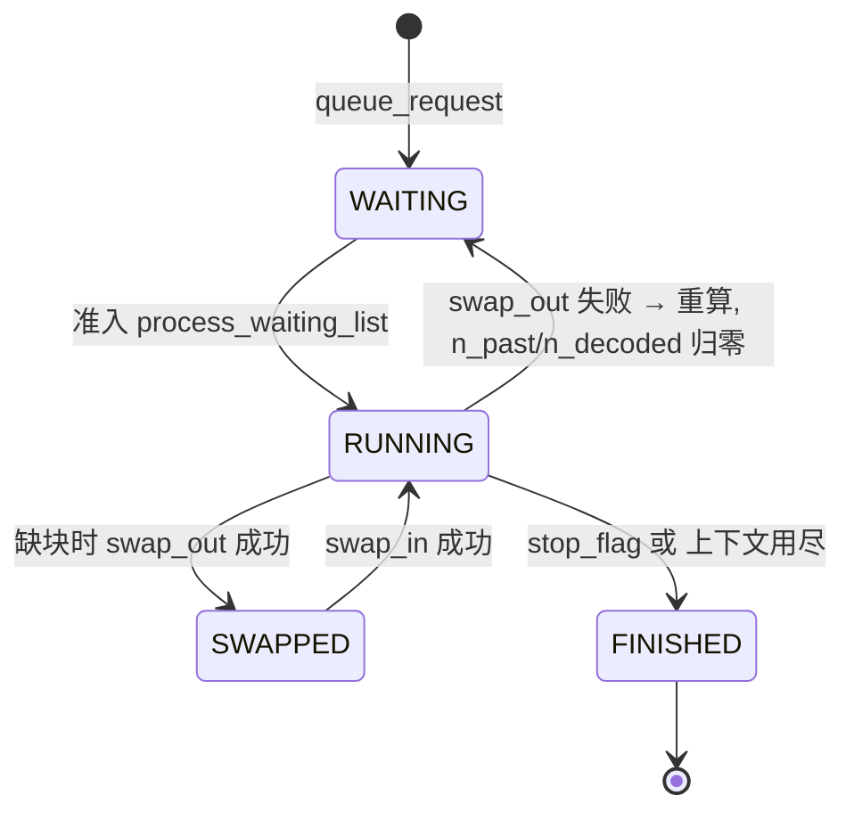
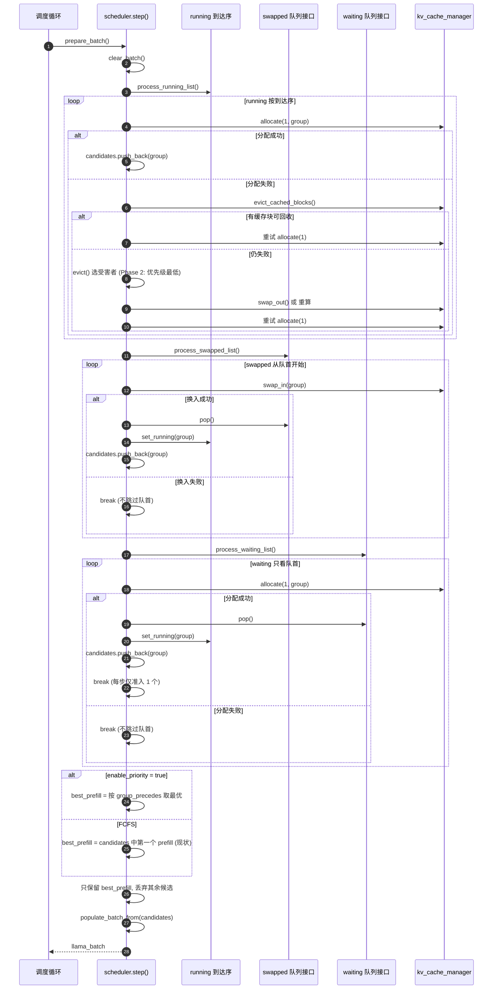
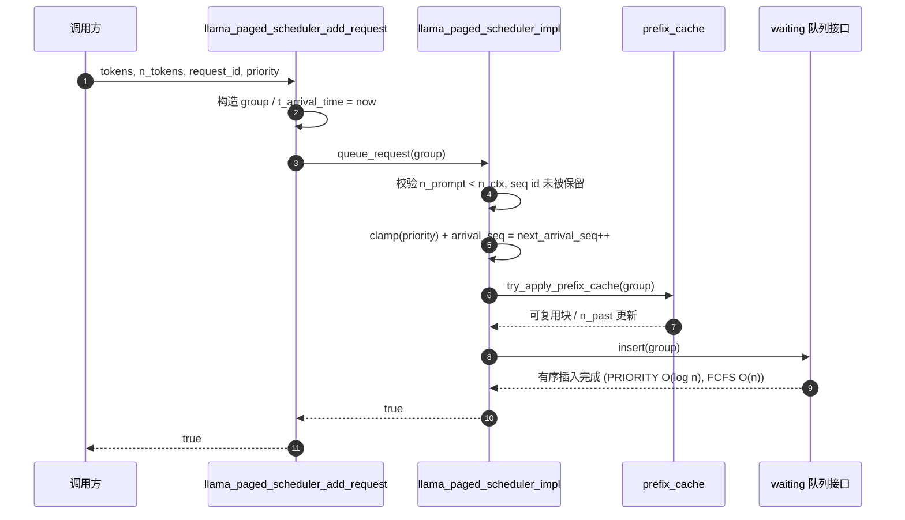
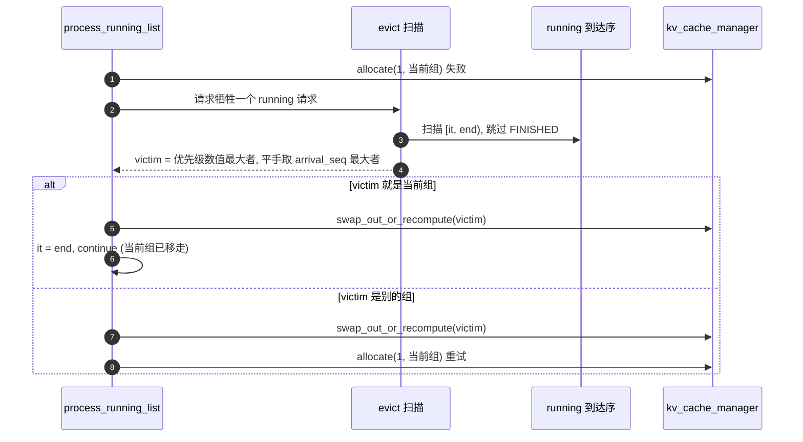

# Paged Scheduler 请求优先级设计

状态: 设计稿 v7 (2026-10-30)

调度语义基线: 严格队首 (与 vLLM 一致)。
优先级模式下队列按优先级排序，每步只看队首；**队首不满足条件就停止本队列的
调度，不越过它去处理后面低优先级/后到达的请求**。FCFS 同理: 先到的请求失败，
后到的也不处理。

双模式: `enable_priority = false` (默认) 时保持原有 FCFS 行为；`true` 时才按请求
优先级排序。两种模式共用同一套队列与调度流程，只有队列实现与排序/选择谓词不同。

适用范围: `llama-paged` / `-kvp` 路径下的 paged scheduler。
核心文件: `src/llama-paged-queue.h`、`src/llama-paged-scheduler-impl.{h,cpp}`、
`src/llama-sequence-group.h`、`src/llama-paged-scheduler.cpp`、`include/llama.h`。

---

## 0. 评审导览

### 0.1 版本变更

| # | 修改点 | 说明 |
|---|--------|------|
| 1 | 优先级语义 (v2) | 数值越小优先级越高，默认 0 (与 vLLM 一致) |
| 2 | 队首语义 (v3) | 队首失败即停，不越过它处理后面的请求 (与 vLLM 一致) |
| 3 | 双模式 (v4) | `enable_priority` 开关：`false` (默认) 保持原 FCFS，`true` 才按优先级排序 |
| 4 | 队列抽象 (v5) | `waiting` / `swapped` 封装成统一接口，**按策略二选一**: FCFS 用 `std::deque` + 按键有序插入 (pop O(1)、push O(n))、PRIORITY 用二叉堆 (O(log n))；容器形态对齐 vLLM 的 `FCFSRequestQueue` / `PriorityRequestQueue` |
| 5 | 评审修订 (v5) | 修正堆比较器方向 (最大堆要传反序谓词)；FCFS 保持现状 (按 `(t, seq)` 键插回原位、prefill 取第一个候选)；删除 `push_front`；修正用例期望值与引用勘误 |
| 6 | 文档可读性 | 增加状态机图、准入时序图、单步调度时序图、换出时序图 |
| 7 | 单一 API (v6) | `llama_paged_scheduler_add_request` 直接增加 `int32_t priority = 0` (C++ 默认参数)，去掉 `_with_priority` 与转发层；C 调用方需显式传第 5 个参数 |
| 8 | 队列容器 (v7) | PRIORITY 实现改用 `std::priority_queue`：元素所有权指针由 `unique_ptr` 改为 `shared_ptr`，`pop()` 先拷出 `top()` 再弹出 (`unique_ptr` 无法从 `priority_queue` 公开接口取出)；FCFS 实现不变 |

### 0.2 一句话方案

> 给请求加一个 `priority` 字段；把 `waiting` / `swapped` 封装成只暴露
> `push / peek / pop` 的队列接口，FCFS 用 `std::deque` (按到达键有序插入)、
> 优先级用 `std::priority_queue` (二叉堆，元素为 `shared_ptr`)；`running` 保持到达序
> `std::list`；`step()` 选 prefill 时，
> 优先级模式按比较器取最优、FCFS 保持"取 candidates 中第一个"的现状。
> 走哪套队列由 `enable_priority` 开关决定，默认关闭即原有 FCFS。

### 0.3 评审要点 (请重点看这几处)

| 位置 | 需要确认的事 |
|------|--------------|
| §1.1 | 优先级语义: 0 是默认值，负数表示更高优先级，正数表示更低优先级 |
| §3.1 | 队列接口设计: 5 个方法 (push/peek/pop/empty/size)，两套实现；FCFS 为什么按键有序插入；优先级队列为什么用 `std::priority_queue` + `shared_ptr`，比较器为什么必须取反序 |
| §5.2 / §5.3 | 队首失败即 `break`，不扫描后续请求 (vLLM 语义) |
| §4.5 | 双模式: `enable_priority=false` 保持 FCFS，`true` 才按优先级；默认 false |
| §5.4 / §5.5 | FCFS 下 prefill 仍取 candidates 中第一个；重算走普通 push 按键归位，不用 `push_front` |
| §5.6 | 逐出对象是否改为 "优先级最低者" (vLLM PRIORITY 模式也是这么做的)，以及候选集限定为 `[it, end)` |
| §8 风险 13 | 换出满块组再换入会越界的**既有缺陷**，与本方案耦合 |
| §11 | 待决策问题 (是否跳过队首已确定: 不跳过) |

### 0.4 改动文件一览

```text
新增 src/llama-paged-queue.h            队列接口 + 比较器 + deque / priority_queue 两套实现
改  src/llama-sequence-group.h          新增 priority / arrival_seq；组指针别名改为 shared_ptr
改  src/llama-paged-scheduler-impl.h    队列成员、比较器、开关、evict 签名
改  src/llama-paged-scheduler-impl.cpp  准入/换入/prefill/逐出 + 模式切换
改  src/llama-paged-scheduler.cpp       init 读取开关、add_request 增加 priority、seq_state
改  src/llama-cparams.h                 paged_priority 字段
改  src/llama-context.h / .cpp          访问器、cparams 拷贝、默认值
改  include/llama.h                     context_params.paged_priority、C API、seq_state
改  common/common.h                     enable_priority 字段
改  common/common.cpp                   common_params → context_params 映射
改  common/arg.cpp                      --enable-priority / --no-enable-priority (仅 paged 示例)
改  examples/paged/paged.cpp            透传开关、压测旋钮、结果打印优先级
改  examples/paged/README.md            语义说明与双模式
改  tests/test-paged-kv.cpp             make_fixture 开关 + 新增用例
不改 kv-cache / block-manager / prefix-cache / memory-hybrid / ggml-cann
```

---

## 1. 目标与范围

### 1.1 需求

允许调用方为每个请求指定优先级:

- 字段类型 `int32_t priority`，默认 **0**。
- **数值越小优先级越高，数值越大越晚被服务。**
  - `-10` → 高优先级 (紧急)
  - `0` → 默认
  - `10` → 低优先级 (后台)
- 优先级相同的请求按到达顺序处理 (先到先服务)。

因此队列排序键是:

```text
(priority ASC, t_arrival_time ASC, arrival_seq ASC)
```

其中 `arrival_seq` 是调度器在 `queue_request()` 里分配的单调递增序号，
用于消除同一微秒内到达时的排序歧义 (见 §2.2)。

> 约定提示 1: 本语义与 vLLM 的 `priority` 一致 (数值小者优先)，但与
> `ggml_sched_priority` (`common/common.h:72`，进程/线程优先级，0=normal..
> 3=realtime) **无关**。代码里统一叫 `request priority`，不要复用
> `ggml_sched_priority` 的类型与命名，也不要和 `--prio` 参数混淆。
>
> 约定提示 2: 语义方向容易写反，优先级方向只在 `group_precedes` 定义一次；堆的
> 反序谓词 `group_follows` 必须由它派生，其余地方一律复用；单测里必须同时覆盖
> 正数和负数优先级。
>
> 约定提示 3: **调度模式在初始化时决定，不由入队参数决定**。
> `enable_priority` (即 `llama_context_params.paged_priority`) 在
> `llama_paged_scheduler_init()` 时传入调度器并固定，之后不可切换；
> `add_request()` 的 `priority` 只是"每个请求的优先级值"，不是开关——
> FCFS 模式下传任何值都不会改变排队顺序。默认关闭，行为与现有 FCFS 一致
> (见 §1.4、§4.5)。

### 1.2 范围

1. `waiting` 与 `swapped` 封装成队列接口，按策略选择 deque / `std::priority_queue` 实现 (核心需求)。
2. 配套修正: 稳定 FIFO、prefill 选择、逐出对象选择。
3. C API 的 `llama_paged_scheduler_add_request` 增加 `priority` 参数 (C++ 默认 0)。
4. 双模式开关 `enable_priority`: 关闭时排序键退化为到达序，保持原 FCFS。

### 1.3 非目标 (v1 明确不做)

- 运行中抢占: 不因高优先级到来而暂停正在 decode 的低优先级请求。
  (逐出策略修正见 §5.6，它改变"内存不足时牺牲谁"，不是主动抢占。)
- 跨队列统一仲裁: `step()` 仍按 `running → swapped → waiting` 的固定阶段顺序
  (阶段顺序约束准入/换入/换出的先后；唯一例外是优先级模式下 §5.4 的 prefill
  选择会在已收集的 candidates 里跨阶段比较，FCFS 模式不跨阶段)。
- 优先级老化 / 公平性配额: 严格优先级，低优先级可以饥饿。
- 队首失败后的越队尝试: 队首放不下就本步不调度该队列，**不**为了"防止阻塞"
  去服务后面的请求 (vLLM 语义)。
- 优先级热更新: `priority` 在 `queue_request()` 之后只读。
- prefill/decode 相位仲裁: 优先级只在同一相位内比较。

这些限制必须在 README 中写明，不能暗示 "高优先级永远不会被延迟"。

### 1.4 兼容性承诺

`enable_priority = false` (默认，即原 FCFS):

- 排序键只有 `(t_arrival_time, arrival_seq)`；
- 准入 / 换入 / 逐出顺序与当前实现一致 (唯一差异: 同一微秒的平手由 LIFO 变为
  FIFO，属修复)；FCFS 队列按该键有序插入，所以换出/重算请求会插回原位；
- prefill 选择保持"取 candidates 中第一个"，与现状一致 (见 §5.4)；
- 传入的 `priority` 被忽略 (打一次 warning)；
- 现有单测与现有 C++ 调用方**源码不需要修改** (新参数有 C++ 默认值 0)；
  C 调用方与外部绑定需要显式补第 5 个参数 (见 §4.3)。

`enable_priority = true` 时才启用本文描述的优先级排序。

---

## 2. 现状与关键约束

### 2.1 队列与状态

三个队列 (`llama-paged-scheduler-impl.h:67-69`):

```text
running : std::list<unique_ptr<group>>    按 t_arrival_time 升序 (到达序)
swapped : std::list<unique_ptr<group>>    按 t_arrival_time 升序
waiting : std::list<unique_ptr<group>>    按 t_arrival_time 升序
```

> 注: 上面是本次改造**前**的基线。v7 起组指针别名
> `llama_sequence_group_ptr` 是 `std::shared_ptr<llama_sequence_group>`
> (为让 `std::priority_queue::top()` 拷贝得出元素，见 §3.1)，`running` 同样持有
> `shared_ptr`。`std::list<...>` 的形态与到达序语义不变。

状态机与队列迁移:



图中 `RUNNING --> WAITING` 的重算路径复用同一个 `llama_sequence_group` 对象，
所以 `priority` / `arrival_seq` 天然保留。

### 2.2 问题清单

看似只要换个比较器，实际有 6 个耦合点:

| # | 位置 | 现状 | 影响 |
|---|------|------|------|
| 1 | `impl.cpp:277` `insert_sorted_by_arrival_time` | 三个队列**共用**一个插入函数 | 直接改比较器会让 `running` 也变成优先级序，破坏 `evict()` 与 `curr_is_back` (见 §5.6) |
| 2 | `impl.cpp:280-287` | `lower_bound` 只比较 `t_arrival_time`；相等键会插到已有元素之前 | 相同时间戳当前是 **LIFO**，与 "先到先处理" 相反 |
| 3 | `impl.cpp:491-527` `process_waiting_list` | 只看队首，每步最多准入 1 个；分配失败即 `break` | "只看队首 / 失败即停" 是**期望语义，保留**；要改的是队首由"到达最早"变成"优先级最高" |
| 4 | `impl.cpp:472-489` `process_swapped_list` | 从头换入，失败即 `break` (注释写"尊重 FCFS") | 同上；注释与判据要改成"尊重队列排序键" (FCFS=到达序, PRIORITY=优先级) |
| 5 | `impl.cpp:99-107` `step()` | `find_if` 取 candidates 中第一个 `n_decoded==0` 的请求 | candidates 顺序是 running→swapped→waiting，先到者永远赢，优先级模式下队列内排序被打平 (FCFS 模式保留这一现状，见 §5.4) |
| 6 | `impl.cpp:394-406` `evict()` | 固定驱逐 `running.back()`，即**最新到达**的请求 | 晚到的高优先级请求一旦进入 running 就是队尾，缺块时先被牺牲 (优先级倒挂) |

另外两个既有行为 (v1 不改变，但必须知道):

- `step()` 顺序是 `running → swapped → waiting` (`impl.cpp:87-97`)，即
  **swapped 总是先于 waiting 拿到 GPU 块** (跨队列倒挂，见 §8 风险 6)。
- 只要 `waiting` 非空且准入成功，`step()` 就丢弃所有 decode 候选
  (`impl.cpp:99-107`)，prefill 优先于 decode。

---

## 3. 总体设计

### 3.1 队列抽象: 两个实现，一个接口

调度器对 waiting / swapped 只有三个动作: **压入、看队首、弹出队首**。把它们封装
到一个最小接口后面，两种策略各给一个实现；容器形态与 vLLM 的
`FCFSRequestQueue(deque)` / `PriorityRequestQueue(heapq)` 对应 (FCFS 的 push 端
有差异，见下)。

```cpp
// src/llama-paged-queue.h
class llama_paged_queue {
  public:
    virtual ~llama_paged_queue() = default;

    virtual void   push(llama_sequence_group_ptr g) = 0;        // 新请求 / 换出 / 重算
    virtual llama_sequence_group * peek() const = 0;            // 队首, 不转移所有权
    virtual llama_sequence_group_ptr pop() = 0;                 // 弹出并转移所有权
    virtual bool   empty() const = 0;
    virtual size_t size()  const = 0;
};

// 比较器与队列放在同一头文件, 调度器与队列共用同一份定义
inline bool group_precedes (const llama_sequence_group & a, const llama_sequence_group & b);  // 优先级序
inline bool arrival_precedes(const llama_sequence_group & a, const llama_sequence_group & b); // (t, seq) 到达序

std::unique_ptr<llama_paged_queue> llama_paged_queue_create(bool by_priority);
```

| 策略 | 实现类 | 底层容器 | 复杂度 |
|------|--------|----------|--------|
| FCFS (`enable_priority=false`) | `llama_paged_fcfs_queue` | `std::deque<llama_sequence_group_ptr>` + 按 `arrival_precedes` 有序插入 | push O(n)，peek/pop O(1) |
| PRIORITY (`enable_priority=true`) | `llama_paged_priority_queue` | `std::priority_queue<llama_sequence_group_ptr, std::vector<...>, group_follows>` + `shared_ptr` 元素 | push/pop O(log n)，peek O(1) |

接口只有 5 个方法，调度代码对两种策略**完全无感知**:

```cpp
// process_waiting_list
if (waiting->empty()) return;
llama_sequence_group * group = waiting->peek();
// ... try_apply_prefix_cache / allocate ...
if (!success) return;                        // 队首失败即停
candidates.push_back(group);
set_running(waiting->pop());

// process_swapped_list
while (!swapped->empty()) {
    llama_sequence_group * group = swapped->peek();
    if (!kv_cache_manager->swap_in(*group)) break;   // 队首换不进即停
    candidates.push_back(group);
    set_running(swapped->pop());
}
```

实现要点:

- **FCFS 不是简单的 `push_back`**: 新请求天然是最大键、落在队尾，但换出会把请求
  放进 swapped、重算会把请求放回 waiting，这两类请求的 `(t_arrival_time,
  arrival_seq)` 早于队列里已有的部分元素。纯 `push_back` 会让"后换出的旧请求"
  排到"先换出的新请求"后面，默认 FCFS 的准入/换入顺序就与现状不一致。因此 FCFS
  实现用 `std::lower_bound` 找到键位置插入，重算请求自动回到原位，**不需要
  `push_front`**。插入 O(n) (n 是并发请求数，几十到几百)，pop 仍是 O(1)。
  (vLLM 的 FCFS 队列只在尾部 append、抢占时 prepend，所以它的队列在抢占后并不
  严格按到达序；本实现选择按键插回原位，以保持 llama.cpp 现有行为。)
- **优先级实现用 `std::priority_queue` + `shared_ptr`**: `priority_queue::top()`
  只返回 `const_reference`、`pop()` 直接析构元素，所以**元素必须可拷贝**——
  组指针别名 `llama_sequence_group_ptr` 因此由 `unique_ptr` 改为
  `shared_ptr` (`src/llama-sequence-group.h`)。`pop()` 先拷贝 `top()` 取出一份引用，
  再 `pop()` 释放队列自己那份；`peek()` 直接 `top().get()` 借出裸指针。
  代价只是 `pop()` 路径上一次原子引用计数增减，group 本体 (3 个 `vector`)
  从不拷贝。这样容器形态也与 vLLM 的 `PriorityRequestQueue` 的 heapq 写法一致:

```cpp
// 堆比较器: priority_queue 的堆顶是"按 comp 的最大者"。
// 堆顶必须是 group_precedes 意义下最先服务的请求, 所以传入反序谓词。
struct group_follows {
    bool operator()(const llama_sequence_group_ptr & a, const llama_sequence_group_ptr & b) const {
        return group_precedes(*b, *a);
    }
};

std::priority_queue<llama_sequence_group_ptr, std::vector<llama_sequence_group_ptr>,
                    group_follows> queue_;

void push(llama_sequence_group_ptr g) override {
    queue_.push(std::move(g));
}

llama_sequence_group * peek() const override {
    GGML_ASSERT(!queue_.empty());
    return queue_.top().get();                   // 借出裸指针, 不转移所有权
}

llama_sequence_group_ptr pop() override {
    GGML_ASSERT(!queue_.empty());
    llama_sequence_group_ptr g = queue_.top();   // 先拷贝 shared_ptr
    queue_.pop();                                // 再释放队列持有的引用
    return g;
}
```

- **堆方向必须取反**: `std::priority_queue` 建的是"按 comp 的最大堆"。`group_precedes(a,b)`
  为真表示 a 更小、应先服务，所以"最大者"恰恰是**最后**被服务的请求；直接把
  `group_precedes` 作为比较器会得到完全反序的结果。必须用反序
  谓词 `group_follows` (等价于 `std::priority_queue<T, vector<T>, greater>` 取
  最小值的写法)，这与 vLLM `heapq` 的最小堆语义一致。
- **重算不使用 `push_front`**: 现有代码本来就没有 `push_front`——`set_waiting()`
  的位置由 `insert_sorted_by_arrival_time()` 按 `t_arrival_time` 隐式决定，重算
  请求因为键是旧的而自然回到原位。FCFS 队列和优先级队列都按键插入，普通 `push`
  就能复现这个行为；显式 `push_front` 反而会把重算请求插到更早到达的阻塞请求
  前面 (破坏 FCFS)，所以接口里不提供它。
- 队列在元素入队期间是唯一持有者 (`shared_ptr` 引用计数为 1，只在 `pop()` 瞬间
  临时变成 2)；`peek()` 返回裸指针，调度器在 `pop()` 之前不会把 group 移走。
  `id_to_group` 与 candidates 里保存的仍是裸指针，不参与引用计数。

这样不再需要 `std::multiset`、迭代器或 `extract()`；同一微秒的平手由
`arrival_seq` 决定 (FIFO)，与 `running` 的插入规则一致。

### 3.2 排序键

```cpp
// true 表示 a 应先于 b 被服务。只在 enable_priority=true 时使用。
// 约定: priority 数值越小越优先; 同优先级按到达先后。
inline bool group_precedes(const llama_sequence_group & a, const llama_sequence_group & b) {
    if (a.priority != b.priority) {
        return a.priority < b.priority;          // 小者优先, 不要写 a-b (int32 会溢出)
    }
    if (a.t_arrival_time != b.t_arrival_time) {
        return a.t_arrival_time < b.t_arrival_time;
    }
    return a.arrival_seq < b.arrival_seq;        // 全序的最后一维, 保证严格弱序
}

// 到达序: FCFS 队列的插入键、running 的插入键都用它。
inline bool arrival_precedes(const llama_sequence_group & a, const llama_sequence_group & b) {
    if (a.t_arrival_time != b.t_arrival_time) {
        return a.t_arrival_time < b.t_arrival_time;
    }
    return a.arrival_seq < b.arrival_seq;
}
```

- `group_precedes` 只用于优先级模式: 优先级队列、`step()` 选 prefill；堆比较器
  `group_follows` (仿函数) 是它的反序 (§3.1)。
- `arrival_precedes` 用于 FCFS 队列的有序插入和 `running` 的插入。同一微秒的
  平手由 `arrival_seq` (入队序号) 决定，因此是 FIFO 而不是现状的 LIFO。
- FCFS 模式下 `step()` 选 prefill 保持现状 (取 candidates 中第一个)，不调用
  `arrival_precedes`——见 §5.4 的说明。
- 保留 `t_arrival_time` 作为第一键，兼容现有单测用
  `group.t_arrival_time = request_id` 控制顺序的做法 (`tests/test-paged-kv.cpp:345`)。
- `arrival_seq` 由调度器分配、单调递增、永不复用，保证比较器是严格全序。
- 注: `t_arrival_time` 来自系统时钟 (见 §4.3 的单位修正)，极端情况下可能回跳；
  当前方案仍让 t 作第一键、`arrival_seq` 只做平手，是为了兼容现有测试的构造方式。
  若将来需要严格的"入队先后"，可把 `arrival_seq` 提为第一键 (会改变现有用例的
  `t_arrival_time = request_id` 写法)。
- 两个谓词定义在 `src/llama-paged-queue.h`，调度器与队列共用同一份，避免方向漂移。

### 3.3 队列形态

```text
waiting / swapped = llama_paged_queue (接口; 形态由 enable_priority 决定)

  FCFS (std::deque, 按键有序插入):
    [ 最早到达 ] [ ... ] [ 最新到达 ]     # (t_arrival_time, arrival_seq) 升序
      ^ peek / pop
  PRIORITY (std::priority_queue / 二叉堆):
    [ prio=-5, t=100, seq=7 ]  <- peek / pop (堆顶)
    其余元素之间没有顺序语义 (堆的内部排列)

running = std::list (到达序, 两种模式都不排序)
  [ seq=1 ] [ seq=3 ] [ seq=7 ] [ seq=9 ]
       ^ 最早到达                                    ^ 最新到达
```

### 3.4 单步调度时序



---

## 4. 数据结构与 API

### 4.1 `llama_sequence_group`

`src/llama-sequence-group.h`:

```cpp
struct llama_sequence_group {
    int32_t                     request_id = -1;
    llama_sequence_group_status status     = llama_sequence_group_status::PENDING;

    int64_t t_arrival_time   = 0;
    int64_t t_first_token_us = 0;

    // 请求优先级: 数值越小越优先, 默认 0。入队后只读。
    int32_t  priority    = 0;
    // 调度器在 queue_request() 内分配的单调入队序号, 仅用于同优先级 tie-break。
    uint64_t arrival_seq = 0;

    uint32_t n_prompt  = 0;
    // ...
};

using llama_sequence_group_ptr  = std::shared_ptr<llama_sequence_group>;  // 可拷贝, 供 priority_queue 取出
using llama_sequence_group_list = std::list<llama_sequence_group_ptr>;   // running 用
```

`llama_paged_queue` 及其两个实现放在 `src/llama-paged-queue.h`
(header-only，约 150 行)；`llama_paged_queue_create(bool)` 按策略返回对应实现。

### 4.2 调度器实现类

`src/llama-paged-scheduler-impl.h`:

```cpp
    llama_paged_scheduler_impl(uint32_t n_ctx, uint32_t block_sz, int32_t n_batch,
                               llama_kv_cache_paged * kv_manager,
                               llama_memory_hybrid_paged * hybrid_memory = nullptr,
                               bool priority_enabled = false);

    // running: 保持到达序 (evict / 分配顺序依赖该不变量)
    // 等价于按 arrival_precedes 有序插入
    void insert_sorted_by_arrival_time(llama_sequence_group_ptr g, llama_sequence_group_list & list);

    // 逐出: 只从 [from, end) 中挑 running 元素, 返回被逐出的对象 (可能为空)
    llama_sequence_group_ptr evict(llama_sequence_group_list::iterator from);

    const bool priority_enabled_;               // 构造后不可变
    uint64_t   next_arrival_seq = 0;            // 在 queue_request 内分配
    llama_sequence_group_list running;          // 到达序
    std::unique_ptr<llama_paged_queue> swapped; // = llama_paged_queue_create(priority_enabled_)
    std::unique_ptr<llama_paged_queue> waiting; // 同上
```

`group_precedes` / `arrival_precedes` 定义在 `llama-paged-queue.h` (§3.2)，
调度器和队列共用，不重复定义。

构造时按开关注入具体实现 (之后不可切换):

```cpp
llama_paged_scheduler_impl::llama_paged_scheduler_impl(uint32_t n_ctx, ..., bool priority_enabled) :
    priority_enabled_(priority_enabled),
    swapped(llama_paged_queue_create(priority_enabled)),
    waiting(llama_paged_queue_create(priority_enabled)),
    n_seq_max_ctx(n_ctx), ... {
}
```

`set_waiting` / `set_swapped` 退化为一行 `push` (重算也走这里):

```cpp
void llama_paged_scheduler_impl::set_waiting(llama_sequence_group_ptr g) {
    GGML_ASSERT(g && g->status != llama_sequence_group_status::WAITING);
    g->status = llama_sequence_group_status::WAITING;
    waiting->push(std::move(g));   // FCFS 按键插回原位; PRIORITY 按 key 重新入堆
}
```

注意: 两种队列的有序性都依赖排序键 (FCFS: `t_arrival_time` / `arrival_seq`;
PRIORITY: `priority` / `t_arrival_time` / `arrival_seq`)。`try_apply_prefix_cache`
只改 `n_past/n_prompt/block_table`，不碰这些键，所以 `peek()` 之后在元素仍留在
队列里时调用是安全的。

### 4.3 C API

`include/llama.h` (放在现有 `// Queueing and stepping.` 分组内，**只保留一个入口**):

```c
    // Queue a request. Lower `priority` values are served first (default 0;
    // negative values are higher priority). Requests with equal priority are
    // served in arrival order.
    // Priority only takes effect when the scheduler was created with
    // llama_context_params.paged_priority = true -- that mode is decided at
    // llama_paged_scheduler_init() time, not by this argument. Otherwise the
    // value is recorded but ignored.
    // The value is clamped to [-1000000, 1000000].
    //
    // C has no default arguments: C callers must pass `priority` explicitly
    // (pass 0). The default below only applies to C++ callers.
    LLAMA_API bool llama_paged_scheduler_add_request(
            struct llama_paged_scheduler * sched,
            const llama_token *            tokens,
            int32_t                        n_tokens,
            int32_t                        request_id,
            int32_t                        priority
#if defined(__cplusplus)
            = 0
#endif
            );
```

`src/llama-paged-scheduler.cpp`:

```cpp
LLAMA_API bool llama_paged_scheduler_add_request(
        struct llama_paged_scheduler * sched, const llama_token * tokens,
        int32_t n_tokens, int32_t request_id, int32_t priority) {
    if (!sched || !tokens) return false;
    llama_sequence_group group;
    group.request_id = request_id;
    group.n_prompt   = n_tokens;
    group.priority   = priority;             // 钳制与告警统一在 queue_request (§5.1)
    for (int i = 0; i < n_tokens; ++i) group.logical_seq.push_back(tokens[i]);
    group.t_arrival_time = ggml_time_us();   // 单位微秒, 原注释写 milliseconds 有误
    return sched->impl.queue_request(group);
}
```

要点:

- **模式与参数解耦**: 是否按优先级调度**只由初始化时的 `paged_priority`
  (`enable_priority`) 决定**，调度器构造完成后固定；`add_request` 的
  `priority` 参数不决定模式，FCFS 模式下传任何值都不会改变排队顺序
  (只会触发一次 warning)。
- **只保留一个 API 入口**，不再有 `_with_priority` 和转发层。C++ 调用方可省略
  `priority`；C 调用方必须显式传 (传 0)。
- 这是**源码/ABI 变更**。C++ 调用点因默认参数可以不改，但建议显式传值:
  - `src/llama-paged-scheduler.cpp:80` (warmup) → 传 `0`
  - `examples/paged/paged.cpp:85` → 传该请求的优先级 (关闭模式传 0)
  - `tests/test-paged-kv-e2e.cpp:145` → 传 `0`
  C 调用方与外部绑定 (ctypes/cgo 等) 必须同步补第 5 个参数 (C 没有默认参数)。
- 如果不想在 C 头文件里引入 `#if defined(__cplusplus)` 的默认参数，可以让
  `priority` 成为必填的第 5 个参数、所有调用点显式传 0 —— 更贴合 `llama.h`
  现有风格 (全头文件目前没有任何默认参数)。
- 优先级钳制与越界告警只在 `queue_request` 做一次 (公共 API 与直接构造 group 的
  调用方都会经过这里)，C API 包装层只负责赋值。

### 4.4 可观测性

把 `priority` 追加到 `struct llama_paged_seq_state` 末尾 (不改变已有字段偏移)，
并在 `llama_paged_scheduler_get_seq_state` 回填。性能脚本与单测都能通过公共
API 校验排序结果。

### 4.5 FCFS / 优先级双模式

需求: 优先级是**可选能力**，默认仍是原来的 FCFS。

#### 4.5.1 开关链路

完全复用 `kv_paged` 的既有链路 (`common_params` → `llama_context_params` →
`llama_cparams` → `llama_context` → scheduler):

```text
common_params.enable_priority = false            common/common.h  (靠近 kv_paged)
   │  CLI: --enable-priority                     common/arg.cpp, set_examples({LLAMA_EXAMPLE_PAGED})
   ▼
llama_context_params.paged_priority = false      include/llama.h  (放 kv_paged 旁边)
   ▼  cparams.paged_priority = params.paged_priority;
llama_cparams.paged_priority                     src/llama-cparams.h, src/llama-context.cpp
   ▼
llama_context::paged_priority()                  src/llama-context.h/.cpp (仿 block_size())
   ▼
llama_paged_scheduler_impl(..., priority_enabled)
```

CLI 选项 (与 `--kv-paged` 同风格):

```cpp
add_opt(common_arg(
    {"--enable-priority"},
    {"--no-enable-priority"},
    "order paged requests by priority (default: disabled, FCFS)",
    [](common_params & params, bool value) { params.enable_priority = value; }
).set_env("LLAMA_ARG_ENABLE_PRIORITY").set_examples({LLAMA_EXAMPLE_PAGED}));
```

命名注意: `--prio` 已被线程优先级占用，所以开关用 `--enable-priority`
(长选项，不设短选项)；`common_params` 里的字段按需求命名为 `enable_priority`。

另: `llama_context_params.paged_priority` 插在 `kv_paged` 附近会移动其后字段的
偏移；本仓库不承诺 C ABI (调用方应通过 `llama_context_default_params()` 初始化)，
若需要严格 ABI 兼容则追加到结构体末尾。

#### 4.5.2 行为矩阵

| 动作 | `enable_priority = false` (默认, FCFS) | `enable_priority = true` |
|---|---|---|
| waiting / swapped 顺序 | `(t_arrival_time, arrival_seq)` 键序 (`deque` 有序插入) | `(priority, t_arrival_time, arrival_seq)` (堆) |
| `add_request(..., priority)` | 接受请求，`priority` 被忽略，记一次 warning | 生效 |
| `step()` 选 prefill | candidates 中第一个 prefill (现状) | 优先级最高的 prefill |
| 逐出受害者 (§5.6) | 到达最新者 = `running.back()` | 优先级最低者 (平手取到达最新) |
| 队首失败即停 | 是 | 是 |

#### 4.5.3 实现要点

- **两个队列按策略二选一**: `waiting` / `swapped` 都是
  `std::unique_ptr<llama_paged_queue>`，构造时由
  `llama_paged_queue_create(priority_enabled)` 实例化:

  ```cpp
  // enable_priority = true  -> std::priority_queue, push/pop O(log n)
  // enable_priority = false -> std::deque, 按键插入 O(n) / pop_front O(1)
  waiting = llama_paged_queue_create(priority_enabled);
  swapped = llama_paged_queue_create(priority_enabled);
  ```

  调度代码只调用 `push / peek / pop`，对两种实现完全无感知。
- 两种模式**不复制调度逻辑**: `priority_enabled_` 只影响
  (a) 队列实现的选择、(b) 优先级模式下 `step()` 选 prefill 用 `group_precedes`
  (FCFS 保持 candidates 中第一个)、(c) 逐出受害者选择。
- 队列在构造时创建，运行期不可切换，调度器不提供修改接口。
- 关闭模式时 `priority` 字段仍然存在并被记录 (seq_state 里可见)，只是不参与排序。
- 默认 `false`，所以现有调用方 (example / e2e / 现有单测) 零改动。

### 4.6 与 vLLM V1 实现的对应关系

对照本地 vLLM 源码 (`vllm/v1/core/sched/request_queue.py`、`scheduler.py`):

| 方面 | vLLM V1 | 本方案 | 是否一致 |
|---|---|---|---|
| 默认策略 | `policy = "fcfs"` (`config/scheduler.py:109`) | `enable_priority = false` | 一致 |
| 策略开关 | `--scheduling-policy {fcfs,priority}` | `--enable-priority` | 形式不同，语义一致 |
| FCFS 队列 | `FCFSRequestQueue(deque)`，`append` / `popleft` (`request_queue.py:75`) | `llama_paged_fcfs_queue` (`std::deque` + 按键有序插入) | 容器与 pop 端一致；本实现 push 按键插入 (见 §3.1) |
| 优先级队列 | `PriorityRequestQueue` = list + `heapq`，键为 `Request.__lt__` = (priority, arrival_time, request_id) (`request_queue.py:131`, `request.py:305`) | `llama_paged_priority_queue` = `std::priority_queue` + `shared_ptr` 元素，键为 (priority, t_arrival_time, arrival_seq)，比较器 `group_follows` | 一致 (最小堆语义) |
| 准入 (waiting) | `peek_request()` 队首；`allocate_slots` 返回 None 即 `break` (`scheduler.py:773-780`) | `peek()` 队首；分配失败即 `return` | 一致 (严格队首) |
| running | `list[Request]`，按调度顺序 append，不按优先级排序 (`scheduler.py:168`, `826`) | `std::list`，到达序 | 一致 |
| 抢占受害者 | PRIORITY: `max(running, key=(priority, arrival_time))`；FCFS: `running.pop()` (`scheduler.py:474-499`) | Phase 2 用同一比较规则，候选集限定为 `[it, end)` | 规则一致；vLLM 会回滚已调度请求的记账，本实现用更保守的候选集 |
| 重算回队列 | `_preempt_request` 把请求 `prepend` 到 waiting (`scheduler.py:996`) | 按键插回原位 (FCFS) / 按 key 重新入堆 (PRIORITY) | 有意差异: 恢复到达序以保默认零回归 |
| priority 字段 | `Request.priority` 始终存在，FCFS 下不参与排序 (`request.py:73`) | `llama_sequence_group.priority` 始终存在 | 一致 |

差异说明 (均为实现层):

1. 容器形态与 vLLM 对齐: FCFS = deque，PRIORITY = 二叉堆 (`std::priority_queue`)。
   元素用 `shared_ptr` 而非 `unique_ptr`，因为 `priority_queue::top()` 只给 const
   引用、`pop()` 直接析构元素，只有可拷贝的智能指针才能"先拷贝再弹出" (见 §3.1)；
   比较器必须用 `group_follows` 才能得到与 `heapq` 相同的最小堆语义。
   FCFS 侧的 push 端有意不同: vLLM 只 append/prepend，本实现按
   `(t_arrival_time, arrival_seq)` 有序插入，以保持 llama.cpp 现有的
   换入/重算顺序 (见 §3.1)。
2. vLLM 的 waiting 循环除了 KV 不足以外，还有几处"跳过并放进 `skipped_waiting`"
   的情况 (请求处于 blocked 状态、LoRA 数量上限、远端 KV 未就绪，
   `scheduler.py:576-654`)。本 scheduler 没有这些状态，所以严格队首更简单。
3. vLLM 的堆删除靠 `_heap.remove + heapify` (O(n))；我们只做 pop 队首，
   不需要任意删除。

---

## 5. 调度流程改动

### 5.1 准入 `queue_request`

`src/llama-paged-scheduler-impl.cpp:129`:

- 钳制 `priority` 到 `[-1000000, 1000000]`，越界打一条 `LLAMA_LOG_WARN`。
- 在 `std::move(group)` 之前写入 `group.arrival_seq = next_arrival_seq++`。
  必须放在 `queue_request` 而不是 C API 包装层: 单测和未来的直接调用方都走这里。
- 其余逻辑不变 (上下文上限校验、保留 seq 校验、`try_apply_prefix_cache`)。



### 5.2 waiting 取用 `process_waiting_list`

`waiting` 现在是队列接口，`peek()` 就是本步的队首 (FCFS=最早到达，PRIORITY=
最高优先级)。**准入策略保持
现有语义不变**: 只看队首，队首分配失败就停，**不越过它去处理后面的请求**——与
vLLM 一致，也保持了现有 FCFS 的"先到的失败，后到的也不处理"。本方案只改变
"谁排在队首"，不改变"失败即停"。

原逻辑是 `while` + 三处 `break` (预算耗尽 / 分配失败 / 准入成功后立即退出)，
实际每步最多准入 1 个；改成直接看队首后语义更直白:

```cpp
void llama_paged_scheduler_impl::process_waiting_list(llama_sequence_group_raw_list & candidates,
                                                      int32_t remaining_token_budget) {
    if (waiting->empty()) {
        return;
    }
    // 队首: FCFS 为最早到达, PRIORITY 为最高优先级
    llama_sequence_group * group = waiting->peek();
    try_apply_prefix_cache(*group);              // 缓存可能已增长 (不改排序键)

    const int32_t chunk_tokens =
            std::min<int32_t>((int32_t) group->n_prompt, remaining_token_budget);
    if (chunk_tokens <= 0) {
        return;                                  // 预算耗尽
    }

    // 预留整段 prompt + 1 个 decode 槽, 本步只跑 chunk_tokens
    bool success = kv_cache_manager->allocate(1, *group);
    while (!success && evict_cached_blocks()) {
        success = kv_cache_manager->allocate(1, *group);
    }
    if (!success) {
        LLAMA_LOG_DEBUG("%s: head request_id=%d (prio=%d) is inadmissible, "
                        "stop scheduling waiting this step\n",
                        __func__, group->request_id, group->priority);
        return;                                  // 队首失败即停, 不跳过
    }

    candidates.push_back(group);
    set_running(waiting->pop());                 // 弹出并转移所有权
}
```

注意:

- 每步仍只准入 1 个 (原有行为)。
- 队首不可准入时本步不调度 waiting；已经收集到的 running/swapped 候选不受影响。
  若没有任何候选，`check_deadlock` 会返回 DEADLOCK (原有行为，不是新增)。
- 队首阻塞是**预期语义**，但日志要打出阻塞的 request_id / priority，便于定位
  "为什么后面的请求没动"。
- `chunk_tokens` 只决定本步跑多少 token，`allocate` 仍按整段 prompt 预留，
  分块 prefill 的既有语义不变 (prompt 超过 `n_batch` 时照常跨步切块)。
- 前缀缓存命中与优先级无关: 匹配发生在 `queue_request`/本函数入口，先到者先登记。

### 5.3 swapped 换入 `process_swapped_list`

`swapped` 是同一个队列接口，从队首 (FCFS=最早到达, PRIORITY=最高优先级) 开始换入。
**保持现有"换入失败即停"语义**：换不进来的队首会挡住后面的请求，这与现有 FCFS
的行为一致，也与 vLLM "队首分配失败即 break" 的规则一致；本方案只改变"谁排在
队首"。

```cpp
void llama_paged_scheduler_impl::process_swapped_list(llama_sequence_group_raw_list & candidates) {
    while (!swapped->empty()) {
        llama_sequence_group * group = swapped->peek();
        if (!kv_cache_manager->swap_in(*group)) {
            LLAMA_LOG_DEBUG("%s: head request_id=%d (prio=%d) cannot be swapped in, "
                            "stop swapping this step\n",
                            __func__, group->request_id, group->priority);
            break;                               // 队首换不进即停, 不跳过
        }
        candidates.push_back(group);
        set_running(swapped->pop());
    }
}
```

把旧注释 "We respect FCFS, so we stop here to prevent a younger swapped request
from jumping ahead" (`impl.cpp:480`) 改成 "按队列顺序换入；队首换不进来就停"。

### 5.4 prefill 选择

`step()` 目前取 candidates 中第一个 `n_decoded==0` 的请求 (`impl.cpp:99-107`)，
而 candidates 的顺序是 running(到达序) → swapped → waiting，在优先级模式下会
把队列内的优先级顺序抹平；在 FCFS 模式下这个位置序恰好就是要保留的现状。

因此按模式区分:

```cpp
llama_sequence_group * best_prefill = nullptr;
for (auto * g : candidates) {
    if (!g || g->n_decoded != 0) continue;
    if (!best_prefill || (priority_enabled_ && group_precedes(*g, *best_prefill))) {
        best_prefill = g;
    }
}
if (best_prefill) {
    candidates.clear();
    candidates.push_back(best_prefill);
}
```

说明:

- `enable_priority=false` 时保持"取 candidates 中第一个 prefill"，与现状逐字节一致；
  这是默认模式零回归的一部分。
- `enable_priority=true` 时在全部候选里按 `group_precedes` 取优先级最高者，覆盖
  running 里的分块 prefill (`n_decoded` 在分块期间保持 0)、刚换入的 prefill 和
  刚准入的 waiting prefill。
- 优先级模式下这一步确实跨越了 running / swapped / waiting 三个阶段做了一次选择；
  阶段顺序仍只约束准入/换入/换出 (§1.3)。FCFS 模式不跨阶段。
- FCFS 的位置序与"最早到达"在多数情况下相同，差异只出现在重算把旧请求放回
  waiting 之后 (见 §5.5)。这属于既有行为，本方案不改变。
- 这一步扫描的是 candidates 向量 (最多 = running + swapped + 1 个 waiting)，
  与队列实现无关；扫描成本是 O(k)，可以忽略。
- 仍保持 "只保留一个 prefill、丢弃全部 decode" 的既有相位规则 (§1.3)。
- candidates 内部顺序对 batch 语义是中性的 (`populate_batch_from` 与
  `derive_current_batch_data` 按位对应，消费者用 `batch.seq_id` 反查)。

### 5.5 换出 / 重算 `swap_out_or_recompute`

该函数 (`impl.cpp:351-392`) 复用同一个 `llama_sequence_group` 对象，因此
`priority` 与 `arrival_seq` 自动保留。重算回到 waiting 走普通的 `set_waiting`
(即 `queue->push`)，位置由排序键恢复:

- FCFS: deque 按 `arrival_precedes` 有序插入；请求的 `(t_arrival_time,
  arrival_seq)` 没变，自然回到原来的位置，一步内多次重算也不会互相插队；
- PRIORITY: 按 `group_precedes` 重新入堆，恢复原优先级位置。

不需要 `push_front`: 字面插到队首会把重算请求放到更早到达的阻塞请求之前，破坏
FCFS (vLLM 的 `prepend` 就是这样，本实现有意不同，见 §4.6)。

这是期望语义。

若重算后它仍然一次性拿不出全部块，本步 waiting 就不会再调度 (队首阻塞)。
这是与 vLLM 一致的严格队首语义，不是缺陷；但如果重算请求的 prompt 很大而
GPU 块又紧，表现出来就是整个 waiting 队列停摆，需要靠调优先级或增大块池解决
(见 §8 风险 9)。

### 5.6 优先级感知的逐出 (建议纳入 Phase 2)

**为什么必须处理**: `evict()` 固定驱逐 `running.back()` (`impl.cpp:401`)，
即"最新到达"。晚到的高优先级请求恰好就是 `running.back()`，于是它在内存压力下
会成为第一个被换出/重算的对象，优先级语义被反转。

vLLM 在 `PRIORITY` 模式下同样是按优先级选受害者
(`max(self.running, key=lambda r: (r.priority, r.arrival_time))`,
`scheduler.py:474-479`)，只有 FCFS 模式才用 `running.pop()` (尾部/最新，
`scheduler.py:499`)。
所以这一项不是"超出 vLLM 的增强"，而是与 vLLM 对齐的必要修正。

```text
running(到达序) = [ A(prio 0, seq 1), B(prio 0, seq 2), C(prio -10, seq 3) ]   # C 是高优先级

step N: 访问 A -> allocate 失败 -> evict_cached_blocks 无果
        -> evict() 取 back() = C (最高优先级!)
        -> A 重试 allocate 成功, 用掉 C 释放的块
        -> C 被 swap_out / recompute (n_past 归零, 已生成 token 白跑)
step N+1: C 换回 running, 仍是 back(); 下一次分配失败再次驱逐它
```



修复要求 (不能只改一行):

1. `evict()` 返回被逐出的对象，供调用方判断"被逐出的是不是当前组"。
2. 受害者只能从**尚未压入 candidates 的后缀** `[it, end)` 里挑。否则会把已进入
   candidates 的组换到 CPU，随后 `populate_batch_from` 用 CPU 块号
   (`>= n_gpu_blocks`) 计算 GPU 写槽，越界写 KV
   (`calculate_global_slot_index`, `impl.cpp:529`)。
3. 跳过 `status == FINISHED` 的组。
4. 受害者规则 (随模式变化):
   - `enable_priority = true`: **优先级最低者 (数值最大)；平手取到达最新者**；
   - `enable_priority = false`: 到达最新者 (= 现在的 `running.back()`)。
   `curr_is_back` 的位置判断 (`impl.cpp:437`) 必须换成对象身份比较
   (`victim.get() == group`；用 `request_id` 不可靠，`queue_request` 不拒绝重复 id)。
5. 顺手修换入容量 (见 §8 风险 13)。

```cpp
// 从 [from, end) 选受害者: 优先级最低(数值最大); 平手取最晚到达
llama_sequence_group_ptr llama_paged_scheduler_impl::evict(
        llama_sequence_group_list::iterator from) {
    auto victim = running.end();
    for (auto it = from; it != running.end(); ++it) {
        llama_sequence_group & g = **it;
        if (g.status == llama_sequence_group_status::FINISHED) continue;
        bool worse = (victim == running.end());
        if (!worse) {
            if (priority_enabled_ && g.priority != (*victim)->priority) {
                worse = g.priority > (*victim)->priority;        // 数值大 = 优先级低
            } else {
                worse = g.arrival_seq > (*victim)->arrival_seq;  // 平手 / FCFS: 取最晚到达
            }
        }
        if (worse) victim = it;
    }
    if (victim == running.end()) return nullptr;
    llama_sequence_group_ptr g = std::move(*victim);
    running.erase(victim);
    return g;
}
```

调用侧 (`process_running_list`, `impl.cpp:436-460`):

```cpp
if (running.size() > 1) {
    llama_sequence_group_ptr victim = evict(it);
    if (victim) {
        const bool victim_is_curr = (victim.get() == group);   // 指针比较: request_id 不保证唯一
        swap_out_or_recompute(std::move(victim));
        if (victim_is_curr) { it = running.end(); continue; }   // 当前组已被移走
        success = kv_cache_manager->allocate(1, *group);        // 换掉别人后重试
    }
}
```

兼容性: `enable_priority = false` 时规则退化为 "取到达最新者" = `running.back()`，
与现有行为一致；`enable_priority = true` 且所有请求优先级相同时同样退化为
`back()`。`back()` 永远在 `[it, end)` 里，候选向量不会被污染。唯一差异是
`FINISHED` 组不再可能被选中 (既有缺陷修复)。

补充:

- vLLM 的受害者候选集是整个 `running` (包括本步已经调度的请求，并回滚其 token
  预算与 block 记账)；本实现为避免 candidates 污染只看 `[it, end)`，因此选择
  结果可能与 vLLM 不同——这是有意为之的更保守策略。
- `process_running_list` 的**分配顺序**仍是 `running` 的到达序，优先级只影响
  "牺牲谁"，不影响同一 step 内谁先拿块。

---

## 6. 改动清单 (文件级)

```text
新增  src/llama-paged-queue.h
      llama_paged_queue 接口 + group_precedes / arrival_precedes +
      group_follows (priority_queue 的反序比较器) +
      llama_paged_fcfs_queue (deque, 按键有序插入) +
      llama_paged_priority_queue (std::priority_queue + shared_ptr 元素) +
      llama_paged_queue_create(bool by_priority)

改    src/llama-sequence-group.h
      新增 priority / arrival_seq 字段与默认值;
      llama_sequence_group_ptr 由 unique_ptr 改为 shared_ptr (供 priority_queue 取出)

改    src/llama-paged-scheduler-impl.h
      新增 priority_enabled_ / next_arrival_seq；
      构造函数新增 bool priority_enabled = false;
      waiting / swapped 成员改为 std::unique_ptr<llama_paged_queue>;
      set_waiting 去掉 front 参数 (重算按键自动归位);
      evict() 改为接收起点迭代器并返回被逐出对象;
      insert_sorted_by_arrival_time 改用 arrival_precedes (t, seq)

改    src/llama-paged-scheduler-impl.cpp
      queue_request: arrival_seq 分配 + priority 钳制
      set_waiting / set_swapped: 改为 queue->push
      process_waiting_list: peek 队首, 分配失败即 return, 成功 pop
      process_swapped_list: while peek -> swap_in -> pop, 队首失败即 break
      step(): PRIORITY 下 prefill 选择改为 group_precedes 最优 (FCFS 保持第一个)
      evict / process_running_list: 受害者选择随 priority_enabled_ 切换 (Phase 2)

改    src/llama-paged-scheduler.cpp
      init 时读取 ctx->paged_priority() 并传入 impl;
      llama_paged_scheduler_add_request 增加 int32_t priority 参数;
      同步更新 warmup / example / e2e 三处调用点; 修正 t_arrival_time 的单位注释;
      get_seq_state 回填 priority

改    include/llama.h
      llama_context_params 增加 bool paged_priority;
      新增 C API 声明 (含 "数值小者优先" 注释);
      llama_paged_seq_state 末尾追加 int32_t priority

改    src/llama-cparams.h
      增加 bool paged_priority

改    src/llama-context.h / src/llama-context.cpp
      增加 paged_priority() 访问器;
      ctor 里拷贝 cparams.paged_priority;
      llama_context_default_params() 增加默认值 false

改    common/common.h
      增加 bool enable_priority = false

改    common/common.cpp
      common_context_params_to_llama() 映射 cparams.paged_priority = params.enable_priority

改    common/arg.cpp
      新增 --enable-priority / --no-enable-priority (仅 LLAMA_EXAMPLE_PAGED)

改    examples/paged/paged.cpp
      透传 enable_priority; 新增优先级旋钮 (§7); 结果表打印优先级

改    examples/paged/README.md
      说明优先级语义、双模式开关与演示方法

改    tests/test-paged-kv.cpp
      新增 §9 的用例; make_fixture 增加 priority_enabled 参数 (默认 false)

不改  src/llama-kv-cache-paged.*, src/llama-block-manager.*,
      src/llama-paged-prefix-cache.*, src/llama-memory-hybrid-paged.*,
      ggml-cann*, llama-graph*, llama-model*
```

预估: Phase 1 约 180-220 行 (其中 queue 抽象约 80 行); Phase 2 约 120-180 行。

---

## 7. 配置与示例旋钮

调度器新增一个全局开关，其余仍由每个请求显式传入:

```text
--enable-priority            默认关闭 (FCFS); 打开后 waiting/swapped 按 priority 排序
                             等价 env: LLAMA_ARG_ENABLE_PRIORITY=1
                             对应 common_params.enable_priority
```

示例程序为了压测还需要两个旋钮，沿用 `LLAMA_PAGED_*` 风格 (inline `getenv` +
`atoi` 默认值)，**仅在开关打开时生效**。注意与开关区分: `LLAMA_ARG_ENABLE_PRIORITY`
是"是否启用优先级调度"，下面两个是"给请求赋什么值":

```text
LLAMA_PAGED_PRIORITY        默认 0    所有请求的基础优先级
LLAMA_PAGED_PRIORITY_STEP   默认 0    每个 seq 递减的步长:
                                     priority = base - seq_id * step
                                     (step > 0 时, 后到者优先级更高)
```

开关关闭时 `paged.cpp` 调 `add_request` 统一传 0 (或不传，走 C++ 默认值)，
避免出现 "传了优先级却不生效" 的困惑；若关闭模式下仍传了非 0 priority，
scheduler 记录一次 warning。

配合现有的 `LLAMA_PAGED_SEQ_DELAY_MS` (错峰到达) 构造演示:

```bash
# 打开优先级调度; seq 后到但优先级更高 (priority 依次为 0, -1, -2, ...)
LLAMA_PAGED_SEQ_DELAY_MS=50 LLAMA_PAGED_PRIORITY_STEP=1 \
  llama-paged -m model.gguf -kvp --enable-priority -ngl 100 -sm none -mg 0 \
              -ns 10 -np 10 -n 50 -b 512 -ub 512 -ngpub 500 -ncpub 100
```

对照实验: 去掉 `--enable-priority` (或 `LLAMA_ARG_ENABLE_PRIORITY=0`) 即为原 FCFS。

输出表增加一列 `priority`，并按优先级分组打印 TTFT 均值。
性能脚本可直接用 `--extra-env LLAMA_PAGED_PRIORITY_STEP=1` 驱动，无需改
`scripts/perf-paged-vs-unified.py`。

---

## 8. 正确性风险与对策

| # | 风险 | 场景 | 对策 |
|---|------|------|------|
| 1 | `running` 被一起改成优先级容器 | 若把 `running` 也换成优先级队列，`evict()` 的队尾语义、`process_running_list` 的分配顺序、`curr_is_back` 全部改变 | `running` 保持 `std::list` + 到达序；debug 断言 `(t_arrival_time, arrival_seq)` 升序 |
| 2 | 队首阻塞 (预期语义) | 高优先级大 prompt 排在 `begin()` 但块不够时，本步不调度该队列，后面的请求也不动；若没有任何候选，`check_deadlock` 返回 DEADLOCK | **有意为之** (vLLM 语义，保持现有 FCFS 的"先到失败则后到不处理")；不要把 `break` 改成 `continue`；日志打印阻塞队首的 id/priority；要避免阻塞只能调低其优先级或增大块池 |
| 3 | 比较器方向写反 (含堆的 min/max) | 语义是"数值小者优先"，容易写成 `>`；另外 `std::priority_queue` 的堆顶是 comp 意义下的**最大**元素，直接把 `group_precedes` 当比较器会整体反序。默认优先级全 0 的现有单测**不会发现**这两种错误 | 比较器只有 `group_precedes` 一份，堆用它的反序 `group_follows`；单测同时覆盖正数/负数优先级，并断言连续的完整 pop 顺序 |
| 4 | 相同时间戳的平手 | 没有 `arrival_seq` 时，同优先级、同 `t_arrival_time` 的请求顺序不确定 | `arrival_seq` 作为第三键；单测覆盖相等时间戳 |
| 5 | 逐出倒挂 | 晚到高优先级请求成为 `running.back()`，每次缺块先被牺牲 | §5.6 优先级受害者选择 |
| 6 | 跨队列倒挂 | swapped 整体先于 waiting 处理，低优先级 swapped 抢先占块 | v1 文档化；Phase 3 可选统一仲裁，或 "waiting 队首优先级更高且可准入时本步跳过 swapped" |
| 7 | 比较器溢出 / 非法值 | `a.priority - b.priority` 溢出会破坏严格弱序，堆的维护行为未定义 | 显式比较而非相减；`queue_request` 入口钳制到 ±1e6 |
| 8 | 优先级热更新破坏有序性 | 元素在堆里时直接改 `priority` 会让堆序失效，后续 push/pop 行为未定义 | v1 声明入队后只读；若要做，必须先 pop → 改值 → 重新 push |
| 9 | 重算重新入队 | 重算请求保留原 `arrival_seq`，回到 waiting 原位置；若它又放不下，本步 waiting 不调度 (队首阻塞) | 队首阻塞是预期语义；若确实需要，可加 `n_recompute` 让重算请求排到同优先级未跑过的请求之后 (这会偏离严格优先级，需要单独确认) |
| 10 | prefill 饿死 decode | 只要有 prefill，本步所有 decode 被丢弃；持续到来的高优先级 prefill 会无限推迟 decode | v1 声明优先级只在相位内生效；Phase 3 可比较两侧最优者后再决定相位 |
| 11 | 前缀缓存 / checkpoint 顺序副作用 | 准入顺序改变 → 完成顺序改变 → LRU 与 GDN checkpoint 槽归属改变，影响后续命中率 | 属预期副作用；性能对比需固定 workload 并注明 |
| 12 | 线程安全 | `arrival_seq++`、队列的 push/pop 都不是线程安全的 | 沿用现有契约: `add_request` 与 `prepare_batch` 必须同线程串行调用 |
| 13 | 换出满块组再换入越界 (既有缺陷，与优先级无关) | 当前组触发逐出时块表必然写满 (`n_past == block_table.size() * block_size`)；若受害者的块表恰好也在块边界 (它把最后一块用满，即 `n_past % block_size == 0`)，`swap_in` 只恢复同样块数、不额外分配，该组作为候选进入 `populate_batch_from`，`calculate_global_slot_index(n_past)` 得到 `block_table_id == block_table.size()`，命中 `GGML_ASSERT(false)` (`llama-paged-scheduler-impl.cpp:546`)。受害者是否在边界取决于它被换出时的位置 (约每 `block_size` 个 token 命中一次)，并非必然。现有单测从未真正跑通"换出→换入"，所以没暴露 | 做 §5.6 时同时修 `swap_in` 容量预留 (按 `n_past+1` 多分配 1 块) 或放宽断言；修复前 swapped 顺序只能用谓词/测试钩子验证 |
| 14 | 堆的 pop 实现写错 | `pop()` 必须先拷贝 `queue_.top()` 再 `queue_.pop()`；直接 `pop()` 会丢掉堆顶，先 `pop()` 再取 `top()` 则会取错元素 (且在空队列上调用 `top()` 是未定义行为) | 按 §3.1 的顺序实现；单测连续 pop 到空并校验顺序 |
| 15 | 运行期切换队列实现 | 队列对象在构造时创建；若中途替换实现，已入队元素会丢失或顺序错乱 | `waiting` / `swapped` 在构造函数里创建，不提供修改接口 |
| 16 | FCFS 队列退化成 `push_back` | 换出/重算会把旧到达的请求重新压入队列；`push_back` 会破坏到达序，默认模式的准入/换入顺序与现状不一致 (B 组评审发现) | FCFS 的 `push` 必须按 `arrival_precedes` 有序插入；单测覆盖"乱序压入后按键弹出"与"重算插回原位" |

---

## 9. 测试计划

### 9.1 单元测试 (`tests/test-paged-kv.cpp`)

前置条件 (不满足会让结论失真):

- `make_group` 增加可选第三参数 `int32_t priority = 0`，现有调用点源码兼容。
- `make_fixture` 增加可选参数 `bool priority_enabled = false`，透传给
  `llama_paged_scheduler_impl`。**优先级类用例必须显式传 true**；默认 false 的
  用例测的是原 FCFS 路径，正好覆盖双模式的兼容性。
- **排序类用例先调用 `fixture.sched->set_prefix_cache_enabled(false)`**:
  `make_group` 用相同 dummy token 1 填充 `logical_seq`，缓存开着时后入队的请求
  会命中前一个请求登记的前缀，`n_prompt/n_past` 被改写，块预算不稳定。
- `process_waiting_list` 每步只准入 1 个、`step()` 又只保留一个 prefill，因此
  排序类用例每步 `n_seq == 1`，可直接用 `batch.seq_id[0][0]` 读被服务者。
- 建议加 helper:

```cpp
static int32_t step_and_update(paged_test_fixture & f, bool stop) {
    llama_batch batch = {};
    EXPECT_TRUE(f.sched->step(batch) == llama_scheduler_status::OK);
    const auto * info = f.sched->get_curr_batch_info();
    const int32_t rid = (int32_t) batch.seq_id[0][0];
    std::vector<llama_token> tok(info->n_seq, 7);
    std::vector<int8_t>      flags(info->n_seq, stop ? 1 : 0);
    f.sched->update(batch, tok, flags.data());
    return rid;
}
```

- `finish()` 会 erase `id_to_group` (`impl.cpp:341`): 组在本步被回收后
  `get_group_from_id` 立即返回 nullptr。要断言 `FINISHED`，必须在 `update()`
  之后、下一次 `step()` 之前检查。

| 用例 | 构造 | 断言 | 目的 |
|---|---|---|---|
| `test_scheduler_priority_default_fcfs` | 3 个请求优先级全 0，`t_arrival_time` 递增 | 服务顺序 0,1,2 | 默认优先级回归 |
| `test_scheduler_fcfs_mode_ignores_priority` | `priority_enabled=false`；A(id0,prio 0) 先入队，B(id1,prio **-10**) 后入队 | 服务顺序 0,1 (优先级被忽略) | 双模式: 关闭时保持原 FCFS |
| `test_scheduler_arrival_seq_monotonic` | 以 id 10,11,12 入队，但 `t_arrival_time` 故意递减 300/200/100 | `arrival_seq` 严格递增且互不相等 | 抓"序号只在 C 包装层赋值"的错误 |
| `test_scheduler_priority_higher_admitted_first` | A(id0,prio 0) 先入队，B(id1,prio **-10**) 后入队 | 第一步服务 B；A 仍 WAITING 且 `n_past==0`；`n_seq==1` | 数值小的后到者超越 |
| `test_scheduler_priority_old_low_yields_to_new_high` | Low(id0,prio **5**,t=1) 先、High(id1,prio **0**,t=1000) 后 | 服务顺序 1,0 | 老到达但低优先级让位 |
| `test_scheduler_priority_equal_tie_break_fifo` | 同优先级且 `t_arrival_time` 相同；Part A 先入 id3 再 id1，Part B 反过来 | 各自按入队顺序服务 | 平手 FIFO |
| `test_scheduler_waiting_order_priority_then_arrival` | id 0..3，优先级 {**-5**, 0, **-5**, 0}，`t=id` | 服务顺序 **0,2,1,3** | 完整三键排序 |
| `test_scheduler_running_stays_arrival_ordered` | A(id0,prio 0) 先、B(id1,prio **-10**) 后，跑到两者都 decode | `n_seq==2` 时按 `batch_offsets` 取到 A 在前 | 抓 "把 running 也按优先级排序" 的错误 |
| `test_scheduler_priority_ordering_strict_total_order` | 比较器取 X(prio 0,t 5,seq 1)/Y(**-5**,9,2)/Z(**-5**,5,3)/W(**-5**,5,4) | 非自反、反对称、可传递，任意两者不等价 | 保证严格弱序 |
| `test_scheduler_recompute_preserves_priority_and_arrival_seq` | 小 `n_gpu_blocks` + 小 `n_cpu_blocks` 逼出重算路径 | 重算后 `priority/t_arrival_time/arrival_seq` 不变，`n_past/n_decoded` 归零并被重新准入，且在 waiting 中回到按键应在的位置 | 重算不改排名 |
| `test_scheduler_fcfs_prefill_uses_first_candidate` | FCFS；A 在 running 里分块 prefill 后被重算回 waiting，B 较晚到达并先进入 candidates | 选 candidates 中第一个 (B)，与改动前一致 | 锁死 §5.4 的 FCFS 零回归 |
| `test_scheduler_priority_head_blocks_lower` | 队首 prio **-10**、prompt 32 (需 3 块)，`n_gpu_blocks=2`；其后 prio 0、prompt 15 | 连续 `step()` 均为 DEADLOCK，Low 始终 WAITING 且 `n_past==0` | 钉住"队首失败即停、不跳过"的 vLLM 语义 |
| `test_scheduler_priority_eviction_victim` | 受害者选择抽成独立谓词，在到达序 A(prio **+10**)/B(prio **0**)/H(prio **-10**) 的合成 running 上，游标放在 B | 选 B；A 数值更大但在游标之前，必须跳过；同优先级取 `arrival_seq` 最大者；跳过 FINISHED | §5.6 的选择规则与候选集 |

说明: `test_scheduler_fcfs_mode_ignores_priority` 与
`test_scheduler_fcfs_prefill_uses_first_candidate` 的 fixture 传
`priority_enabled = false`，用来锁死双模式行为；其余用例都传 true
(`test_scheduler_priority_default_fcfs` 在两种模式下结果相同，可用 true 构造)。

swapped / waiting 的顺序现在**可以直接单测**，不需要测试钩子: `llama_paged_queue`
是独立对象，只有 push / peek / pop，测试可以直接驱动:

| 用例 | 构造 | 断言 |
|---|---|---|
| `test_paged_queue_fcfs_order` | `llama_paged_fcfs_queue` 依次 push id 0,1,2 | pop 顺序 0,1,2 |
| `test_paged_queue_fcfs_keyed_insert` | 乱序 push 到达键 2,0,1 | pop 顺序 0,1,2 |
| `test_paged_queue_fcfs_same_arrival_fifo` | 同 `t_arrival_time`，依次 push seq 1,2,3 | pop 顺序 1,2,3 (FIFO) |
| `test_paged_queue_priority_order` | 乱序 push P(id10,prio 2,t=100,seq1)/Q(id11,prio **-7**,t=200,seq2)/R(id12,prio **-7**,t=50,seq3)/S(id13,prio **-7**,t=50,seq4) | pop 顺序 12,13,11,10 |
| `test_paged_queue_priority_reinsert` | 重算请求重新 `push` (键未变) | 仍按 (priority, t, seq) 排序，不插到队首 |
| `test_paged_queue_empty_size` | push/pop 交替 | `empty()`/`size()` 一致；空队列由调用方先判空 |

**不要**用真实的 `swap_out`/`swap_in` 去端到端验证 swapped 顺序: 该路径本身有
一个既有崩溃 (见 §8 风险 13)，与优先级无关；排序语义已由上面的队列单测覆盖。

现有用例预期: 全部保持通过。

- `test_scheduler_deadlock_oversize_waiting_request` 在 Phase 1/2 下都仍是
  DEADLOCK (队列里只有它)。
- `test_scheduler_prefix_cache_hit/zero_suffix/eviction` 每次只入队一个等待请求。
- `test-paged-kv-e2e.cpp` 只入队 1 个请求，无法观测排序，保持不动。

### 9.2 端到端 / 性能

- 用 `examples/paged` + `LLAMA_PAGED_SEQ_DELAY_MS` + `LLAMA_PAGED_PRIORITY_STEP`
  做对照: `STEP=0` (全 FCFS) vs `STEP=1` (后到者优先)，对比两组请求的 TTFT 分布。
- 回归项: 默认优先级下输出应与改动前逐 token 一致；prefix cache 命中率不应下降。

### 9.3 建议加的断言

- `populate_batch_from` 中 (debug): 每个候选的所有 `block_table` 项必须
  `is_block_gpu(id)` 为真，抓"候选被换出后仍进入 batch"的回归。
- `process_running_list` 中 (debug): `running` 始终按 `arrival_precedes`
  (`(t_arrival_time, arrival_seq)`) 升序——前提是 `insert_sorted_by_arrival_time`
  也改用 `arrival_precedes` (只比较 t 的 `lower_bound` 在同微秒时是 LIFO)。
- `set_waiting/set_swapped` 中 (debug): `push` 后 `size()` 增加 1，`pop` 后减少 1，
  `empty()` 与 `size()` 一致。

---

## 10. 分阶段实施

```text
Phase 1  队列抽象 + 双模式开关 (需求本体)
         新增 src/llama-paged-queue.h (接口 + 比较器 + deque/priority_queue 两套实现)
         priority / arrival_seq 字段 + group_precedes / arrival_precedes / group_follows;
         llama_sequence_group_ptr 改 shared_ptr (priority_queue 的 pop 需要可拷贝元素)
         enable_priority 链路: common_params → context_params → cparams → scheduler
         waiting / swapped 改为队列接口 + queue_request 分配 arrival_seq
         C API 新入口 + 优先级模式的 prefill 选择
         验收: `enable_priority=false` 零回归 (原 FCFS, 含换出/重算顺序);
               `=true` 排序/平手/FIFO 用例通过

Phase 2  正确性补强
         evict() 优先级受害者 (返回 victim、限定后缀、跳过 FINISHED)
         swap_in 容量预留 (风险 13)
         debug 断言
         验收: 逐出倒挂 / 候选污染用例通过

Phase 3  可选增强
         跨队列仲裁 (swapped 让位给更高优先级 waiting)
         prefill/decode 相位仲裁
         基于进展的 liveness 检测 (替代仅看 swapped 计数的 livelock 判定)
         老化 / 公平性配额
```

---

## 11. 待决策

1. 是否把 §5.6 的逐出修正放进第一个可合入版本？
   不放进的话，"晚到的高优先级请求最先被牺牲" 依然成立，文档必须明说优先级
   只在准入/换入阶段生效。
2. ~~跳过不可准入的队首~~ —— 已确定: **不跳过**，队首失败即停 (vLLM 语义)。
3. 是否在 `llama_paged_seq_state` 里暴露 `priority`？(推荐暴露，便于测试。)
4. 是否需要运行期修改优先级？v1 建议不支持。
5. 优先级取值范围是否需要业务约束 (如只允许 0..255 或 -100..100)？
   当前方案按 ±1e6 钳制。
6. FCFS 模式下能否接受 "同一微秒到达的平手由 LIFO 变成 FIFO"？FCFS 队列按
   `(t_arrival_time, arrival_seq)` 有序插入、`running` 也用同一键，平手由入队
   序号决定，而原来的 `lower_bound` 只比较时间戳、对相等时间戳是 LIFO。属修复；
   若想严格保持现状，需要让插入谓词退回只比较 `t_arrival_time` (不推荐，且会让
   §9.3 的排序断言失效)。
7. ~~CLI 名称~~ —— 已确定: `--enable-priority` / `--no-enable-priority`
   (不设短选项，避免与 `--prio` 等冲突)。
8. 队列抽象放独立文件 `src/llama-paged-queue.h` 还是并入
   `llama-paged-scheduler-impl.h`？(推荐独立，便于单测)
9. ~~重算回队首是否需要 `push_front`~~ —— 已确定: **不需要**。FCFS 队列按
   `(t_arrival_time, arrival_seq)` 有序插入、PRIORITY 用堆，重算请求的键不变，
   普通 `push` 就会回到原位；字面 `push_front` 会插到更早到达的阻塞请求之前。
