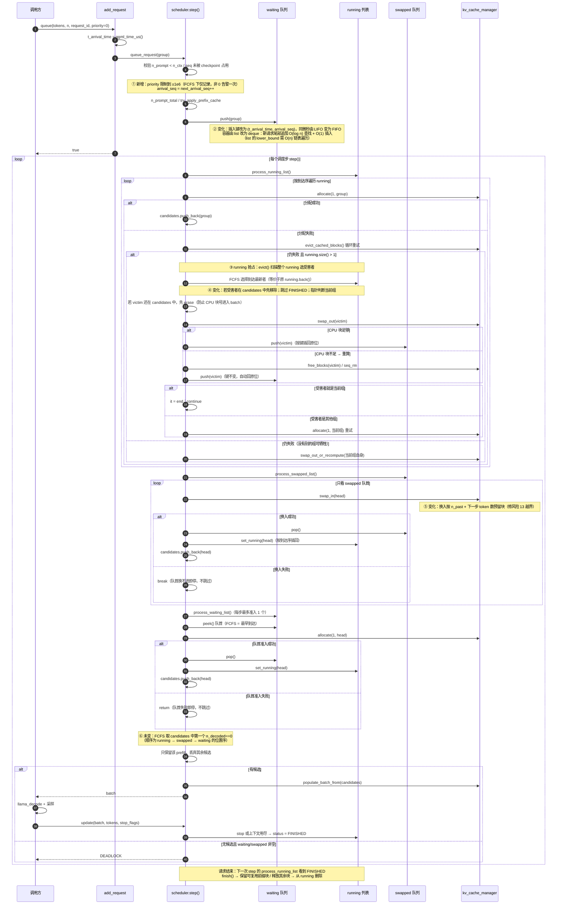
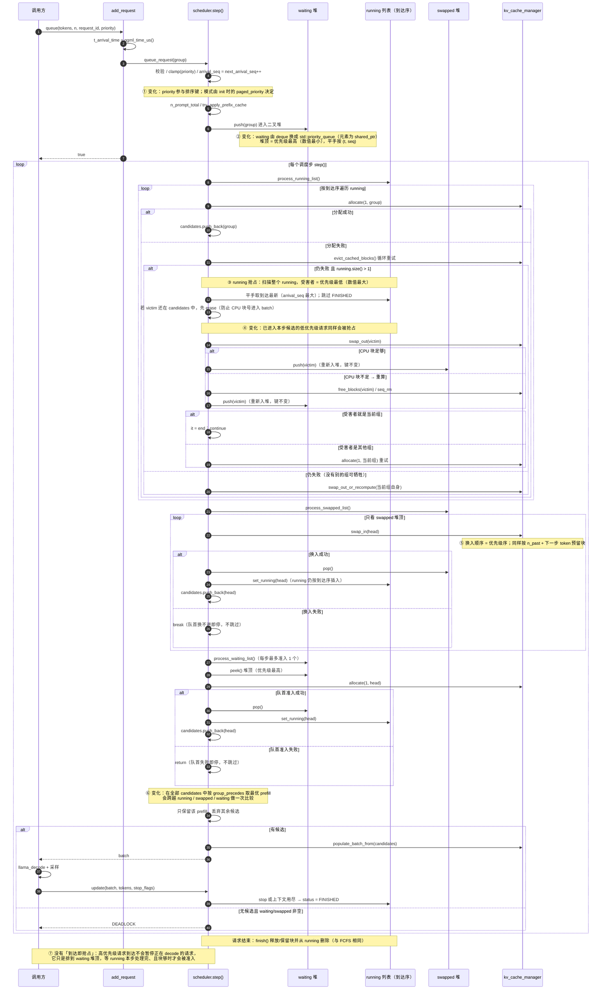

# Paged Scheduler 请求生命周期时序图（含 running 抢占）

状态: 与 `docs/schedule-priority.md` v7 及当前实现对应 (2026-10-30)

阅读前提:

- 本文的 **running 抢占** 指「KV 块不足时，从 `running` 里挑一个请求换出到 CPU 或退回重算」，
  即代码中的 `evict()` / `swap_out_or_recompute()`。
  它**不是**「高优先级请求一到就暂停正在 decode 的低优先级请求」——本实现没有这种主动抢占
  （见 `docs/schedule-priority.md` §1.3 非目标）。
- 图中 `①` `②` … 标记的是**与改动前代码不同**的位置，图后逐条解释。
- 未标记的步骤（严格队首、每步最多准入 1 个 waiting 请求、prefill 优先于 decode）保持原样。
- 一次 `step()` 处理一个调度步；下面的 `loop 每隔调度步` 会重复执行很多次，直到请求结束。
- 「抢占」发生在 `process_running_list()` 内部，先于 `process_swapped_list()`
  和 `process_waiting_list()`；因此本步被换出的请求可能在同一 step 的后续阶段被重新换入/准入。

---

## 1. FCFS 模式（`enable_priority = false`，默认）

排序键: `(t_arrival_time, arrival_seq)`；`running` 始终按到达序。



### 1.1 与改动前代码的差异点

| 标记 | 位置 | 改动前 | 改动后 | 为什么 |
|---|---|---|---|---|
| ① | `queue_request` | 只构造 group，`t_arrival_time` 由 C API 写入 | 增加 `arrival_seq = next_arrival_seq++`；`priority` 限制到 `±1e6`，FCFS 下非 0 只告警一次 | 需要稳定的第三排序键消除「同一微秒到达」的歧义；`priority` 字段在 FCFS 下也保留（seq_state 可见） |
| ② | waiting / swapped 容器 | `std::list` + `lower_bound` 只比较 `t_arrival_time`；相等时间戳插入到已有元素之前（**LIFO**） | `std::deque` + 按 `(t_arrival_time, arrival_seq)` 有序插入（**FIFO**）；pop 仍 O(1) | 平手顺序由新增的 `arrival_seq` 修复（与容器无关）；改用 `deque` 是性能选择：新请求总追加到队尾，`deque` 随机访问使 `lower_bound` 为 O(log n) + 尾部 O(1)，而 `list` 需 O(n) 链表遍历；中段插入两者都是 O(n)；另与 vLLM 的 `FCFSRequestQueue(deque)` 对齐 |
| ③ | `evict()` 扫描范围与候选集 | `evict()` 固定 `running.back()`，调用方用 `curr_is_back` 判断 | `evict()` 扫描整个 `running`；返回被逐出对象；若受害者已在 `candidates` 中，调用方先将其移除 | 早期实现为避免 CPU 块号进入 batch，把候选集限制为 `[it, end)`；但这会保护本步先拿到块的低优先级请求，造成一步内的优先级倒挂。现在改为显式移除候选：batch 在 `process_running_list` 之后才构建，移除后换出/重算依然安全 |
| ④ | 受害者判定 | 不跳过 `FINISHED`；位置判断 `curr_is_back` | 跳过 `FINISHED`；用 `victim.get() == group` 比较对象身份 | `FINISHED` 组本步会被回收，不应成为受害者；`request_id` 不保证唯一，不能用来比较 |
| ⑤ | `kv_cache_paged::swap_in` | 只按块表大小恢复同样数量的块 | 至少恢复到 `ceil((n_past + 下一步 token 数) / block_size)` 个块 | 满块组换出再换入后直接进入 batch，下一步写 token 时 `block_table[n_past / block_size]` 越界（§8 风险 13） |
| ⑥ | prefill 选择 | `find_if` 取 candidates 中第一个 `n_decoded == 0` | **保持原样**（仅改成等价的循环写法） | 锁死 FCFS 零回归：位置序就是原来的选择结果 |

> 关于容器选择：**FIFO 语义来自排序键 `(t_arrival_time, arrival_seq)`，不是来自 `deque`**，
> 换成 `list` 用同一比较器同样是 FIFO。选 `deque` 的理由是热点路径——新请求的键最大，
> 总是插到队尾：`deque` 支持随机访问，`lower_bound` 为 O(log n)，尾部插入摊还 O(1)；
> `std::list` 的 `lower_bound` 需要链表遍历到尾部，实际是 O(n) 次指针跳转。
> 换出/重算把旧键插回中间时，两者都是 O(n)（`deque` 搬移元素，`list` 遍历链表）。
> 此外 `deque` 分块连续存储，分配/缓存开销比每元素一个节点的 `list` 更小。

### 1.2 FCFS 下保持不变的行为

- waiting / swapped / running 的处理阶段顺序仍是 `running → swapped → waiting`。
- waiting 每步最多准入 1 个；swapped 从队首连续换入直到失败。
- 队首准入失败 / 换入失败即停，不越过队首服务后面的请求。
- 只要有 prefill 候选，本步所有 decode 候选都被丢弃（prefill 优先）。
- 逐出仍优先牺牲「到达最新」的请求；FCFS 下与原来的 `running.back()` 等价。
- 分配顺序仍是 `running` 的到达序，与优先级无关。

---

## 2. 优先级模式（`--enable-priority` / `paged_priority = true`）

排序键: `(priority, t_arrival_time, arrival_seq)`，数值小的优先级高。
`running` **仍然**按到达序，不按优先级排序。



### 2.1 与改动前（原 FCFS 实现）的差异点

| 标记 | 位置 | 原实现 | 优先级模式 | 为什么 |
|---|---|---|---|---|
| ① | `queue_request` | 只记录 `t_arrival_time` | `priority` 进入排序键；`arrival_seq` 仍是第三键 | 优先级数值小者先服务，同优先级退回到达序（与 vLLM 一致） |
| ② | waiting / swapped | `std::list`，按到达序 | `std::priority_queue` + `shared_ptr` 元素，比较器为 `group_precedes` 的反序 `group_follows` | 最小堆语义；`shared_ptr` 可拷贝，`top()` 后拷贝再 `pop()` 即可取出元素（`unique_ptr` 无法从 `priority_queue` 公开接口取出） |
| ③ | `evict()` 受害者 | 固定 `running.back()` = 最新到达 | 扫描整个 `running`：优先级最低者（数值最大），平手取 `arrival_seq` 最大；跳过 `FINISHED`；若受害者已在 `candidates` 中先移除 | 既修「晚到的高优先级请求恰好是 `back()`」的倒挂，也修「本步先拿到块的低优先级请求被保护」的倒挂。vLLM 同样会抢占已调度请求并回滚记账；本实现用「移除候选 + 真实换出/重算」达到同样效果 |
| ④ | 抢占语义 | 只影响「牺牲谁」 | 同上，但**不改变分配顺序**：同一 step 内谁先拿块仍按 `running` 到达序 | 优先级只影响逐出对象；被抢占的已调度请求会从本步 `candidates` 移除（batch 尚未构建，因此安全） |
| ⑤ | swapped 换入顺序 | 按到达序 | 按优先级序；换入容量预留与 FCFS 一致 | 本方案只改变「谁排在队首」，不改「换不进即停」 |
| ⑥ | prefill 选择 | candidates 中第一个 prefill（位置序） | 全部候选中 `group_precedes` 最优者 | 队列内排序在 `running → swapped → waiting` 拼接后会打平，必须在候选集合上重新比较 |
| ⑦ | 新请求到达 | 无主动抢占 | 无主动抢占 | v1 明确不做运行中抢占；高优先级只在准入/换入/逐出阶段生效 |

### 2.2 逐出倒挂示例（③ 的解释）

```text
running（到达序）= [ A(prio +10, 低), B(prio 0), C(prio -10, 高) ]
当前组 B 缺块，且 A 本步已经拿到块并进入 candidates

旧行为（候选集限定 [it, end)）：
        → 只能从 [B, C] 里选 → 牺牲 C（高优先级）
        → A 因为「本步已拿块」被保护 → 一步内的优先级倒挂

新行为（扫描整个 running + 移除候选）：
        → 受害者 = A（priority 数值最大）
        → 先把 A 从 candidates 移除，再换出/重算 → B 重试 allocate
```

为什么移除候选后是安全的：`populate_batch_from()` 在 `process_running_list()` 之后才根据
`candidates` 构建 batch。把 A 从 `candidates` 移除后再换出，A 的 CPU 块号不会进入本步 batch。

FCFS 模式下受害者仍是最晚到达者（等价于原 `running.back()`）；它通常不在 `candidates`
中，因此行为与之前一致。

### 2.3 优先级模式下仍然不变的语义

- waiting / swapped 的**阶段顺序**仍固定为 `running → swapped → waiting`；跨队列仲裁
  （例如「swapped 让位给更高优先级 waiting」）是 Phase 3，未实现。
- 严格队首：队首放不下 / 换不进就停，不跳过。高优先级请求也可能被前面的
  prefill 或队首阻塞延迟。
- waiting 每步最多准入 1 个；有 prefill 时本步所有 decode 候选被丢弃。
- `running` 不按优先级排序，同一 step 内的分配顺序仍是到达序。
- 优先级在 `queue_request()` 之后只读，不支持运行期修改。

---

## 3. 两种模式对照

| 环节 | FCFS（默认） | PRIORITY（`--enable-priority`） |
|---|---|---|
| waiting / swapped | `deque`，按 `(t, seq)` 有序插入 | `std::priority_queue`，按 `(priority, t, seq)` |
| 队首含义 | 最早到达 | 优先级最高（数值最小） |
| 准入 / 换入失败 | 即停，不跳过 | 即停，不跳过（相同） |
| prefill 选择 | candidates 中第一个 | candidates 中优先级最优 |
| running 顺序 | 到达序 | 到达序（相同） |
| 缺块时牺牲谁 | 到达最新者（= 原 `back()`） | 优先级最低者；平手到达最新 |
| 新请求到达是否抢占 | 否 | 否（相同） |
| 运行期切换模式 | 不支持 | 不支持（构造时固定） |
