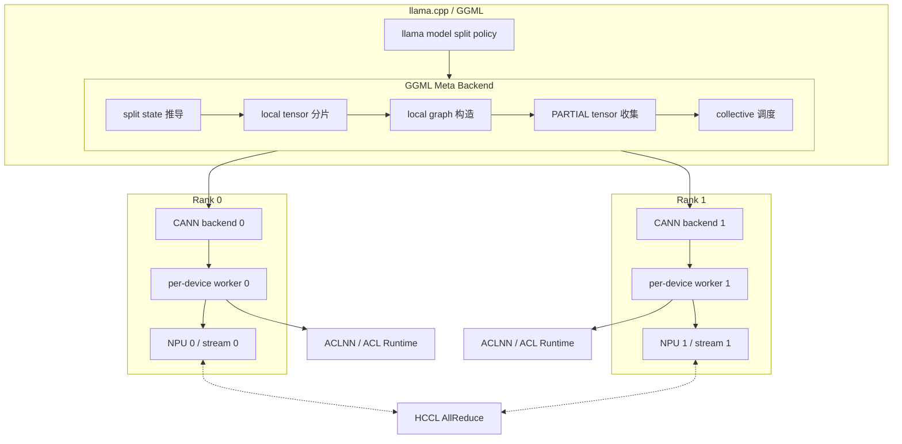
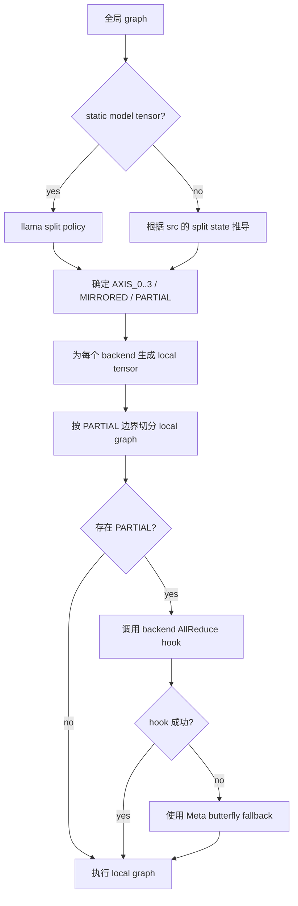
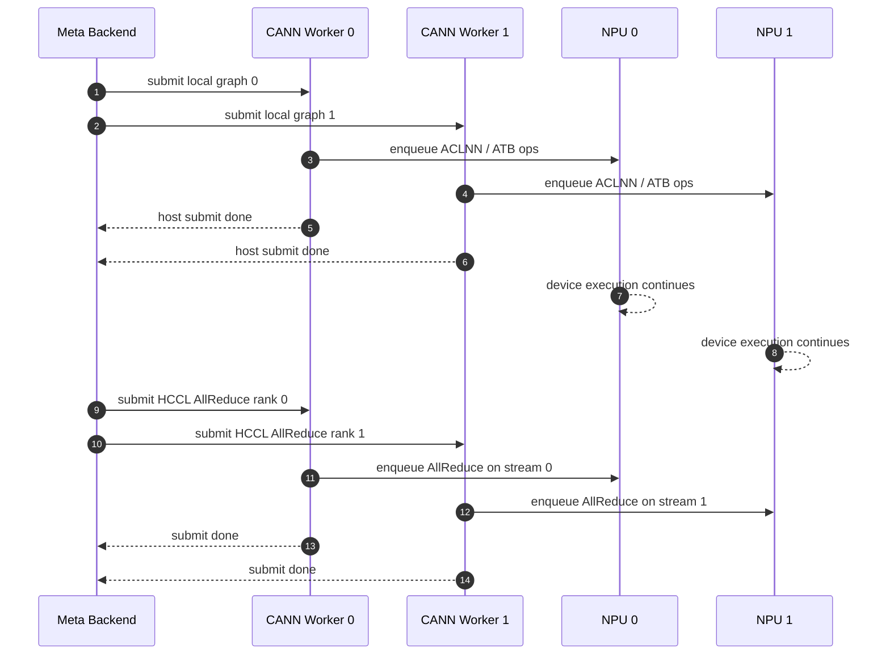
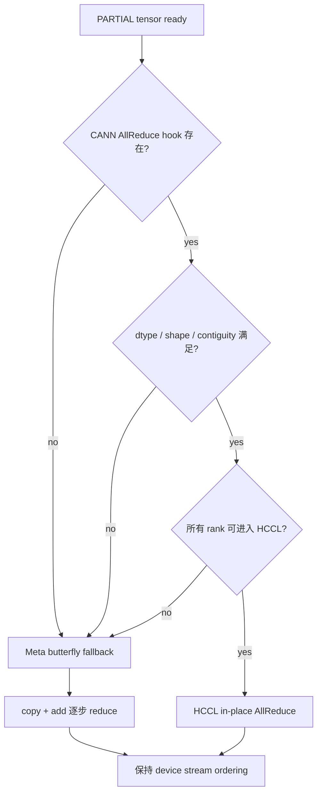
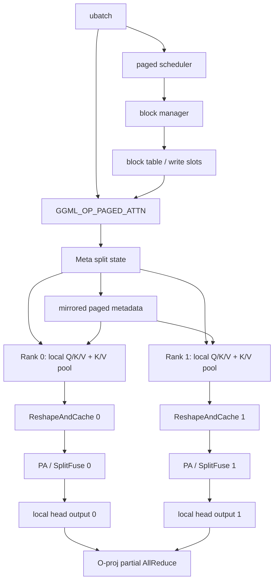
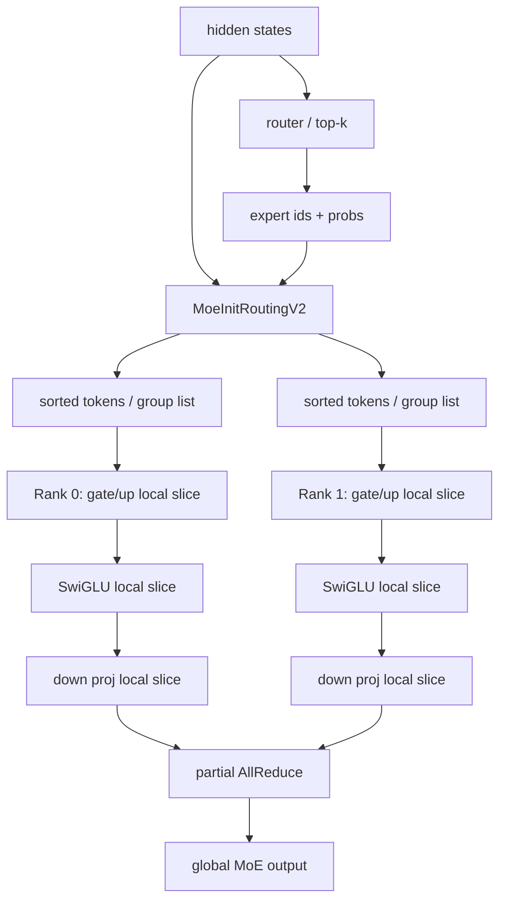
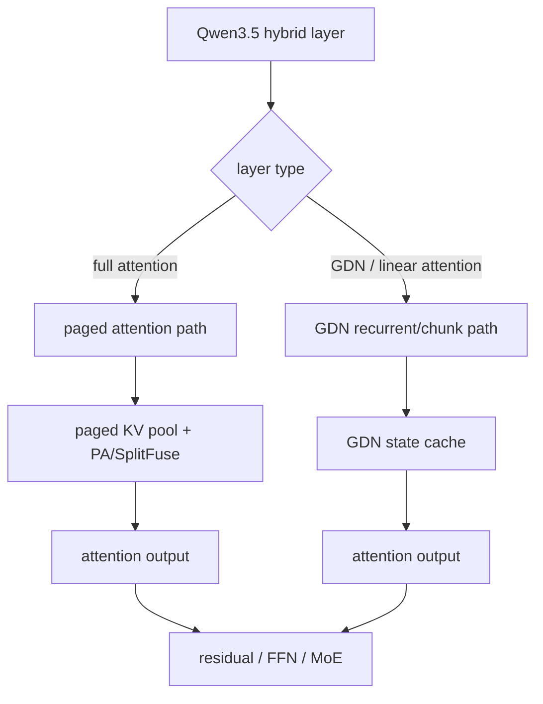

# llama.cpp CANN TP 综合设计

> 本文合并 `cann-tp-design.md` 的通用 TP 通信设计与 v4 310P-first 多线程重构方案，收敛为统一设计视图；不记录阶段性实现进度或实测数据。

## 1. 目标与边界

llama.cpp 的 CANN TP 目标是把多张 Ascend NPU 当作一个逻辑设备，支持 `--split-mode tensor`。本设计优先面向单机 2 x 310P，覆盖以下能力：

1. Meta Backend 通用 TP 切分与通信调度。
2. CANN 后端 per-device worker 和 HCCL AllReduce。
3. Paged attention + TP2。
4. Qwen3.5 / Qwen3.5 MoE 的本地 TP 推理。

本阶段不纳入：

1. 多机 TP。
2. MoE Expert Parallel。
3. 通用 ACL Graph capture/replay。
4. 4/8 卡的系统性验证。
5. FP16 之外的主流 TP 路径。

## 2. 总体架构



核心原则：

1. TP policy 在 llama.cpp / GGML 上层，不在 CANN kernel 内重复推导。
2. Meta Backend 负责切分、局部图、PARTIAL 传播和 collective。
3. CANN backend 只执行已经切好的 local tensor。
4. 多设备时每个 CANN backend/context 由一个专属 worker 独占。
5. HCCL AllReduce 使用 in-place 语义，通信后不做每步 host synchronize。

## 3. 设计范围

| 能力 | 阶段 | 说明 |
|---|---|---|
| Meta TP | MVP | split state、local graph、PARTIAL/collective |
| CANN per-device worker | MVP | 多设备启用，环境变量保留用于诊断 |
| HCCL AllReduce | MVP | F16/F32/BF16，in-place，设备 stream 有序 |
| Dense TP | MVP | 优先以 2 卡验证 |
| Paged attention TP2 | MVP | full attention 层的 paged KV + TP |
| MoE TP | MVP | TP weight slicing，非 Expert Parallel |
| GDN | 后置优化 | 使用 vendor fused path，性能策略单独设计 |
| ACL Graph | 后置 | capture/replay 与多设备调度单独设计 |
| 4/8 卡 | 后置 | 通信和拓扑单独验证 |
| 多机 | 后置 | 不在本阶段 |

## 4. Model split and Meta Backend

llama.cpp 使用通用 Meta Device 聚合多个 simple backend。模型加载时，`src/llama-model.cpp` 中的 `llama_meta_device_get_split_state()` 决定 tensor 如何切分：

1. Q/K/V/FFN 按对应维度切分。
2. KV cache 按 head 维度切分。
3. 大部分 bias、norm、router、meta 输入保持 mirrored。
4. `PARTIAL` 表示每卡有局部和，需要在层尾 AllReduce。

Meta Backend 不依赖具体硬件后端。它为每个 simple backend 生成 local graph，识别 PARTIAL tensor，然后调用后端通信 hook 或使用通用 butterfly fallback。

关键设计锚点：

1. `ggml-backend-meta.cpp` 负责 split state 推导、local graph 构造、AllReduce 调度。
2. `ggml-backend-meta.cpp` 需要 `GGML_OP_PAGED_ATTN` 的 split state 规则。
3. `ggml-backend-meta.cpp` 会探测 `ggml_backend_comm_init`、`ggml_backend_comm_free`、`ggml_backend_comm_allreduce_tensor`。
4. CANN backend 应注册这套通信 hook。

### 4.1 切分与局部图流程



### 4.2 关键数据结构与接口契约

#### 4.2.1 Meta split state

Meta Backend 对每个 tensor 使用统一的 split state 描述。CANN 侧只消费 Meta Backend 传入的 local tensor，不应直接读取该结构决定 kernel 行为。

```cpp
enum class SplitAxis {
    Axis0 = 0,
    Axis1 = 1,
    Axis2 = 2,
    Axis3 = 3,
    Mirrored = 10,
    Partial  = 11,
};

struct SplitState {
    SplitAxis axis;

    // axis >= Axis0 时:
    // [segment][device] -> 每个设备在该 segment 内的元素数
    int64_t ne[16 * MaxMetaDevices];

    // 每个 segment 重复的次数
    uint32_t nr[16];
    uint32_t n_segments;
};
```

Meta Device 的创建契约是：

```cpp
ggml_backend_dev_t create_meta_device(
    ggml_backend_dev_t * devs,
    size_t n_devs,
    SplitState (*get_split_state)(const ggml_tensor *, void * userdata),
    void * userdata);
```

#### 4.2.2 Backend communication hook

CANN backend 通过 registry proc address 暴露以下接口，供 Meta Backend 调用：

```cpp
void * cann_comm_init(ggml_backend_t * backends, size_t n_backends);
void   cann_comm_free(void * comm_ctx);
bool   cann_comm_allreduce_tensor(void * comm_ctx, ggml_tensor ** tensors);
```

对应的 proc address 名称为：

```text
ggml_backend_comm_init
ggml_backend_comm_free
ggml_backend_comm_allreduce_tensor
```

通信上下文建议至少持有：

```cpp
struct CannTpComm {
    std::vector<ggml_backend_t> backends;
    std::vector<int32_t>        device_ids;
    std::vector<HcclComm>       comms;
};
```

`comm_allreduce_tensor` 的契约：

1. `tensors[i]` 与 rank `i` 一一对应。
2. 所有 rank 的 dtype、element count、contiguity 必须一致。
3. inactive shard 先清零。
4. 支持 F32 / F16 / BF16。
5. 使用 in-place reduce。
6. 成功时只保证 collective 已按 device stream 顺序 enqueue，不做 host wait。

#### 4.2.3 CANN per-device worker

每个 CANN backend/context 拥有一个专属 worker。worker 可以用如下逻辑结构描述：

```cpp
struct CannTpWorkerJob {
    enum class Kind {
        Graph,
        Callback,
    } kind;

    ggml_cgraph * graph     = nullptr;
    void (*callback)(ggml_backend_t, void *) = nullptr;
    void * callback_arg = nullptr;

    bool       pending      = false;
    bool       submit_done  = false;
    ggml_status status = Success;
};

struct CannTpWorker {
    std::thread       thread;
    std::mutex        mutex;
    std::condition_variable cv;

    bool started = false;
    bool stop    = false;
    CannTpWorkerJob job;
};
```

worker 提交接口约定为：

```cpp
ggml_status submit_local_graph(ggml_backend_t backend, ggml_cgraph * graph);

void run_collectives_parallel(
    ggml_backend_t * backends,
    size_t n_backends,
    void (*fn)(ggml_backend_t, void *),
    void ** args);
```

语义约束：

1. graph 与 collective 都由绑定 device 的 worker 执行。
2. `submit_local_graph()` 返回时只表示 host-side submit done。
3. collective 提交必须在对应 rank 的 worker 上进行。
4. 禁止多个线程并发访问同一个 CANN backend/context。

#### 4.2.4 prefill/decode phase interface

ACL Graph 或 hybrid 模型不能只靠 graph shape 判断执行阶段，因此 backend 需要显式 phase 接口：

```cpp
void cann_backend_set_prefill(ggml_backend_t backend, bool prefill);
```

对应 proc address 建议命名为：

```text
ggml_backend_cann_set_prefill
```

#### 4.2.5 PagedAttention tensor contract

`GGML_OP_PAGED_ATTN` 的输入按 `src[]` 顺序约定：

| src | 内容 | TP 布局 |
|---|---|---|
| 0 | Q | local heads |
| 1 | new K | local KV heads |
| 2 | new V | local KV heads |
| 3 | K pool | local KV heads |
| 4 | V pool | local KV heads |
| 5 | block table | mirrored |
| 6 | write slots | mirrored |
| 7 | context lens | mirrored |
| 8 | batch offsets | mirrored |
| 9 | batch lens | mirrored |

op params 至少包含：

```cpp
struct PagedAttnParams {
    float scale;
    int32_t block_size;
    int32_t max_blocks;
};
```

Paged batch metadata 可以抽象为：

```cpp
struct PagedBatchMeta {
    int32_t * write_slots;     // [n_tokens]
    int32_t * block_table;     // [batch_size, max_blocks]
    int32_t * context_lens;    // [batch_size]
    int32_t * batch_offsets;   // [batch_size]
    int32_t * batch_lens;      // [batch_size]

    int32_t n_tokens;
    int32_t batch_size;
    int32_t max_blocks;
};
```

#### 4.2.6 MoE grouped path contract

MoE grouped path 的核心接口是：

```cpp
bool   cann_moe_grouped_supported(const ggml_tensor * dst);
void   cann_moe_grouped_compute(ggml_backend_cann_context & ctx, ggml_tensor * dst);
```

grouped path 需要满足以下张量契约：

1. expert weight 为 F16。
2. input 为 F32。
3. expert ids 为 I32。
4. weight、input、ids 的维度关系可路由。
5. weight / input 连续。

grouped path 内部至少产出：

```text
sorted_tokens   -- expert-major 排序后的 token 数据
group_list      -- 每个 expert 的 token 数或 cumulative token 数
grouped_output  -- expert-major 的 FFN 输出
row_inverse     -- expert-major 输出还原到 token-major 的索引
```

## 5. CANN per-device worker

多设备不能简单用同一个线程来回切 device。CANN runtime 的 OpExecCache 是线程级缓存，跨设备同线程执行容易命中错误缓存。因此本设计引入 per-device persistent worker。

设计要点：

1. 每个 CANN backend/context 独占一个 worker thread。
2. worker 启动时绑定自己的 device。
3. local graph compute 由 worker 执行。
4. collective 也在对应 device 的 worker 中提交。
5. worker 返回的是 host-side submission 完成，不是 device completion。
6. 后续 collective 和 graph op 依赖 device stream ordering，不额外 host synchronize。
7. 多设备默认启用 worker，`GGML_CANN_DISABLE_WORKER=1` 用于诊断。

worker 主要代码位于：

1. `ggml/src/ggml-cann/ggml-cann.cpp`
2. `ggml/src/ggml-cann/cann-worker.h`

### 5.1 Worker submission model



这里 `submit done` 表示 host 侧提交完成，不等待 NPU 计算完成。

## 6. HCCL 通信设计

本设计使用 HCCL 作为主通信路径。

### 6.1 communicator

`HcclCommInitAll()` 根据参与 TP 的 device list 创建每个 rank 的 communicator。单机场景下，device rank 与 backend 顺序一一对应。

### 6.2 AllReduce

`ggml_backend_cann_comm_allreduce_tensor()` 的行为：

1. 检查所有 rank 的 dtype、element count 和 contiguity。
2. 将 GGML dtype 映射到 HCCL dtype：F16/F32/BF16。
3. inactive shard 先清零。
4. 每个 rank 在自己的 device worker 中调用 `HcclAllReduce()`。
5. 使用 in-place AllReduce。
6. 不做 host synchronize，依赖 device stream ordering。

### 6.3 Communication path selection



### 6.4 Fallback path

Meta Backend 自带 butterfly fallback。如果 HCCL hook 不存在或失败，仍然可以退回通用路径。旧的 D2D Copy + Add 设计保留为后续 fallback 方向，主路径是 HCCL。

## 7. Paged attention + TP

### 7.1 Semantics

`GGML_OP_PAGED_ATTN` 负责一个 full attention 层的：

1. 新 K/V 写入 paged pool。
2. decode 或 prefill attention。
3. 输出 local head slice。

Qwen3.5 这类 hybrid 模型只有部分层使用 full attention。GDN/linear attention 层仍然走独立 recurrent 路径，不进入 `PAGED_ATTN`。

### 7.2 Meta split rules

规则如下：

1. Q/K/V/output 按 head 相关维度切分，即 `AXIS_1`。
2. K/V pool 按 `AXIS_2` 切分，对应 `n_heads_kv`。
3. block table、context lens、batch offsets、batch lens 等 metadata 全部 mirrored。
4. 所有输入都 mirrored 时，输出也 mirrored。

K/V pool 名称固定为：

```text
cache_paged_k_l%d
cache_paged_v_l%d
```

这样 Meta Backend 能稳定识别 paged KV cache。

### 7.3 CANN ATB path

`paged_attn.cpp` 使用 ATB：

1. `ReshapeAndCache` 写入新 K/V。
2. decode 使用 `PagedAttention`。
3. 无历史上下文的 prefill 使用 `SelfAttention`。
4. 带历史上下文的 prefill 使用 SplitFuse。
5. 每个设备维护独立 ATB context / workspace / op cache。

TP2 下必须 per-device 保存 ATB state，否则两张卡会复用同一个 ATB context/stream/workspace，导致卡死或错误。

### 7.4 Paged KV cache

`llama-kv-cache-paged.cpp` 维护：

1. 每 layer 的 K/V pool。
2. block manager。
3. block table。
4. sequence position。
5. GPU/CPU block swap。

`seq_rm()` 语义限定为整段 clear 和尾部截断，不支持中间区间删除。prefix cache 的状态 fork 只作用于 GDN state，paged KV 的 block sharing 由 paged scheduler 驱动。

### 7.5 Paged attention data flow



## 8. MoE TP

本设计采用 MoE TP weight slicing，不是 Expert Parallel。

### 8.1 Split method

1. `ffn_gate_exps` / `ffn_up_exps` 按 `AXIS_1` 切分。
2. `ffn_down_exps` 按 `AXIS_0` 切分。
3. router / bias / norm 等保持 mirrored。

这等价于把每个专家的 FFN 输出和输入维度分到不同 device 上，最后由 Meta Backend 做 partial reduce。

### 8.2 CANN path

MoE grouped path 使用：

1. `MoeInitRoutingV2` 完成 token-to-expert routing。
2. `GroupedMatmulWeightNz` 执行 NZ expert weight matmul。
3. 不满足 NZ 条件时退到 `GroupedMatmulV4`。
4. F16 expert weight 在加载后转成 NZ。

对应模块：

1. `ggml/src/ggml-cann/moe_ops.cpp`
2. `ggml/src/ggml-cann/moe_fused_ops.cpp`
3. `ggml/src/ggml-cann/weight_layout.cpp`

### 8.3 MoE TP data flow



### 8.4 设计约束

1. 没有做 Expert Parallel。
2. 没有 token-level allgather dispatch。
3. A3B 类模型的 MoE / GDN / TP 通信开销需要单独评估。
4. vLLM Ascend 310P 使用显式 allgather + expert 分发，与本方案的 TP weight slicing 不是同一种并行结构。

## 9. GDN / linear attention

Qwen3.5 是 hybrid 模型。GDN 层使用独立 recurrent/chunk path：

1. `LLM_FUSED_OP_GDN_AR`
2. `LLM_FUSED_OP_GDN_CH`

GDN 层采用 vendor fused GDN 路径。TP 下的 shape/communication 优化单独推进，是 decode 性能优化的重要方向之一。

### 9.1 Hybrid layer 路由



## 10. Graph 与 stream

### 10.1 ACL Graph

TP 模式下关闭 ACL Graph。原因：

1. 多设备 capture 语义复杂。
2. worker 与 graph capture 生命周期需要更严格的绑定。
3. paged attention 与 metadata 更新不宜直接进入 capture/replay。

后续目标是串行 capture + 并行 replay，并且把 paged attention 的 graph params 显式更新。

### 10.2 prefill/decode distinction

通过 `ggml_backend_cann_set_prefill()` 显式把 prefill/decode phase 传给 CANN backend，避免从 graph shape 猜测执行阶段。

### 10.3 Sync semantics

HCCL AllReduce 是 stream-ordered。collective 后不做 host synchronize。后续 local graph op 也提交到同一 device stream，因此顺序依赖由 stream 保证。

## 11. 验收与测试设计

验收以 correctness 为第一门禁，性能数据作为后续优化输入，不作为 MVP 阶段的唯一目标。

### 11.1 功能验收

1. 单卡 reference 与 TP2 logits 在预设误差内一致。
2. TP2 的 dense、MoE、paged full-attention 路径均可完成 prefill 和 decode。
3. paged metadata 在两个 rank 上一致。
4. GDN 状态与 paged KV 的生命周期互不破坏。
5. 连续运行无 hang、leak 或 nondeterministic failure。

### 11.2 性能观察项

1. prefill throughput。
2. decode aggregate tps。
3. TPOT。
4. TTFT。
5. AllReduce device time 和 arrival skew。
6. paged attention、GDN、MoE、copy/cast 的耗时占比。

## 12. 实施路线

### Phase 1: 稳定 2 x 310P TP

1. 固化 TP2 dense / MoE / paged smoke。
3. 建立单卡 vs TP2 logits 对照。
4. 明确最小 correctness gate。

### Phase 2: paged attention 优化

1. block size 从 16 对齐到 64/128。
2. 减少 metadata 拷贝。
3. 优化 Q/K/V cast/permute。
4. 验证 ATB workspace 复用。
5. 引入 profiling 时间线。

### Phase 3: MoE 性能

1. 对比 `GroupedMatmulWeightNz` 与 `npu_grouped_matmul`。
2. 评估 allgather dispatcher。
3. 评估 Expert Parallel。
4. 优化 router / sort / gather / cast。

### Phase 4: GDN 性能

1. 确认 GDN 在 TP local shape 下的最优 kernel。
2. 减少 GDN 输入输出 cast。
3. 对齐 vLLM 310P 的 recurrent/chunk 路径。

### Phase 5: 4/8 卡

1. HCCL communicator 泛化。
2. 非均匀 split 验证。
3. topology-aware benchmark。
4. cross-device transport 优化。

### Phase 6: Graph 与平台扩展

1. ACL Graph 串行 capture。
2. 并行 replay。
3. BF16 capability gate。
4. 910B / A2 验证。

## 13. Risks and mitigations

| 风险 | 影响 | 对策 |
|---|---|---|
| OpExecCache 线程级缓存 | 多设备失败 | 保持 per-device worker |
| 同一 CANN context 被多线程访问 | race | context/backend/stream 独占 |
| HCCL communicator 初始化差异 | 兼容性 | capability gate + fallback |
| cross-device copy 缺失 | transport fallback 受限 | 先保留 Host staging 方案 |
| local shape 不满足 kernel | TP 正确性 | FP16 dense 优先，逐层 dump |
| MoE TP 不等于 EP | 性能差距 | 后续评估 allgather / EP |
| paged block size 16 | PA kernel 效率低 | 对齐 64/128 |
| ACL Graph capture | TP 正确性 | TP 模式关闭，后置 |
| 非 host sync 后的依赖错误 | hang / 错值 | 依赖 stream ordering，禁止乱序提交 |

## 14. Differences vs vLLM Ascend 310P

| 维度 | vLLM Ascend 310P | 本方案 |
|---|---|---|
| Paged attention | `torch_npu._npu_paged_attention` / splitfuse | ATB `PagedAttention` / `SelfAttention` |
| KV layout | 合并 5D cache | 独立 K/V pool，NZ 视图 |
| TP | worker/rank，显式 parallel group | Meta Backend 单进程多 backend |
| MoE | allgather dispatcher + expert 分发 | TP weight slicing + grouped matmul |
| GDN | 310P 专用 recurrent/chunk kernel | vendor fused path，仍在收敛 |
| Graph | 更完整的 ACL graph / compile pass | TP 模式关闭 |

因此 vLLM 310P 不能作为 1:1 参考实现，但可以作为 block size、mask、MoE dispatch 和 graph pass 的参考方向。

## 15. 文件索引

| 文件 | 作用 |
|---|---|
| `src/llama-model.cpp` | 模型 tensor split policy |
| `ggml/src/ggml-backend-meta.cpp` | Meta TP、local graph、collective |
| `ggml/src/ggml-cann/ggml-cann.cpp` | CANN backend、worker、op dispatch |
| `ggml/src/ggml-cann/cann-comm.cpp` | HCCL communicator / AllReduce |
| `ggml/src/ggml-cann/cann-worker.h` | worker 接口 |
| `ggml/src/ggml-cann/paged_attn.cpp` | ATB paged attention |
| `ggml/src/ggml-cann/moe_ops.cpp` | grouped MoE path |
| `ggml/src/ggml-cann/weight_layout.cpp` | dense/expert weight NZ layout |
| `src/llama-kv-cache-paged.cpp` | paged KV cache |
| `src/llama-memory-hybrid-paged.cpp` | paged attention + GDN hybrid memory |
| `src/llama-context.cpp` | graph phase / paged KV placement |

## 16. 总结

本方案的核心是：

1. llama.cpp 继续持有 TP policy。
2. Meta Backend 继续负责切分和 collective。
3. CANN backend 提供 per-device worker、HCCL AllReduce、paged attention 和 grouped MoE。
4. 优先在 2 x 310P 上完成 correctness MVP。
5. 性能演进集中在 paged attention、MoE dispatch、GDN path 和 graph 层。
