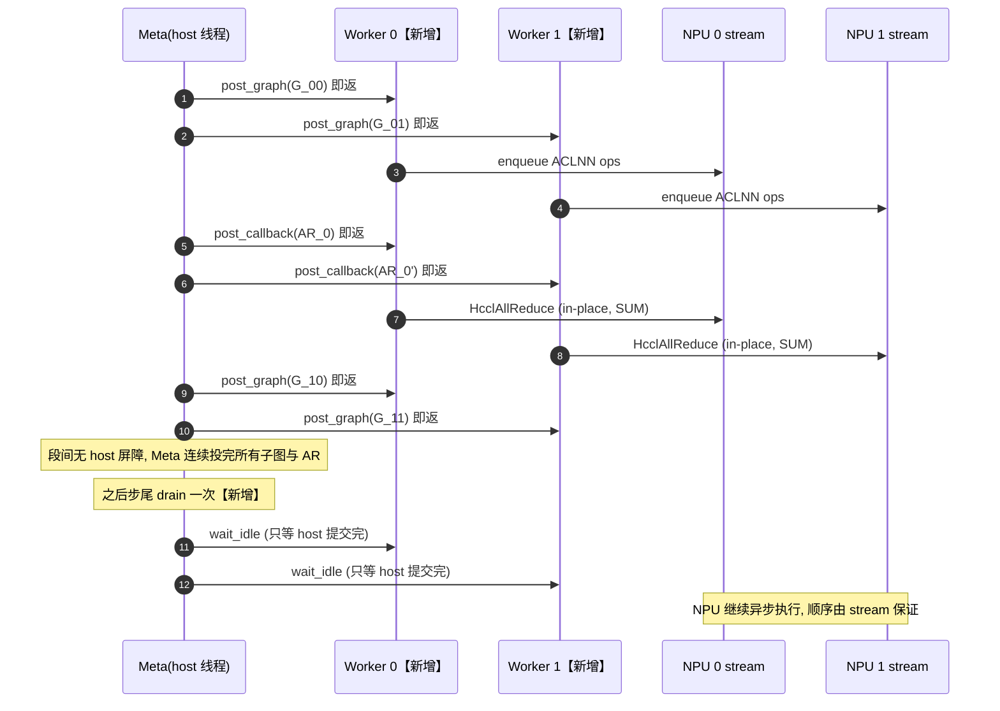
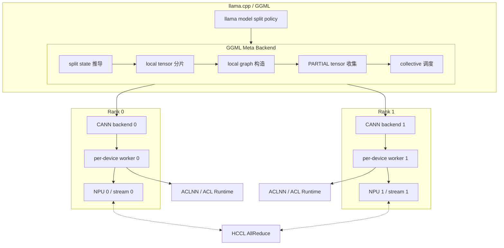
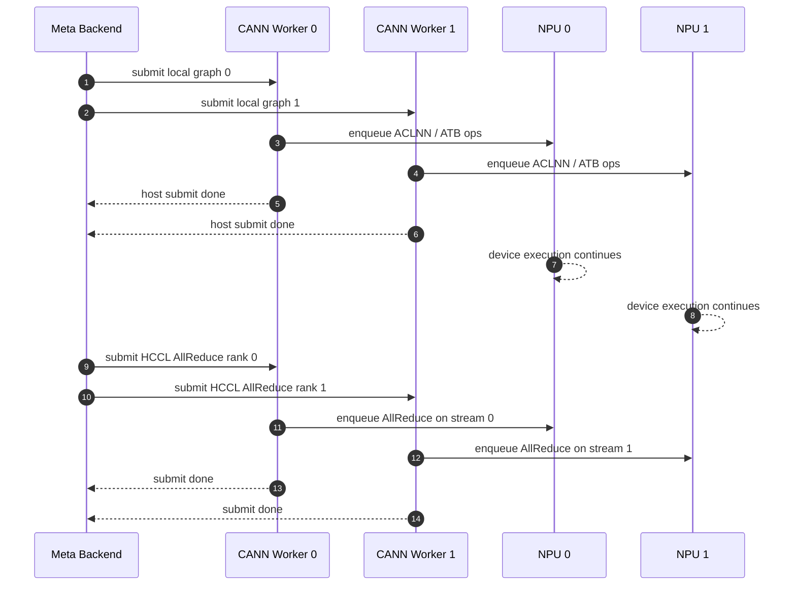

# llama.cpp CANN TP 实现方案（PR 增量视图）

> 本文描述本 PR（工作区 vs `develop` 基点 21015853c，净变更 30 个文件 +5449/-832，含
> 本目录 5 个文档；2026-11-10 `git diff HEAD --numstat` 实测，F16 cube 与 ubatch 映射代码已删）的
> **增量**实现逻辑：改了什么、为什么改、核心代码在哪。**11-10 起工作重心从 TP2 执行模型
> 转向 W8A8 路径适配（见 7.4）**，TP2 内容为既有增量。每节开头用一小段"存量背景"
> 交代基点已有逻辑（否则增量读不出上下文），新增核心内容用【新增】/【改造】/【修复】
> 着重标记，并标注**实现依据**：
>
> - `设计 X.Y` = 架构文档 [cann-tp-combined-design.md](cann-tp-combined-design.md) 的章节/条款，
>   正文中可直接点击跳转，章节级对照索引见 2.2；
> - `实现期` = 设计未涉及，实现过程中发现或补充的内容（偏离表之外的设计外增量）。
>
> 与架构文档的偏离在第 10 节集中列出。
>
> 链接约定：设计文档章节用 GitHub 风格标题锚（github.com 网页端点击直达对应章节；被引用标题
> 为英文，保证锚点为纯 ASCII，在 CLion/VS Code/远程开发下也可点击跳转）；
> 代码位置用 `文件名#L起-L止` 行锚（`../../` 指回仓库根目录；github.com 与 CLion 编辑器点击均可跳转，
> 但 CLion 不解析 markdown 文件的行锚，也不支持自定义 HTML 锚，只认标题锚）。
>
> 注：工作区代码曾带有 `[TP2-NOTE 提交前删除]` 标注的开发者注释（已于 11-10 全部删除，
> 共 86 处），其承载的上下文已沉淀进本文。

## 1. 增量总览

按变更性质分类（行数为 `git diff HEAD --numstat` 实测）：

| 性质 | 内容 | 量级 |
|---|---|---|
| 新增文件 | [`cann-worker.h`](../../ggml/src/ggml-cann/cann-worker.h)（per-device worker）、[`cann-comm.cpp/h`](../../ggml/src/ggml-cann/cann-comm.cpp)（HCCL 通信）、CMakeLists 链接 hccl | +427 |
| 新增机制：执行模型 | per-device worker、graph 三路径、步尾 drain、`wait_submit` proc | ggml-cann.cpp 内 TP2 部分 +407/-201 |
| 新增机制：W8A8/Q8 A8 适配（11-10 主线） | W8A8 专家 FRACTAL_NZ 原地转换+descriptor 缓存、Q8_0 专家重量化 A8、TP 切片到齐再上传、get_tensor NZ 反变换、NZ 专家图 eager 回退、F16 grouped 默认化 | ggml-cann.cpp 内 W8A8 部分 +281/-38，common.h helper |
| 新增机制：Meta TP 正确性 | PAGED_ATTN 切分规则、分页池切分接线、interleaved gather | meta.cpp +521/-51 |
| 新增机制：Paged 修复 | per-device ATB state、GDN 状态放置、context 同步补丁 | paged_attn.cpp +123/-108 等 |
| 新增机制：算子层 | NZ/V4 双算子、down NZ 门控、GDN GQA 头序重排、W8A8 pad、RMS 确定性分解 | aclnn_ops.cpp +359/-40 等 |
| 存量改造 | 通信 hook 惰性化、butterfly 保序、MoE anchor 适配 TP 边界、set_tensor_2d 加载快路径、split state 缓存失效 | 分散 |
| 存量删除 | piecewise 模式（约 -145 行）、`MoeTokenUnpermute` fused 路径 | N/A |
| 模型/内存接线 | 分页池命名与切分、meta 设备挂载、`v_conv` 物化、显存 margin | src/ 下 6 文件 +101/-7 |

不在本 diff 内的说明：设计文档 8.3 提到的 `GGML_CANN_MOE_QGMD`（int8 实验路线）基点与本 diff 均无引用 - 它是
未提交的演进中间态，router 一致性最终方案是"mirrored 冗余计算 + F32 kernel
确定性"（见 3.2）。**W8A8 算子本体同样在基点 HEAD 内、不在本 diff**：dense
`aclnnDynamicQuant`+`aclnnQuantMatmulV5`、grouped `MUL_MAT_ID`、`GGML_TYPE_W8A8`
与 ModelSlim 转换链（`convert_hf_to_gguf.py --outtype w8a8` + `conversion/modelslim.py`）、
test-backend-ops W8A8 用例；本 diff 只含其加载/切分/图门控侧适配（见 7.4）。

`tests/test-backend-ops.cpp` 与 `examples/paged/paged.cpp` 调试用例已回退，不在本 diff 内。

## 2. 全景：增量拼出的 TP2 执行模型

存量背景：基点已提供 split state 切图框架、PARTIAL 子图边界、comm hook **探测框架**
（但无后端实现，边界求和实际恒走 butterfly，见第 5 节）、butterfly 回退本身。本 PR 把
执行模型改造成：一卡一线程 worker + FIFO 投递 + 步尾 drain，并补上 HCCL 真实现。
Meta（host 线程）把图按 PARTIAL 边界切段，graph job 和 AllReduce callback job 按投递
顺序进各卡 worker 队列，设备 stream 天然保序：



两个关键语义（依据：[设计 4.2.3](cann-tp-combined-design.md#423-cann-per-device-worker)、[5.1](cann-tp-combined-design.md#51-worker-submission-model)、[10.3](cann-tp-combined-design.md#103-sync-semantics)）：

1. **post 即返**：Meta 投递 graph/collective 后立即返回，不等 NPU 算完，也不等 host
   提交完。两张卡的提交天然并行。基点没有 worker，graph 在 Meta 线程同步执行，不存在
   这个流水线。
 2. **wait_idle 只等 host，且每步只 drain 一次**：整个 step（一次 `graph_compute`）的
    所有子图和 AllReduce 都投递完毕后，Meta 才在步尾等各卡 worker 完成 host 提交
    （[meta.cpp:2904-2914](../../ggml/src/ggml-backend-meta.cpp#L2904-L2914)）。段与段之间
    host 不做任何等待。设备侧正确性依赖 stream ordering：本段 AllReduce 排在本段计算
    之后、下一段计算之前 - 这是架构文档 10.3 "不做 host synchronize" 的实现载体。
    与设计 4.2.3 条 2 单槽 per-call 确认的差异及安全性论证（sum vs max、单槽结构性
    不可行、生命周期重用点）见
    [验证报告 #13](1.md#13-fifo-队列--步尾批量确认-vs-单-job-槽-per-call-确认c)。

从 worker 视角看，两张卡队列完全同构：

```text
dev0 队列:  [G_00][AR_0][G_10][AR_1]...[G_n0]   -> NPU0 stream 按此序执行
dev1 队列:  [G_01][AR_0'][G_11][AR_1']...[G_n1]  -> NPU1 同构
```

### 2.1 增量代码地图（只列本 PR 变更区域，点击直达）

| 增量 | 位置 | 实现依据 | 说明 |
|---|---|---|---|
| PAGED_ATTN split 规则【新增】 | [meta.cpp:911-933](../../ggml/src/ggml-backend-meta.cpp#L911-L933) | [设计 7.2](cann-tp-combined-design.md#72-meta-split-rules)、[4.2.5](cann-tp-combined-design.md#425-pagedattention-tensor-contract) | Q/K/V AXIS_1、pool AXIS_2、元数据 MIRRORED |
| butterfly 保序【修复】 | [meta.cpp:2750-2756](../../ggml/src/ggml-backend-meta.cpp#L2750-L2756) | 实现期 | submit_sync 先排空 worker 的 host 提交（见 3.4） |
| interleaved gather【新增】 | [meta.cpp:1435-1484](../../ggml/src/ggml-backend-meta.cpp#L1435-L1484) | 实现期（[设计 4.2.1](cann-tp-combined-design.md#421-meta-split-state) 仅定义 nr 语义） | nr==2 双 VIEW + CONCAT 节点 |
| 缓存 snapshot 失效【新增】 | [meta.cpp:514-516](../../ggml/src/ggml-backend-meta.cpp#L514-L516) | 实现期 | 只比 data 前字段 + name |
| worker 结构 + FIFO【新增文件】 | [cann-worker.h:33-168](../../ggml/src/ggml-cann/cann-worker.h#L33-L168) | [设计 5](cann-tp-combined-design.md#5-cann-per-device-worker)、[4.2.3](cann-tp-combined-design.md#423-cann-per-device-worker) | job 队列、wait_idle、start/stop（见 4.2） |
| wait_submit + 步尾 drain【新增】 | [meta.cpp:2127-2144](../../ggml/src/ggml-backend-meta.cpp#L2127-L2144)、[2923-2934](../../ggml/src/ggml-backend-meta.cpp#L2904-L2914) | [设计 4.2.3](cann-tp-combined-design.md#423-cann-per-device-worker)、[10.3](cann-tp-combined-design.md#103-sync-semantics) | 缺 proc 退化为完整 synchronize（见 4.3） |
| worker 启用判定 + 三路径【新增】 | [ggml-cann.cpp:271-272](../../ggml/src/ggml-cann/ggml-cann.cpp#L271-L272)、[3965-4001](../../ggml/src/ggml-cann/ggml-cann.cpp#L3965-L4001) | [设计 5](cann-tp-combined-design.md#5-cann-per-device-worker)（判定有偏离，见偏离 #5） | 活跃设备>1；直跑/post 即返/post+wait 降级（见 4.4） |
| device 引用计数【新增】 | [ggml-cann.cpp:117-142](../../ggml/src/ggml-cann/ggml-cann.cpp#L117-L142) | 实现期 | g_cann_device_users，归零才 ResetDevice |
| TP 关 ACL Graph【新增】 | [ggml-cann.cpp:3736-3754](../../ggml/src/ggml-cann/ggml-cann.cpp#L3736-L3754) | [设计 10.1](cann-tp-combined-design.md#101-acl-graph) | `GGML_CANN_ACL_GRAPH_TP` 实验开关 |
| proc 注册【新增】 | [ggml-cann.cpp:4805-4855](../../ggml/src/ggml-cann/ggml-cann.cpp#L4805-L4855) | [设计 4.2.2](cann-tp-combined-design.md#422-backend-communication-hook)、[4.2.4](cann-tp-combined-design.md#424-prefilldecode-phase-interface) | wait_submit / set_prefill / comm 三件套 |
| 通信 hook 惰性化【改造】 | [meta.cpp:2147-2176](../../ggml/src/ggml-backend-meta.cpp#L2147-L2176) | [设计 4.2.2](cann-tp-combined-design.md#422-backend-communication-hook)（时机为实现决定） | 从构造期移到首次 graph_compute（见 5.1） |
| HCCL 生命周期 + AR【新增文件】 | [cann-comm.cpp:61-212](../../ggml/src/ggml-cann/cann-comm.cpp#L61-L212) | [设计 6.1](cann-tp-combined-design.md#61-communicator)、[6.2](cann-tp-combined-design.md#62-allreduce) | init/free/allreduce + callback（见 5.2） |
| per-device ATB state【修复】 | [paged_attn.cpp:49-118](../../ggml/src/ggml-cann/paged_attn.cpp#L49-L118) | [设计 7.3](cann-tp-combined-design.md#73-cann-atb-path) 条 5 | g_atb[设备号]，替换全局单例 |
| 分页池命名【新增】 | [llama-kv-cache-paged.cpp:71-74](../../src/llama-kv-cache-paged.cpp#L71-L74) | [设计 7.2](cann-tp-combined-design.md#72-meta-split-rules)（名称约定） | `cache_paged_(k|v)_l%u` 供 meta 识别 |
| 分页池切分规则【新增】 | [llama-model.cpp:388](../../src/llama-model.cpp#L388)、[537-547](../../src/llama-model.cpp#L537-L547)、[786-792](../../src/llama-model.cpp#L786-L792) | [设计 7.2](cann-tp-combined-design.md#72-meta-split-rules) | pattern + AXIS_2 + 头粒度 |
| GDN 支持探测【新增】 | [llama-memory-recurrent.cpp:20-49](../../src/llama-memory-recurrent.cpp#L20-L49) | [设计 7.1](cann-tp-combined-design.md#71-semantics)、[9 章](cann-tp-combined-design.md#9-gdn--linear-attention) | 决定 s 状态 NPU/CPU 放置 |
| worker 同步下沉【新增，替代框架补丁】 | [ggml-cann.cpp:122-125](../../ggml/src/ggml-cann/ggml-cann.cpp#L122-L125)、[2201-2214](../../ggml/src/ggml-cann/ggml-cann.cpp#L2201-L2214) | 实现期 | 注册表 + 排空助手，llama-context 还原纯净（见 6.4） |
| MoE anchor 重构 + ROUTER CHECK【改造】 | [moe_fused_ops.cpp:739-756](../../ggml/src/ggml-cann/moe_fused_ops.cpp#L739-L756)、[797-801](../../ggml/src/ggml-cann/moe_fused_ops.cpp#L797-L801)、[928-990](../../ggml/src/ggml-cann/moe_fused_ops.cpp#L928-L990) | 实现期（通用时序修复，方案无关） | anchor 以 router matmul 为主、hook 内联先算；softmax 锚防御回退；FULL_DEBUG 下 host 参考校验 |
| NZ/V4 双算子【新增】 | [moe_ops.cpp:346-358](../../ggml/src/ggml-cann/moe_ops.cpp#L346-L358)、[moe_fused_ops.cpp:242-252](../../ggml/src/ggml-cann/moe_fused_ops.cpp#L242-L252) | [设计 8.2](cann-tp-combined-design.md#82-cann-path) 条 2/3 | NZ->WeightNz，ND->V4 |
| down NZ 门控 + 熔断【新增】 | [weight_layout.cpp:138-141](../../ggml/src/ggml-cann/weight_layout.cpp#L138-L141)、[aclnn_ops.cpp:4518-4526](../../ggml/src/ggml-cann/aclnn_ops.cpp#L4518-L4526) | 实现期（[设计 8.2](cann-tp-combined-design.md#82-cann-path) 条 4 的细化） | 双融合开关；NZ 进 IndexSelect 直接 abort |
| GDN GQA 头序重排【新增】 | [aclnn_ops.cpp:5725 起](../../ggml/src/ggml-cann/aclnn_ops.cpp#L5725) | 实现期 | 修 develop 合并后 4.9x/2.1x 回退 |
| set_tensor_2d 快路径【新增】 | [ggml-cann.cpp:2430-2530](../../ggml/src/ggml-cann/ggml-cann.cpp#L2430-L2530) | 实现期 | host 攒批，down_exps 加载 450s -> 285ms |
| W8A8 专家 NZ 转换 + descriptor 缓存【新增，11-10】 | [ggml-cann.cpp:1884-1920](../../ggml/src/ggml-cann/ggml-cann.cpp#L1884-L1920)、[1087-1101](../../ggml/src/ggml-cann/ggml-cann.cpp#L1087-L1101) | 实现期 | FRACTAL_NZ 原地转换，descriptor 存 tensor->extra（见 7.4） |
| Q8_0 专家 A8 重量化【新增，11-10】 | [ggml-cann.cpp:2043-2100](../../ggml/src/ggml-cann/ggml-cann.cpp#L2043-L2100)、[2792-2797](../../ggml/src/ggml-cann/ggml-cann.cpp#L2792-L2797) | 实现期 | 行内 Q8_0 块 scale max 作通道 scale；alloc 预留 scale plane（见 7.4） |
| set_tensor_2d Q8 专家 tracker【新增，11-10】 | [ggml-cann.cpp:2451-2470](../../ggml/src/ggml-cann/ggml-cann.cpp#L2451-L2470) | 实现期 | TP 切片到齐后一次性 A8 上传（见 7.4） |
| get_tensor NZ 反变换【新增，11-10】 | [ggml-cann.cpp:2102-2143](../../ggml/src/ggml-cann/ggml-cann.cpp#L2102-L2143) | 实现期 | D2H 观察公开 34 字节 W8A8 块表示 |
| NZ 专家图 eager 回退【新增，11-10】 | [ggml-cann.cpp:3789-3800](../../ggml/src/ggml-cann/ggml-cann.cpp#L3789-L3800) | 实现期 | CANN 9.1 NZ 图 replay 不安全（见 7.4） |

### 2.2 设计依据索引（点击直达架构文档）

正文引用与依据标注均可点击；下表为反向索引：架构文档章节 -> 本文档实现小节。

| 设计章节 | 内容 | 本文档对应小节 |
|---|---|---|
| [设计 4](cann-tp-combined-design.md#4-model-split-and-meta-backend) | 模型切分与 Meta Backend（规则 3 router/bias/norm mirrored） | 3.2；偏离 #3 |
| [设计 4.2.1](cann-tp-combined-design.md#421-meta-split-state) | SplitState 结构（ne/nr/n_segments） | 2.1 代码地图（interleaved gather 行）；[验证报告 3.11](1.md#311-interleaved-gather双-view--concat) |
| [设计 4.2.2](cann-tp-combined-design.md#422-backend-communication-hook) | 后端通信 hook proc 契约 | 4.3、5.1；偏离 #1/#2 |
| [设计 4.2.3](cann-tp-combined-design.md#423-cann-per-device-worker) | worker 提交接口、submit done 语义 | 2、4.2、4.3 |
| [设计 4.2.4](cann-tp-combined-design.md#424-prefilldecode-phase-interface) | prefill/decode phase 接口 | 8（set_prefill 未闭环；偏离 #6） |
| [设计 4.2.5](cann-tp-combined-design.md#425-pagedattention-tensor-contract) | PagedAttention tensor 契约 | 3.1 |
| [设计 4.2.6](cann-tp-combined-design.md#426-moe-grouped-path-contract) | MoE grouped path 契约 | 7.2 |
| [设计 5 章](cann-tp-combined-design.md#5-cann-per-device-worker) | per-device worker 提交模型 | 第 4 节；偏离 #4/#5 |
| [设计 5.1](cann-tp-combined-design.md#51-worker-submission-model) | Worker 提交模型时序 | 2、第 4 节 |
| [设计 6.1](cann-tp-combined-design.md#61-communicator) | communicator（HcclCommInitAll） | 5.2 |
| [设计 6.2](cann-tp-combined-design.md#62-allreduce) | AllReduce 行为契约 | 5.2 |
| [设计 6.3](cann-tp-combined-design.md#63-communication-path-selection) | 通信路径选择（HCCL 优先/回退） | 5 节背景 |
| [设计 6.4](cann-tp-combined-design.md#64-fallback-path) | butterfly 回退路径 | 3.4 |
| [设计 7.1](cann-tp-combined-design.md#71-semantics) | GDN 走独立 recurrent 路径 | 6.3 |
| [设计 7.2](cann-tp-combined-design.md#72-meta-split-rules) | Paged split 规则、pool 命名 | 3.1、6.2 |
| [设计 7.3](cann-tp-combined-design.md#73-cann-atb-path) | ATB 路径（条 5 per-device state） | 6.1；偏离 #7 |
| [设计 7.4](cann-tp-combined-design.md#74-paged-kv-cache) | Paged KV cache | 6.2、6.3 |
| [设计 7.5](cann-tp-combined-design.md#75-paged-attention-data-flow) | Paged attention 数据流 | 基点存量承载 |
| [设计 8.1](cann-tp-combined-design.md#81-split-method) | 切分方式（条 3 router/bias/norm mirrored） | 3.2；偏离 #3 |
| [设计 8.2](cann-tp-combined-design.md#82-cann-path) | NZ/V4 主备算子、F16 转 NZ | 7.2；偏离 #11 |
| [设计 9 章](cann-tp-combined-design.md#9-gdn--linear-attention) | GDN / linear attention | 6.4 |
| [设计 10.1](cann-tp-combined-design.md#101-acl-graph) | TP 模式关闭 ACL Graph | 8；偏离 #9 |
| [设计 10.2](cann-tp-combined-design.md#102-prefilldecode-distinction) | prefill/decode 区分 | 8；偏离 #6 |
| [设计 10.3](cann-tp-combined-design.md#103-sync-semantics) | 同步语义（stream ordering） | 2、4.3 |
| [设计 13 章](cann-tp-combined-design.md#13-risks-and-mitigations) | 风险与对策 | 3.4、4.1 |

## 3. Meta Backend
总体架构



背景：每个 tensor 经 `calculate_split_state`
推导切分状态 - 静态权重回调 llama 侧 `llama_meta_device_get_split_state()` 按名称规则
决定 axis，计算节点按 op 沿 `src` 递归传播（MUL_MAT 做轴变换，PARTIAL 经 elementwise
传递）。`init_tensor_impl` 据此为每张卡构造 local tensor；split state 为 PARTIAL 的节点
成为子图边界，相邻边界可由 `get_i_delayed` 合并（AllReduce(a)+AllReduce(b)=
AllReduce(a+b)）。Meta 线程逐段 `graph_compute_async` 提交，边界处调用 comm hook 跨卡
求和，hook 不可用退 butterfly（本线程 D2D 拷贝折半 ADD）。注意基点虽探测 comm hook，
但没有任何后端注册（见第 5 节），实际恒走 butterfly；且整个流程在 Meta 单线程同步执行，
不存在 host 提交与设备执行的分离。

本 PR 的 meta 增量都围绕 worker 化后的新执行模型：

### 3.1 PAGED_ATTN split 规则【新增】

> 实现依据: [设计 7.2](cann-tp-combined-design.md#72-meta-split-rules)（Q/K/V/output AXIS_1、K/V pool AXIS_2、metadata mirrored）、
> [设计 4.2.5](cann-tp-combined-design.md#425-pagedattention-tensor-contract)（src[0..9] tensor 契约）。

TP2 下 paged attention 的输入必须满足特定切分布局，本 PR 在
[`handle_paged_attn`](../../ggml/src/ggml-backend-meta.cpp#L919-L937) 用**结构断言**（不是
名称）约束：

- src[0..2]（Q/new K/new V）必须 AXIS_1（按头切）；
- src[3..4]（K/V pool）必须 AXIS_2（按 KV 头切）；
- src[5..9]（block table/write slots/context lens/batch offsets/batch lens）必须
  MIRRORED；
- 全镜像输入时输出 MIRRORED，否则输出 AXIS_1。

配套的静态池切分在 llama 侧（见 6.2），两者用"头"粒度对齐边界。

### 3.2 MoE router 一致性（mirrored）

> 实现依据: [设计 8.1](cann-tp-combined-design.md#81-split-method) 条 3、[设计 4](cann-tp-combined-design.md#4-model-split-and-meta-backend) 规则 3（router / bias / norm 等保持
> mirrored）；一致性论证与验证为实现期补充。

`ffn_gate_inp.weight`（MoE router 门控权重，35B GGUF 中为 F32）在 split 表中无特判，落
catch-all MIRRORED（[llama-model.cpp:614](../../src/llama-model.cpp#L614)），两卡各持全量、各算一遍
（vLLM ReplicatedLinear 同构）。top-k 选专家必须跨卡一致，否则 AllReduce 会把不同专家的
输出加到一起：输入是上一边界 AllReduce 分发的同一份字节，kernel 为裸 F32 `aclnnMm`（2D
分支，无 cast），实测顺序 ~6 万次调用 + 并发批 + 多形状均无路由分叉
（test-report-tp2.md 五、TP2-NUM-007）：**经验级保证，非构造级**，是 router 一致性的
唯一依托。执行层（融合 hook 以 router matmul 为锚内联计算 logits）见 7.1；早期工作树的
PARTIAL + leader canonicalization 已整体移除，从未提交。

### 3.3 graph_compute 执行骨架【改造】

> 实现依据: [设计 4.2.3](cann-tp-combined-design.md#423-cann-per-device-worker)（worker 提交模型）、
> [10.3](cann-tp-combined-design.md#103-sync-semantics)（stream ordering，不做 host synchronize）。

段循环结构是基点存量，本 PR 只改两处接点：入口的 comm hook 惰性探测（见 5.1），
段循环后的步尾 drain（见 4.3）。执行阶段骨架（[meta.cpp:2872-2914](../../ggml/src/ggml-backend-meta.cpp#L2872-L2914)）：

```text
graph_compute():                                # meta.cpp:2335 起
    ensure_comm()                               # 惰性, 一次性(见 5.1)
    ensure_wait_submit()                        # 同上(见 4.3)
    for i in 0..n_subgraphs-1:                  # 段循环(基点存量结构)
        for j in each backend:
            graph_compute_async(bcj.cgraph[i])  # post 即返(worker 化后, 见 4.2)
        if i < n_subgraphs-1:
            nodes = [各卡子图最后一个节点]       # = 各卡的 PARTIAL 量
            ok = comm_ctx ? comm_allreduce(comm_ctx, nodes) : false
            if !ok: allreduce_fallback(i)       # butterfly(基点存量, 见 3.4)
    for j in each backend:                      # 循环外, 步尾 drain 一次【新增】(见 4.3)
        wait_backend_submit(j)                  # = 各卡 worker wait_idle
```

### 3.4 butterfly 保序修复【修复】

> 实现依据: 实现期（[设计 6.4](cann-tp-combined-design.md#64-fallback-path) 保留 butterfly 为回退路径，但未写 worker 与回退路径的
> stream 竞争；对应[设计 13](cann-tp-combined-design.md#13-risks-and-mitigations)风险表"禁止乱序提交"条目的落地）。

butterfly 回退是基点存量（D2D 拷贝 + 折半 ADD，
[meta.cpp:2742-2871](../../ggml/src/ggml-backend-meta.cpp#L2742-L2871)），但它隐含假设自己排的
拷贝命令与 graph 提交在同一线程。worker 化后 Meta 线程与 worker 线程共写同一设备
stream，会乱序。本 PR 在 fallback 排拷贝前先等 worker 完成 host 提交
（`submit_sync`，[meta.cpp:2750-2756](../../ggml/src/ggml-backend-meta.cpp#L2750-L2756)），
这是 wait_submit proc 的第二个用例（第一个是步尾 drain，见 4.3）。

## 4. per-device worker【新增文件】

存量背景：基点的 `graph_compute` 在调用线程同步执行整张图（无 worker、无 host 提交与
设备执行的分离），多设备由同一 Meta 线程顺序驱动。



### 4.1 为什么必须一卡一线程

> 实现依据: [设计 5](cann-tp-combined-design.md#5-cann-per-device-worker)（worker 提交模型）、[设计 13](cann-tp-combined-design.md#13-risks-and-mitigations)风险表（OpExecCache 线程级缓存）。

CANN runtime 的 OpExecCache 是**线程级**缓存：同一个 host 线程在两张卡之间来回切换，
会命中错误的缓存条目（[cann-worker.h:1-17](../../ggml/src/ggml-cann/cann-worker.h#L1-L17)
文件头注释）。因此多设备时每个 CANN backend 由一个专属 worker 线程独占。worker 本身
device 无关（[cann-worker.h:14-16](../../ggml/src/ggml-cann/cann-worker.h#L14-L16)）：不含
CANN 头文件，graph 执行器和 collective callback 自己 `ggml_cann_set_device`
（thread-local）。

### 4.2 结构与 FIFO 语义

> 实现依据: [设计 4.2.3](cann-tp-combined-design.md#423-cann-per-device-worker)（worker 逻辑结构建议：graph/callback 两类 job）。

```cpp
struct cann_worker_job {          // cann-worker.h:33-42
    kind_t kind;                  // graph 或 callback
    ggml_cgraph * graph;          // kind == graph
    void (*callback)(ggml_backend_t, void *);  // kind == callback
    ggml_status status;
};

struct cann_worker {              // cann-worker.h:44-64
    std::thread thread;  std::mutex mutex;  std::condition_variable cv;
    std::deque<cann_worker_job> jobs;        // FIFO
    ggml_status fail_status;                 // 第一个失败 job 的状态
};
```

主循环 [`cann_worker_loop`](../../ggml/src/ggml-cann/cann-worker.h#L72-L109) 伪代码：

```text
worker_loop:
    lock
    while true:
        wait(cv, until stop || !jobs.empty())          # 无任务休眠
        while !jobs.empty():
            job = jobs.pop_front()                     # FIFO: 执行序 = 投递序
            running = true; unlock()                   # 执行期解锁, 允许并发查询
            if job.kind == graph:  status = graph_fn(backend, job.graph)
            else:                  job.callback(backend, job.arg)
            lock(); running = false
            if status 失败 && fail_status 未记: fail_status = status   # 只记第一个
        if stop: break

wait_idle:                                           # cann-worker.h:169-178
    wait(cv, until jobs.empty() && !running)          # "host 侧已全部提交"
    return fail_status 并清零                        # 不蕴含设备算完
```

### 4.3 wait_submit proc 与步尾 drain【新增】

> 实现依据: [设计 4.2.3](cann-tp-combined-design.md#423-cann-per-device-worker) 条 2（submit done
> 语义；确认时机从 per-call 批量化到步尾，见偏离 #13）、[10.3](cann-tp-combined-design.md#103-sync-semantics)
>（不做 host synchronize）。proc 为设计外新增（偏离 #1）。

worker 化之前 graph 在 Meta 线程同步执行，返回即提交完成；worker 化之后必须补一个
"host 提交完成"观察点。传输机制是新增的第 4 个 comm proc：

    - **proc**：[`ggml_backend_wait_submit_t`](../../ggml/include/ggml-backend.h#L225) 类型，
      Meta 侧一次性探测（`ensure_wait_submit`，[meta.cpp:2135-2144](../../ggml/src/ggml-backend-meta.cpp#L2135-L2144)），
      缺失时退化为完整 `ggml_backend_synchronize`（[meta.cpp:2127-2133](../../ggml/src/ggml-backend-meta.cpp#L2127-L2133)）；
      CANN 实现 = `cann_worker_wait_idle`（[ggml-cann.cpp:4811-4818](../../ggml/src/ggml-cann/ggml-cann.cpp#L4811-L4818)）。
- **调用点全集**（只在需要 host 观察点的地方调用）：
  1. 稳态步尾 drain：每步每卡一次，投完本步全部子图和 AllReduce 后
     （[meta.cpp:2904-2914](../../ggml/src/ggml-backend-meta.cpp#L2904-L2914)，见 3.3 骨架）；
  2. butterfly 回退排拷贝前逐次 `submit_sync`（见 3.4）；
  3. 降级路径 post 后立即 wait（见 4.4）；
  4. 完整 synchronize 先 wait 再 `aclrtSynchronizeStream`
     （[ggml-cann.cpp:3465-3475](../../ggml/src/ggml-cann/ggml-cann.cpp#L3465-L3475)）。

与设计 4.2.3 条 2"单槽 per-call 确认"的差异（sum vs max、单槽结构性不可行、生命周期
安全）完整论证见
[验证报告 #13](1.md#13-fifo-队列--步尾批量确认-vs-单-job-槽-per-call-确认c)。

### 4.4 启用判定与三条执行路径

> 实现依据: [设计 5](cann-tp-combined-design.md#5-cann-per-device-worker)条 7（"多设备默认启用 worker，GGML_CANN_DISABLE_WORKER=1 用于
> 诊断" - 实际判定为"活跃设备>1"，见偏离 #5；降级路径为设计外实现期补充）。

启用条件（[ggml-cann.cpp:271-272](../../ggml/src/ggml-cann/ggml-cann.cpp#L271-L272)）：

```cpp
!ggml_backend_cann_worker_disabled() && cann_device_users_active() > 1
```

"实际持有 backend 的设备数 > 1"而非物理卡数：多卡机器跑单卡模型仍走直通
（`GGML_CANN_DISABLE_WORKER=1` 诊断用）。设备引用计数
[`g_cann_device_users`](../../ggml/src/ggml-cann/ggml-cann.cpp#L117-L144) 归零才
`aclrtResetDevice`。

[`ggml_backend_cann_graph_compute`](../../ggml/src/ggml-cann/ggml-cann.cpp#L3965-L4001)
首次调用时惰性启动 worker，分三条路径：

1. **无 worker**（单卡/诊断）：本线程直接跑 `graph_compute_impl`（原 `graph_compute`
   更名，[ggml-cann.cpp:3449](../../ggml/src/ggml-cann/ggml-cann.cpp#L3449)）。
2. **TP 稳态**：`post_graph` 即返。
3. **降级**：曾起过 worker 但活跃设备降到 1，post 后立即 `wait_idle`
   （[ggml-cann.cpp:3960-3965](../../ggml/src/ggml-cann/ggml-cann.cpp#L3960-L3965)）：
   调度器随后要往同一 stream 排 CPU 岛边界的同步拷贝，必须排在本图之后。

启动前先 `set_device` + 预建默认流
（[ggml-cann.cpp:3942-3949](../../ggml/src/ggml-cann/ggml-cann.cpp#L3942-L3949)），避免主线程
lazy 建流与 worker 竞态。

## 5. HCCL AllReduce【新增文件】

存量背景：基点的 meta 已有 comm hook 探测框架（构造期按 proc 名取
`ggml_backend_comm_init` 等），但 CANN 侧没有任何注册（基点 ggml-cann.cpp 无
comm/Hccl 符号），`comm_ctx` 恒为 null，边界求和实际全部走 butterfly。本 PR 用新文件
补上后端实现，[设计 6.3](cann-tp-combined-design.md#63-communication-path-selection) 的"HCCL 优先、butterfly 回退"路径选择才真正成立。

### 5.1 hook 接线与惰性化【改造】

> 实现依据: [设计 4.2.2](cann-tp-combined-design.md#422-backend-communication-hook)（hook 契约；惰性时机为实现决定，见偏离 #2）。

基点在构造函数里初始化 communicator（基点 meta.cpp:1830），本 PR 移到
[`ensure_comm`](../../ggml/src/ggml-backend-meta.cpp#L2147-L2176)，在每次 `graph_compute`
入口调用（[meta.cpp:2328](../../ggml/src/ggml-backend-meta.cpp#L2328)）、仅尝试一次。原因
（[meta.cpp:2144-2146](../../ggml/src/ggml-backend-meta.cpp#L2144-L2146)）：仅用于分配
paged KV pool 的 meta backend 不应为同一组设备创建第二套 communicator。
`GGML_META_NO_HCCL=1`（新增）强制走 butterfly。

### 5.2 communicator 生命周期与 AllReduce【新增文件】

> 实现依据: [设计 6.1](cann-tp-combined-design.md#61-communicator)（HcclCommInitAll / communicator）、[设计 6.2](cann-tp-combined-design.md#62-allreduce)（AllReduce 行为：
> 契约检查、inactive shard 清零、dtype 映射、in-place、每 rank 在自己 worker 提交、
> 不做 host synchronize）、[设计 4.2.2](cann-tp-combined-design.md#422-backend-communication-hook)（proc 契约）。"所有 rank 都必须有 worker"
> 的死锁防护为设计外实现期发现。

- [`cann_comm_init`](../../ggml/src/ggml-cann/cann-comm.cpp#L84-L119)：校验全 CANN、去重
  device id、`HcclCommInitAll`；失败返回 null，Meta 永久回退 butterfly。
- [`cann_comm_free`](../../ggml/src/ggml-cann/cann-comm.cpp#L121-L142)：先对每个 backend 完整
  synchronize（保证集合通信结束）再 `HcclCommDestroy`。
- [`cann_comm_allreduce_tensor`](../../ggml/src/ggml-cann/cann-comm.cpp#L144-L212)：所有校验
  前置（dtype F32/F16/BF16 映射、类型/元素数/连续性，失败 return false 走 butterfly），
  然后逐 rank `post_callback`：

```text
cann_comm_allreduce_tensor(tensors):            # Meta 线程调用
    校验失败 -> return false(退 butterfly)
    if 任意 rank 无 worker: return false        # 单线程顺序提交会死锁(:199-208)
    for i in ranks:
        post_callback(worker[i], allreduce_callback, {
            buf  = tensors[i]->data,            # in-place
            zero = !COMPUTE_flag(tensors[i]),   # inactive shard(如零尺寸切片留下的 stale 数据)
            stream = cann_ctx->stream() })
    return true                                  # 只入队, 不等待

allreduce_callback(backend, arg):               # worker 线程执行, cann-comm.cpp:61-76
    set_device(device_id)
    if arg.zero: aclrtMemsetAsync(buf, 0)        # 同 stream, 排在 AR 前
    HcclAllReduce(buf, buf, SUM)                 # in-place
```

"所有 rank 都必须有 worker"这条
（[cann-comm.cpp:199-208](../../ggml/src/ggml-cann/cann-comm.cpp#L199-L208)）：诊断模式下单线程
顺序提交，rank0 会阻塞在 `HcclAllReduce` 里等 rank1，死锁。错误处理是 `HCCL_CHECK`
记错误码后 `GGML_ABORT`（[cann-comm.cpp:17-24](../../ggml/src/ggml-cann/cann-comm.cpp#L17-L24)），
已知 "error 24 偶发" 无重试，直接终止。

## 6. Paged attention TP 增量

存量背景：基点的 paged attention 已走 ATB - 按形状分流（decode 用 `PagedAttention`、
无历史 prefill 用 `SelfAttention`/PA_ENCODER、带历史走 spec 模式，分流逻辑见
[paged_attn.cpp:558-719](../../ggml/src/ggml-cann/paged_attn.cpp#L558-L719)），新 K/V 经
`ReshapeAndCache` 写入分页池；paged KV cache 维护 block manager、block table、GPU-CPU
块交换（swap）。但这些 ATB 状态是**全局单例**；且基点没有 TP：池子不参与切分（meta 无
PAGED_ATTN 规则、池子无名称）。本 PR 增量：

### 6.1 per-device ATB state【修复，TP2 卡死根因】

> 实现依据: [设计 7.3](cann-tp-combined-design.md#73-cann-atb-path) 条 5（原文："TP2 下必须 per-device 保存 ATB state，否则两张卡会
> 复用同一个 ATB context/stream/workspace，导致卡死或错误"）。

基点的 ATB 状态（`atb::Context`、op cache、workspace、mask）是全局单例（基点
paged_attn.cpp:97 `atb_paged_state g_atb;`），TP2 下两卡互相覆盖 execute stream 和
workspace，导致卡死或错值。本 PR 改为按设备编号索引的数组
`g_atb[GGML_CANN_MAX_DEVICES]`（[paged_attn.cpp:49-105](../../ggml/src/ggml-cann/paged_attn.cpp#L49-L105)），
`ensure_atb_ctx` 每次把 ATB context 的 execute stream 设为本卡 stream
（[paged_attn.cpp:107-118](../../ggml/src/ggml-cann/paged_attn.cpp#L107-L118)），cleanup 按设备
清理（[paged_attn.cpp:731-774](../../ggml/src/ggml-cann/paged_attn.cpp#L731-L774)）。

### 6.2 分页池切分接线【新增】

> 实现依据: [设计 7.2](cann-tp-combined-design.md#72-meta-split-rules)（K/V pool 名称固定为 `cache_paged_k_l%d` / `cache_paged_v_l%d`、
> 按 AXIS_2 即 n_heads_kv 切分、metadata mirrored）。

打通"分页 KV 池随 TP 切到两卡"的完整链条：

1. **池命名**【新增】：
   [`ggml_format_name(k_layer_gpu, "cache_paged_k_l%u", il)`](../../src/llama-kv-cache-paged.cpp#L71-L74)，
   meta 靠名字识别池子。
2. **切分规则**【新增】：`pattern_paged_kv_cache`（[llama-model.cpp:388](../../src/llama-model.cpp#L388)）
   + 分页池分支（[537-547](../../src/llama-model.cpp#L537-L547)）：`[head_dim, block_size,
   n_heads_kv, n_blocks]` 按 **AXIS_2**（KV 头轴）切、参考 `attn_output.weight` 边界；
   GDN（recurrent）层不使用注意力，池子 MIRRORED。
3. **头粒度对齐**【新增，实现期】：granularity = `granularity_q / n_embd_q`
   （[llama-model.cpp:783-789](../../src/llama-model.cpp#L783-L789)），保证与 attn_k/v 权重的
   头切分边界一致。
4. **meta 设备挂载**【新增，实现期】：`create_memory` 分页分支接受 META 设备类型
   （[llama-model.cpp:2762-2766](../../src/llama-model.cpp#L2762-L2766)）、
   [llama-memory-hybrid-paged.cpp:54-58](../../src/llama-memory-hybrid-paged.cpp#L54-L58)，
   `--split-mode tensor` 下池子挂到包住两卡的 meta 设备。

两卡元数据一致性靠**构造保证**：block manager 只在 host 单进程（paged scheduler）运行，
write slots / block table 是 MIRRORED 输入，两卡收到相同内容；slot = (block, 块内偏移)
与 KV 头无关，每卡写自己头切片的同一 slot。

### 6.3 GDN / hybrid 配合【新增】

主要和GDN融合算子相关。

### 6.4 worker 异步语义同步【修复，已下沉后端】

> 实现依据: 实现期（CANN 上报 `async=false` 能力与 worker 实际异步执行的矛盾，
> 设计未涉及）。初版为 llama-context.cpp 两处框架补丁，评审后重构：框架代码还原 HEAD
> 纯净，同步全部下沉到 CANN 后端内部，llama-context 不感知 worker。
> 11-10 复核：llama-context.cpp 仍不在 diff 内，全文件无任何 worker 引用。

初版补丁（已删除）：`process_ubatch` 开头 worker 活跃时 `ggml_backend_sched_synchronize`
（防改写仍在被读的输入）；decode 取 logits 前强制 `backend_res` 同步
（`LLAMA_LOGITS_SYNC_GET=0` 可关）。

现行方案（[ggml-cann.cpp](../../ggml/src/ggml-cann/ggml-cann.cpp)）：
host 与设备数据的交互全部经过后端接口，把"与在飞 worker 计算有序"做成后端内部不变量：

- **per-device worker 注册表**（[ggml-cann.cpp:122-125](../../ggml/src/ggml-cann/ggml-cann.cpp#L122-L125)）：
  buffer 层钩子拿不到 backend 句柄，worker 启动时登记
  （[3949](../../ggml/src/ggml-cann/ggml-cann.cpp#L3949)）、backend 释放时清理
  （[3294](../../ggml/src/ggml-cann/ggml-cann.cpp#L3294)）。
- **阻塞拷贝排空 `ggml_backend_cann_drain_device`**（[2201-2208](../../ggml/src/ggml-cann/ggml-cann.cpp#L2201-L2208)）：
  buffer 级 `set_tensor`（2242）、`set_tensor_2d`（2436）、`get_tensor`（2545）用阻塞
  `aclrtMemcpy`，不入 worker 流 -> 先 `cann_worker_wait_idle`（提交完）再
  `aclrtSynchronizeStream`（算完）。
- **流上入队排空 `ggml_backend_cann_drain_submit`**（[2210-2214](../../ggml/src/ggml-cann/ggml-cann.cpp#L2210-L2214)）：
  主线程往 backend stream 排异步操作前先 `wait_idle`，防排到产出图之前。覆盖
  `set_tensor_async`（3338）、`get_tensor_async`（3367）、`cpy_tensor_async` 同卡/跨卡
  （3430-3431、3449）、`event_record`/`event_wait`（4540、4557）。

语义等价性：初版补丁 1 防的输入改写全部走 `set_tensor`（upstream `pipeline_parallel`
门控同款语义）；补丁 2 防的 logits D2H 乱序由 `get_tensor_async` 前排空 + 流序解决，
完成性由 `llama_get_logits*` 的 `ctx->synchronize()` 兜底；调度器重排偏移不产生新
hazard（新图进同设备流 FIFO）。开销：worker 惰性启动（首次 graph_compute），权重上传
零开销；每 decode 步首笔输入写入等价于原每-ubatch 一次 sched_synchronize。

另：`common_fit_paged_kv_blocks` 的 VRAM margin 改为 max(5% 或 target, 2GiB)
（[common.cpp:1313-1319](../../common/common.cpp#L1313-L1319)，实现期发现：为 ATB workspace
留头寸，否则池子挤占后 `atb::CreateContext` 首次 paged decode 即失败）；支持 n_ctx=0
用模型默认（[1307-1310](../../common/common.cpp#L1307-L1310)）。

## 7. MoE 增量

存量背景：基点已有 router fused 框架 - 执行器在逐节点循环中拦截 router MUL_MAT
（`ggml_cann_moe_router_fused`），top-k 用 3072 行分块的 `MoeGatingTopKSoftmax`，结果
D2D 回填图张量，再尝试 full-fused：`MoeInitRoutingV2` 产出专家序 sorted 激活 + 逆置换
索引 + group_list，`GroupedMatmulV4` 执行三次 grouped matmul，down 输出经
`MoeTokenUnpermute` 复原 token 序；`GGML_CANN_MOE_ROUTER_FUSION`/`FULL_FUSION` 默认
on。基点的 grouped matmul 只有 V4 一种算子。本 PR 增量：

### 7.1 anchor 重构 + ROUTER CHECK【改造】

> 实现依据: 实现期（融合 hook 时序缺陷修复，与切分方案无关；softmax 锚为防御配置）。

anchor 的咨询与接管发生在节点执行之前，且该时机不是 TP 引入的：hook 派发在基点函数
`evaluate_and_capture_cann_graph` 的节点循环里（调用点
[ggml-cann.cpp:3393](../../ggml/src/ggml-cann/ggml-cann.cpp#L3393)，单卡与 TP 子图共用，
捕获态与 eager 态同循环），`is_router_weight` 按名匹配 `ffn_gate_inp.weight`，单卡同样
命中。走到 router MUL_MAT 先交融合 hook，hook 一旦接管，matmul 不再走正常执行、
`node->data` 尚未写出。锚在 matmul 上就必须自己算出 logits；要读现成值就得后移锚点
（softmax，读正常执行写出的 logits）。基点形态只锚 MUL_MAT、直接读 `node->data`：
拦截时刻不存在任何已写出该 buffer 的执行路径，该读法在任何模式下（单卡、TP mirrored）
都不成立。本 PR 改动（均在
[`ggml_cann_moe_router_fused`](../../ggml/src/ggml-cann/moe_fused_ops.cpp#L727-L995) 内）：

- **anchor 以 router matmul 为主**（[739-756](../../ggml/src/ggml-cann/moe_fused_ops.cpp#L739-L756)）：
  anchor 命中未执行的 MUL_MAT 时，hook 内联调用 `ggml_cann_mul_mat` 先算出 logits
  （[797-801](../../ggml/src/ggml-cann/moe_fused_ops.cpp#L797-L801)）再进入融合路径。
- **softmax 锚为防御回退**（`logits_precomputed`，基点无此路径）：anchor 落在已执行的 matmul
  之后的 SOFT_MAX 上时，直接读现成 logits、不重算。
- **[MoE ROUTER CHECK] 调试**（[928-990](../../ggml/src/ggml-cann/moe_fused_ops.cpp#L928-L990)，
  `GGML_CANN_MOE_FULL_DEBUG` 门控）：host 端从 logits 重算 softmax + top-k 作参考，与
  融合路径回填图张量的 ids/weights 逐 token 比对（前 4000 次调用各查前 2 个 token），
  按卡计 pass/fail，不一致打印。

前置门槛不变：`n_exp % 32 != 0` 整条路径 return false
（[790-792](../../ggml/src/ggml-cann/moe_fused_ops.cpp#L790-L792)）；`v2_routing` 硬编码
false（[:793](../../ggml/src/ggml-cann/moe_fused_ops.cpp#L793)），`MoeGatingTopKSoftmaxV2`
分支为不可达死代码，恒走 3072 行分块路径（[837-885](../../ggml/src/ggml-cann/moe_fused_ops.cpp#L837-L885)）。

对照验证（2026-11-08，TP2 卡 6/7，贪心 96 token）：删去内联计算（复现基点读法）后
生成退化为复读 prompt；关 fusion 走正常执行则输出与默认逐字一致、tg 由 18.4 降至
5.7 t/s。即内联计算是 fusion 在 mirrored 下可用的前提，fusion 带来约 3.2 倍 tg。

### 7.2 NZ/V4 双算子 + down 门控 + 熔断【新增】

> 实现依据: [设计 8.2](cann-tp-combined-design.md#82-cann-path) 条 2/3（主算子 GroupedMatmulWeightNz、不满足 NZ 条件退
> GroupedMatmulV4）。down 门控与 IndexSelect 熔断为[设计 8.2](cann-tp-combined-design.md#82-cann-path) 条 4（F16 expert weight
> 加载后转 NZ）的实现期细化。

- **双算子切换**（基点只有 V4）：NZ 权重走 `GroupedMatmulWeightNz`，ND 走
  `GroupedMatmulV4`（[moe_ops.cpp:346-358](../../ggml/src/ggml-cann/moe_ops.cpp#L346-L358)、
  [moe_fused_ops.cpp:242-252](../../ggml/src/ggml-cann/moe_fused_ops.cpp#L242-L252)、[:665-675](../../ggml/src/ggml-cann/moe_fused_ops.cpp#L665-L675)，前两者在
  `run_sorted_grouped_matmul`，第三个在 `run_moe_gmm`）。架构
  文档 8.2 的主备形态（WeightNz 为主）本 PR 才真正落地。
- **down NZ 门控**（[weight_layout.cpp:138-141](../../ggml/src/ggml-cann/weight_layout.cpp#L138-L141)）：
  需 `GGML_CANN_MOE_ROUTER_FUSION` 与 `GGML_CANN_MOE_FULL_FUSION` 双开（基点存量开关），
  因为 IndexSelect 回退只读 ND。配套熔断：NZ 权重进 IndexSelect 直接 `GGML_ABORT`
  （[aclnn_ops.cpp:4518-4526](../../ggml/src/ggml-cann/aclnn_ops.cpp#L4518-L4526)），防"融合
  开着但运行期被拒"的静默错读。
- **standalone grouped 拒绝 down**（[moe_ops.cpp:90-99](../../ggml/src/ggml-cann/moe_ops.cpp#L90-L99)）：
  `MoeInitRoutingV2` 对 [n_rows,1] 形状的 expertIdx 只展开第一行，down 一律由 full_fused
  接管或 IndexSelect 回退。
- **存量删除**：`ggml_cann_moe_down_unpermute_fused`（MoeTokenUnpermute 路线，基点
  moe_fused_ops.cpp:538/1131 两处调用）整体删除，down 输出改由 full_fused 内
  `GatherV2(down, 0, row_idx)` + Cast 恢复 token 序
  （[moe_fused_ops.cpp:532-545](../../ggml/src/ggml-cann/moe_fused_ops.cpp#L532-L545)）。
- `transform_2d_weight` 尾部补 `aclrtSynchronizeStream`
  （[weight_layout.cpp:103-105](../../ggml/src/ggml-cann/weight_layout.cpp#L103-L105)）：
  转换在默认流、计算在后端流，防读到一半。

full-fused 张量流（基点骨架 + 本 PR 的 NZ/V4 与 GatherV2 收尾）：

```text
hidden F32 --Cast--> hidden16 --+
topk_ids [n_used,n_token] -------+-> MoeInitRoutingV2
                                      |-- sorted_x [n_hidden,n_rows] (专家序)
                                      |-- row_idx (逆置换)
                                      +-- cumsum -> i64 [n_exp] (group_list)
sorted_x --GMM(gate/up 本卡 AXIS_1 切片)--> gate/up -> Silu*up
         --GMM(down 本卡 AXIS_0 切片)--> down
down --GatherV2(axis0,row_idx)--> token 序 --Cast--> down dst
（融合区止于 down; 加权求和是普通图节点; 尾部 partial AR 在 meta 边界）
```

### 7.3 aclnn 其他增量（一句话列表，均为实现期，设计未涉及）

- **GDN GQA 头序重排**【新增】：`gdn_gather_head_axis` 原语 + `GGML_CANN_GDN_GQA_PERM`
  默认 on（[aclnn_ops.cpp:5725 起](../../ggml/src/ggml-cann/aclnn_ops.cpp#L5725)），修 develop
  合并后的 4.9x/2.1x 性能回退；`GGML_CANN_GDN_MULTIBATCH` 默认 off，B>1 逐序列提交。
- **W8A8 kquant fractal pad**【新增】：n 按 16 上取整 pad，expert 栈 ne[2] 展平进 n；
  GDN 投影权重放行 n%16!=0（TP 头切片场景）。
- **flash_attn_ext B 维 stride 修复**【修复】：多流 KV 视图的 B 步长改用视图自身
  `nb[3]`（[aclnn_ops.cpp:4645-4655](../../ggml/src/ggml-cann/aclnn_ops.cpp#L4645-L4655)）。
- **set_tensor_2d 快路径**【新增】：down_exps 沿 k 轴切分后逐行小拷贝致 35B 加载约
  450s，host 攒批后 285ms（[ggml-cann.cpp:2430-2530](../../ggml/src/ggml-cann/ggml-cann.cpp#L2430-L2530)）。

### 7.4 W8A8 / Q8 专家 A8 路径适配

> 实现依据: 实现期。W8A8 算子本体（dense `aclnnDynamicQuant` + `aclnnQuantMatmulV5`、
> grouped `MUL_MAT_ID`）与 GGUF 转换链均在基点 HEAD 内（见第 1 节说明）；本节是
> 11-10 起的**加载 / 切分 / 图门控侧适配增量**（ggml-cann.cpp 内 +281/-38 + common.h
> helper），工作重心自此从 TP2 执行模型转向 W8A8 路径落地。

专家权重上传一次完成，之后 grouped matmul 热路径零转换：

```text
W8A8 GGUF（34B block）或 Q8_0 GGUF（MoE 专家）
    -> set_tensor / set_tensor_2d 到达（TP 下按 per-device 切片）
    -> [W8A8] 解包: payload plane + 每 [expert,输出通道] 一个 FP32 scale   (1930-1970)
    -> [Q8_0] 重量化: 行内 Q8_0 块 scale 的 max 作通道 scale, int8 重算   (2045-2102)
    -> expert_transform_nz: FRACTAL_NZ 原地转换, descriptor 缓存          (1886-1922)
    -> MUL_MAT_ID grouped 读 tensor->extra（NZ descriptor）热路径
    -> get_tensor（D2H）: NZ payload 反排回公开 34B 块表示                (2104-2145)
```

- **W8A8 专家 FRACTAL_NZ 原地转换 + descriptor 缓存**【新增】：
  [`ggml_backend_cann_expert_transform_nz`](../../ggml/src/ggml-cann/ggml-cann.cpp#L1886-L1922)
  把 3D [K,N,E] A8 专家 payload 原地转 NZ cube 布局，`aclnnTransMatmulWeight` 返回的
  descriptor 存 `tensor->extra`、登记进 buffer 的
  [`w8a8_tensors`](../../ggml/src/ggml-cann/ggml-cann.cpp#L1087-L1101)（buffer 释放时统一
  `aclDestroyTensor`）。grouped matmul 只有预变换权重才能全速，一次转换把逐 call
  transpose 移出热路径。默认开启：`ggml_cann_moe_weight_nz_enabled`（common.h，310P
  默认 on，对齐 vllm-ascend WeightLayoutPolicy.FORCE_NZ），=0 强制 ND 调试。
- **Q8_0 专家重量化 A8**【新增】：
  [`ggml_backend_cann_q8_expert_upload_a8`](../../ggml/src/ggml-cann/ggml-cann.cpp#L2045-L2102)
  把 Q8_0 专家块重量化进 grouped A8 布局 - 每 [expert, 输出通道] 一个对称 scale（行内
  Q8_0 块 scale 的 max），int8 重算并 clamp 到 ±127；有损，与 kq 路径同 scheme。
  Q8_0 GGUF 的 MoE 专家因此也走 A8 grouped 算子；alloc 侧预留 payload + scale plane
  （[`get_alloc_size`](../../ggml/src/ggml-cann/ggml-cann.cpp#L2792-L2797)）。
- **TP 切片到齐再上传（set_tensor_2d Q8 专家 tracker）**【新增】：TP 下 Q8_0 专家沿
  k 轴（行）/专家面切分后按片到达，且切片在 per-device slice 内连续 - host 攒批，
  `bytes_written` 到齐后一次性 A8 重量化上传（[2457-2482](../../ggml/src/ggml-cann/ggml-cann.cpp#L2457-L2482)），
  避免逐行小上传 + 重复重量化（与 down_exps 450s 老问题同源）。
- **get_tensor NZ 反变换**【新增】：`tensor->extra` 存在（已 NZ 化）时把 FRACTAL_NZ
  payload 反排回公开 34 字节 W8A8 块表示（一个 int8 fractal block 覆盖 16 行 x 32 个
  K 元素，序 expert/K-block/N-block/row，pad 行跳过，[2104-2145](../../ggml/src/ggml-cann/ggml-cann.cpp#L2104-L2145)），
  保证 D2H 读到公开表示。
- **ACL graph NZ 专家 eager 回退**【新增】：CANN 9.1 上 NZ 专家图从 graph cache
  replay 不安全（长 decode 在 quant kernel 内以非法 GM 地址失败），`MUL_MAT_ID` 且
  A8 grouped 专家且 `extra != nullptr` 的子图一律 eager（call_once 打日志），见第 8 节。
- **F16 grouped 门槛默认化**：删除 `GGML_CANN_MOE_GROUPED=1` opt-in，F16 gate/up
  专家在布局契约满足时默认走 grouped 路由（down 仍被 grouped 路径拒绝、由整层 MoE
  融合接管，[3155-3160](../../ggml/src/ggml-cann/ggml-cann.cpp#L3155-L3160)）。

## 8. ACL Graph 与 TP【新增门控 + 11-10 绑定断链修复】

存量背景：基点单卡模式 ACL Graph 默认开启（`GGML_CANN_ACL_GRAPH`），capture/replay
已是成熟路径，本 PR 只增加 TP 场景的门控。

> 实现依据: [设计 10.1](cann-tp-combined-design.md#101-acl-graph)（"TP 模式关闭 ACL Graph"，三条原因与设计一致；
> `GGML_CANN_ACL_GRAPH_TP` 实验重开为偏离 #9）。set_prefill 依据[设计 4.2.4](cann-tp-combined-design.md#424-prefilldecode-phase-interface) + [10.2](cann-tp-combined-design.md#102-prefilldecode-distinction)
>（注册但未闭环，偏离 #6）。

TP 稳态下 ACL Graph 默认关（eager 提交）：`!graph_tp && worker` 时
`use_cann_graph=false`（[ggml-cann.cpp:3750-3752](../../ggml/src/ggml-cann/ggml-cann.cpp#L3750-L3752)）。
原因（[3753-3766](../../ggml/src/ggml-cann/ggml-cann.cpp#L3753-L3766)）：butterfly 回退的同步
拷贝会与 worker 流的 capture 区竞争；GDN 混合模型的 split 地址不稳使 LRU cache 退化成
recapture 风暴。`GGML_CANN_ACL_GRAPH_TP=1`（新增）知情重开。attention 系节点
（FLASH_ATTN_EXT/PAGED_ATTN/GDN/GLA）所在子图一律 eager
（[3783-3795](../../ggml/src/ggml-cann/ggml-cann.cpp#L3783-L3795)），host 侧 launch 参数烘焙进
graph 会过期。W8A8 MoE FRACTAL_NZ 专家子图（`MUL_MAT_ID` 且 A8 grouped 且
`extra != nullptr`）也一律 eager（[3810-3821](../../ggml/src/ggml-cann/ggml-cann.cpp#L3810-L3821)），
CANN 9.1 上 NZ 图从 cache replay 不安全，见 7.4。

`set_prefill` 显式 phase 接口是本 PR 新增注册（[ggml-cann.cpp:4805-4809](../../ggml/src/ggml-cann/ggml-cann.cpp#L4805-L4809)、
proc 表 [4853-4888](../../ggml/src/ggml-cann/ggml-cann.cpp#L4853-L4888)），但**全仓无调用方**，
实际 prefill 判定仍是形状启发式
（[3711-3739](../../ggml/src/ggml-cann/ggml-cann.cpp#L3711-L3739)：PAGED_ATTN 比较 src[6]/src[9]
的 ne[0]，否则 MUL_MAT src[1]->ne[1]）。未闭环，评审讨论点。

### 8.1 graph decode phase 绑定断链与修复【修复，11-10】

> 实现期发现。此前第 8 章描述的"`GGML_CANN_ACL_GRAPH_TP=1` 实测 +5% tg"在该断链存在时
> 不可能来自 capture（见下），历史数据实为卡对混杂（同旧版 REPORT4 §3.2.2），本节修复后
> 数据取代之。

**断链（修复前）**：decode 门控串联为 ① `graph_decode_mode_ptr` 非空且相位为
DECODE/DRAFT 系（[ggml-cann.cpp:3727-3730](../../ggml/src/ggml-cann/ggml-cann.cpp#L3727-L3730)）→
② `GGML_CANN_ACL_GRAPH`（默认开）→ ③ worker 门（3750）。绑定链本应：
llama_context 构造期对其 backends 逐个经 reg proc `ggml_backend_bind_graph_decode_mode`
登记相位指针（[llama-context.cpp:399-413](../../src/llama-context.cpp#L399-L413)）。TP2 下
model.devices = [Meta 设备]，backends = [meta, CPU]，而 **Meta 设备的 `reg` 字段为
nullptr**（meta_dev 聚合初始化）→ `if (reg)` 不成立 → 绑定整体跳过 → CANN worker 的
`graph_decode_mode_ptr` 恒 null → 门 ① 一票否决。**修复前 TP2 下无论 `GGML_CANN_ACL_GRAPH`
还是 `GGML_CANN_ACL_GRAPH_TP` 都开不了 capture**（2026-11-09 仪器化证实：TP2 2620 次
graph_compute 全部 `mode_ptr=(nil)`）。

**修复（三处）**：

1. **Meta reg + 转发**（[ggml-backend-meta.cpp:2947-2962](../../ggml/src/ggml-backend-meta.cpp#L2947-L2962)、
   reg 实例 [2966-2998](../../ggml/src/ggml-backend-meta.cpp#L2966-L2998)）：给 meta 设备配最小
   reg（`get_name`="Meta"、`get_device_count`=0、`get_proc_address` 导出 bind proc）；
   `ggml_backend_meta_bind_graph_decode_mode` 把指针转发给 `backend_configs` 各子 backend
   （查各自 reg 的同名 proc，非 CANN 子卡优雅跳过）。子 backend 在 meta 构造期即创建，
   早于 llama_context 绑定循环，直接转发即可。该 reg 不进全局注册表、不被设备枚举，
   唯一作用是让 `ggml_backend_dev_backend_reg(meta_dev)` 返回非空。
2. **bind 打印**（[ggml-cann.cpp:4799-4806](../../ggml/src/ggml-cann/ggml-cann.cpp#L4799-L4806)）：
   bind proc 内受 `GGML_CANN_DEBUG_DECISION` 门控的一次性 `[GDEC] bind ... on CANNx` 打印，
   排障用。
3. **llama-bench phase 补丁**（[llama-bench.cpp:2220-2222](../../tools/llama-bench/llama-bench.cpp#L2220-L2222)）：
   **llama-bench 结构性测不了 TP graph** —— 相位唯一设置者是 server 的批处理循环
   （server-context.cpp#L3152-3158：prompt 批 PREFILL、纯续写批 DECODE；llama-cli 因内嵌
   server 而受益），llama-bench 直连 `llama_init_from_model`，相位恒 UNSPECIFIED → 门 ①
   拒绝。补丁在 `test_gen` 每次单 token decode 前设 `graph_decode_mode = DECODE`（与服务端
   契约一致），bench 才能产出真实的 on/off 对比。

**验证（2026-11-10，设备 2/3）**：

| 项 | 结果 |
|---|---|
| 2B TP2 GRAPH_TP=1 / =0 | 1150 次 capture/replay / 0 次（开、关双向成立） |
| 单卡回归（2B dense） | 0 capture，与修复前基线一致 |
| 35B W8A8 TP2 GRAPH_TP=1 | 94 次决策（2 CAPTURE + 92 REPLAY，13 节点子图） |
| 35B W8A8 TP2 g1 长生成 | GSM8K 题答对（72），推理连贯，无崩溃 |
| llama-server `--device` 路径 | bind=2 + 18 capture + 答案正确（42） |
| llama-bench 四条件（同卡对，`-r 3`） | W8A8 tg128 18.29→18.74（+2.5%）；F16 tg128 19.72→21.16（+7.3%）；pp512 两模型持平 |
| 内存 | bench 峰值 ~35.8 GB/卡（g1）vs ~37.2 GB/卡（g0，旧观测），server 路径 25 GB/卡不变 —— capture 不额外吃显存 |

GSM8K 1319 题正确率 on 臂重测进行中（修复前"on"臂实为 off，见 REPORT4 勘误）。

### 8.2 worker capture 限面加固【11-10 晚，固件事故后】

**事故**: 首次 GSM8K on 臂重测中，F16 g1（32 并发）跑 ~25 min 后 0000:41 卡
（chips 2/3）板载固件失联（dmesg `drv_pcie ... no resp`），宿主机重启才恢复。
多 token decode 图（32 并发产出的批）此前从未被 capture 验证过 —— 所有探针
均为单 token。历史 llama-bench `--device` 崩溃期 dev_id=6 的同类固件错误表明
310P3 固件在特定异常路径下本就脆弱。

**修复（worker 模式 shape gate，ggml-cann.cpp 相位门之后）**:

```cpp
// TP worker captures are validated for single-token decode graphs only;
// multi-token batches (e.g. 32-slot server decode) stay eager, the 11-10
// host firmware wedge happened with such graphs captured
if (cann_ctx->worker && graph_is_prefill(cgraph)) {
    use_cann_graph = false;
}
```

- 语义: worker 模式下多 token 图一律 eager，capture 限面到已验证的单 token
  decode 图；单卡路径完全不受影响；bench tg128（单 token）capture 保留。
- 代价: 32 并发服务稳态批为多 token -> eager，生产负载下 GRAPH_TP=1 收益
  归零（仅头尾单 slot 阶段触发 capture）；单流服务/bench 不受影响。
- 干净主机复测（重启后、无 CPU 争抢）: W8A8 tg128 +1.7%、F16 +0.8%、pp512
  持平 —— 旧 +7.3%/+2.5% 为争抢环境下 capture 卸载 host 调度的放大效应
  （REPORT4 §5.3.1）。
- 运维: npu 看门狗（dmesg 固件错误 / npu-smi 挂起 -> 击杀我方进程止损），
  capture 相关测试期间常驻。

**加固后 11-10 晚验证结果**:

| 场景 | W8A8 | F16 |
|---|---|---|
| 单流（bench / cli / 串行探针） | 正确 + 复测 +1.7% tg | **19/20 正确（95%），63 万次 replay 无异常**，+0.8% tg |
| 32-slot 生产 + gate | **健康**（94.6% 进行中，长尾段答案方差属常态，见 REPORT4 5.5） | **流死锁（n=2，可复现）**: 负载 ~5 min 处冻结，机制已定案（见下） |

**F16 32-slot 死锁机制（11-10 复现定案，n=2）**:
- 复现: 干净芯片 0/1 重跑（GDEC 仪表 + 冻结看门狗，gates/run_f16_repro.sh），
  负载 ~5 min 处冻结，与 06:10 原死锁同节拍。证据: **150 CAPTURE /
  0 REPLAY**，cache 计数反复触顶 64（风暴期已在驱逐），chip0 显存
  43829/44277（99.1%）、AICore 100% 自旋，对端 0% 屏障，~246 线程
  futex_wait + 2 R 驱动轮询，dmesg 无固件错误
  （gates/f16_repro_evidence.txt）
- 机制链: ① LRU 匹配为严格地址匹配（common.h:384 matches_cgraph:
  捕获把指针烤入图内; 逐层切分图的 src 权重地址常是区分层的唯一信号，
  放宽 = 用 A 层图回放 B 层权重，正确性红线）② 32-slot 下 ggml 调度器
  按整个 batch 组成分配计算缓冲，ramp-up 期（slot 逐个加入）地址每步
  漂移 -> 签名永不重复 -> 每步捕新图（重捕风暴，永不 replay）③ 每张图
  钉 arena 显存 -> 5 min 吃满 99% ④ 容量驱逐 delete + 释放 arena 块，
  但被逐图的执行仍挂在 stream 队列（replays=0 排除回放已驱逐图）->
  释放"即将被使用的内存" -> 驱动 free 等 stream、stream 等对端屏障、
  对端等 Meta、Meta worker 卡在 capture/evict -> 环 = 冻结
- 幸存/安全对比: W8A8 仅 2 张可捕图、地址与 batch 组成无关 -> 每步
  命中持续 replay; 单流组成恒定 -> 地址稳定（探针 63 万次 REPLAY）
- 已证伪: butterfly 拷贝竞态（310P 无 P2P，cpy_tensor_async return
  false -> 双卡同步阻塞拷贝，ggml-cann.cpp:3385）; submit 信号时点
  （capture 全周期在 graph_compute_impl 内，wait_idle 全覆盖）
- 归属: 重捕风暴是上游 capture 机制（LRU + 严格地址匹配）在多 slot 下
  的设计属性，上游单卡多 slot 同理风暴（但无 worker/butterfly 交错，
  失效通常为驱逐抖动或 OOM 而非死锁环）; 死锁触发环节由本 change 的
  TP worker 层暴露。修复面在上游机制，本 change 不动

**最终结论: `GGML_CANN_ACL_GRAPH_TP` 保持 opt-in 默认 0; F16 32-slot 死锁
不修复、仅记录（known limitation）。**
- 不修复理由: 默认 0 时生产路径永不触发; 目标配置 W8A8 实证免疫（2 张
  稳定签名图，1319 例浸泡零死锁）; 修复（断路器: 连续 N 次 capture 零
  replay -> 永久禁 capture + 清 LRU）需动上游血统的 capture 机制，审查
  负担与风险大于收益
- 单流场景（bench/CLI/单请求服务）: W8A8/F16 均正确，+1~2% tg（干净主机）
- 多 slot 生产: F16 必死锁（重捕风暴 -> 显存打满 -> 驱逐与在飞执行绞死，
  见上定案），W8A8 幸存但不能推广为安全承诺 —— 地址稳定性是运行期属性，
  shape gate 无法预判
- 固件层（310P3）在 capture 异常路径下可能整机卡死（11-10 凌晨 n=1），
  需宿主复位; 看门狗只能止损不能预防


**附带勘误（REPORT4 §3.2.3）**：llama-bench 无 `--device` 路径走 Meta 切分
（`Meta() model buffer = 18229.76 MiB` ≈ 半模型/卡），并非"每卡全量镜像"；实测
35~37 GB/卡为权重 + 大 batch 运行时工作区（NZ 分组内核 eager 工作区等），与 graph
开关无关。"镜像"为误读。

## 9. 环境变量一览

本 PR 新增的开关：

| 变量 | 默认 | 语义 |
|---|---|---|
| `GGML_CANN_DISABLE_WORKER` | 未设 | `=1` 关 worker：单线程直跑 + 关 graph + HCCL 拒绝（退 butterfly），诊断用（依据[设计 5](cann-tp-combined-design.md#5-cann-per-device-worker)条 7） |
| `GGML_META_NO_HCCL` | 未设 | `=1` 强制 Meta 走 butterfly，诊断用（实现期） |
| `GGML_CANN_ACL_GRAPH_TP` | off | TP 模式知情重开 graph capture（11-10 修复绑定断链后真实生效：F16 tg128 +7.3%、W8A8 +2.5%，见 8.1；偏离 #9） |
| `GGML_CANN_RMS_NORM_DECOMP` | off | RMSNorm 确定性分解（实现期备用） |
| `GGML_CANN_GDN_GQA_PERM` | on | GDN GQA 头序重排（实现期） |
| `GGML_CANN_GDN_MULTIBATCH` | off | B>1 时逐序列提交（实现期） |
| `GGML_CANN_MOE_WEIGHT_NZ` | on(310P) | W8A8 路由专家 FRACTAL_NZ 布局，对齐 vllm-ascend 310P 策略；=0 强制 ND 调试（11-10，见 7.4） |
| `GGML_CANN_SET2D_FAST` | on | =0 回退 set_tensor_2d 逐行旧行为，A/B 对照（11-10） |

本 PR 沿用的基点存量开关（行为有改动的注明）：`GGML_CANN_ACL_GRAPH`（单卡，基点已有）、
`GGML_CANN_MOE_ROUTER_FUSION` / `GGML_CANN_MOE_FULL_FUSION`（基点已有，本 PR 给
FULL_FUSION 增加了 down NZ 门控语义）、`GGML_CANN_MOE_FULL_DEBUG`、
`GGML_CANN_WEIGHT_NZ`（基点已有，本 PR 增加 IndexSelect 熔断）。11-10 起删除了基点的
`GGML_CANN_MOE_GROUPED` opt-in（F16 gate/up 专家现默认走 grouped 路由，见 7.4）。

## 10. 与架构文档的偏离点汇总

| # | 架构文档约定 | 实际实现 | 原因 |
|---|---|---|---|
| 1 | comm hook 三个 proc（[4.2.2](cann-tp-combined-design.md#422-backend-communication-hook)） | 新增第 4 个 `ggml_backend_wait_submit` | butterfly 回退要与 worker 保序同一 stream |
| 2 | hook 在 backend 注册即可用 | 首次 graph_compute 惰性探测（基点在构造期） | alloc-only 的 meta backend 不应重复建 communicator |
| 3 | （已消解）原为文档内部矛盾：[第 4 章](cann-tp-combined-design.md#4-model-split-and-meta-backend)说 router mirrored，旧版 [8.1](cann-tp-combined-design.md#81-split-method) 条 4 说 PARTIAL + leader 轮换 | 设计 8.1 已改为条 3 "router / bias / norm 等保持 mirrored"，实现与其一致：两卡冗余计算，一致性靠 F32 kernel 确定性（实测无路由分叉，见 3.2）；工作树早期的 PARTIAL + leader 实现已整体移除 | top-k 选专家跨卡 bit 级一致 |
| 4 | worker 启动时绑定 device（[5 章](cann-tp-combined-design.md#5-cann-per-device-worker)） | worker device 无关，graph_fn/callback 内 set_device | thread-local 语义下更简单 |
| 5 | 多设备默认启用 worker | 活跃 backend 设备数 > 1 才启用，含降级路径 | 多卡机单卡模型不应付 worker 开销 |
| 6 | `set_prefill` 显式 phase（[4.2.4](cann-tp-combined-design.md#424-prefilldecode-phase-interface)、[10.2](cann-tp-combined-design.md#102-prefilldecode-distinction)） | 本 PR 新增注册但无调用方，仍用形状启发式 | 未闭环，评审讨论点 |
| 7 | prefill 带历史用 SplitFuse（[7.3](cann-tp-combined-design.md#73-cann-atb-path)） | 实为 PagedAttention(spec=true)，逐序列执行 | 非 ATB SplitFuse op |
| 8 | Phase 2 block size 对齐 64/128 | 仍为 16（[llama-context.cpp:3905](../../src/llama-context.cpp#L3905)） | 310P ATB PA kernel 支持 64-token blocks，对齐工作后置 |
| 9 | TP 关闭 ACL Graph（[10.1](cann-tp-combined-design.md#101-acl-graph)） | 默认关，`GGML_CANN_ACL_GRAPH_TP` 知情开关可重开 | 11-10 修复绑定断链后实测：F16 tg128 +7.3%、W8A8 +2.5%（8.1）；历史上的"+5% tg / 一次发散"来自断链期数据（capture 从未 engage，差异为卡对混杂），发散未复现 |
| 10 | `cann_comm_allreduce` 的 inactive shard 由 comm 层清零 | HCCL 路径在 callback 里 memset；butterfly 路径由 Meta 用 SCALE(0) 图节点清零 | 两路径各自的实现位置 |
| 11 | [8.2](cann-tp-combined-design.md#82-cann-path) 主算子 WeightNz / 备 V4 | 本 PR 才落地主备形态（NZ -> WeightNz，ND -> V4）；基点只有 V4 | NZ 布局配 310P cube 效率更高 |
| 12 | （vLLM 对比）合并 5D cache | 独立 K/V pool + NZ 视图 | [设计 14 章](cann-tp-combined-design.md#14-differences-vs-vllm-ascend-310p)已注明的差异 |

## 11. 验证状态

以下为本地验证记录（来自 `cann-tp-design-status.md`，非 CI 产物）：

- `test-backend-ops`：MoE/算子层 92/92 通过（本 PR 未新增测试用例，调试用例已回退）。
- `llama-paged` e2e：16/16 通过（分页 + swap 路径）。
- 35B dense + MoE TP2 llama-bench 稳定运行。
- router 跨卡一致性：F32 路径顺序/并发批/多形状实测无路由分叉（test-report-tp2.md 五、TP2-NUM-007）。
- 11-10 W8A8 冒烟：ModelSlim RTN 导入的 W8A8 GGUF（Qwen3.6-35B-A3B：attn q/k/v/o + 专家
  W8A8、GDN 保持 F16）单卡 llama-cli 贪心生成连贯（~10.8 t/s）。注意：GDN 投影也量化的
  checkpoint（RTN-V2）曾整模型乱码，勿用于 llama.cpp（GDN W8A8 路径未验证，见 7.4 背景）。
- Q8_0 专家 A8 重量化与 FRACTAL_NZ 专家图路径待专项验证（见 7.4）。
- 11-10 绑定断链修复验证（见 8.1）：2B TP2 开/关双向成立 + 单卡无回归；35B W8A8 TP2
  capture engage 且长生成正确；llama-server `--device` 路径 bind/capture/答案三确认；
  llama-bench 四条件同卡对 on/off 差异复现（F16 tg128 +7.3%）；内存不随 graph 开关变化。
  GSM8K 1319 题 on 臂正确率重测进行中。
- 已知遗留：HCCL error 24 偶发（无重试，直接 abort）；set_prefill 未闭环。

## 12. 文件索引（本 PR 涉及）

| 文件 | 本 PR 中的角色 |
|---|---|
| `ggml/src/ggml-cann/cann-worker.h` | per-device worker（新增） |
| `ggml/src/ggml-cann/cann-comm.cpp/h` | HCCL communicator + AllReduce hook（新增） |
| `ggml/src/ggml-backend-meta.cpp` | PAGED_ATTN 切分、router leader、hook 惰性化、步尾 drain、butterfly 保序 |
| `ggml/src/ggml-cann/ggml-cann.cpp` | worker 集成、graph 三路径、device 引用计数、TP 关 graph、proc 注册、加载快路径、W8A8/Q8 A8 适配（NZ 转换与缓存、A8 重量化、切片到齐上传、NZ 图回退） |
| `ggml/src/ggml-cann/common.h` | W8A8/MoE helper（A8 expert 判定、`GGML_CANN_MOE_WEIGHT_NZ` 默认 on） |
| `ggml/src/ggml-cann/paged_attn.cpp` | per-device ATB state（全局单例改数组） |
| `ggml/src/ggml-cann/moe_fused_ops.cpp` | anchor 适配、NZ/V4、GatherV2 收尾（删 TokenUnpermute） |
| `ggml/src/ggml-cann/moe_ops.cpp` | standalone grouped 拒绝 down、NZ/V4 切换 |
| `ggml/src/ggml-cann/weight_layout.cpp` | down NZ 门控、转换后同步 |
| `ggml/src/ggml-cann/aclnn_ops.cpp` | GDN GQA 重排、W8A8 pad、NZ 熔断、flash attn 修复 |
| `src/llama-model.cpp` | 分页池 pattern/AXIS_2/粒度、create_memory 接受 META |
| `src/llama-kv-cache-paged.cpp` | 池命名 |
| `src/llama-memory-hybrid-paged.cpp` | pool 接受 META 设备 |
| `src/llama-memory-recurrent.cpp` | GDN 支持探测、s 状态放置 |
| `src/llama-context.cpp` | 已还原纯净（原 worker 同步补丁下沉到 ggml-cann.cpp，见 6.4） |
| `src/models/qwen35.cpp` / `qwen35moe.cpp` | v_conv 物化、调试命名 |
| `common/common.cpp` | paged KV 显存 margin、n_ctx=0 |
